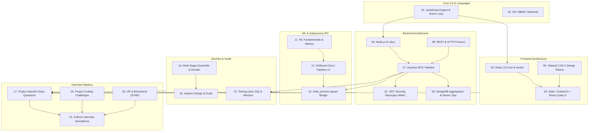

# CHAPTER 00: README & TECHNICAL INTERVIEW STUDY GUIDE

> **Project:** E-Shop AI-Powered E-Commerce Platform with Churn Prediction  
> **Target Audience:** Full-Stack Web Developers, MERN Stack Engineers, Machine Learning Engineers  
> **Handbook Objective:** Complete mastery of the architecture, implementation decisions, code flow, and interview defense for the E-Shop platform.

---

## 1. Handbook Structure & Chapter Index

This interview preparation handbook is organized into 22 dedicated chapters designed to transition you from code comprehension to confident, articulate interview delivery.

| Chapter | File Name | Primary Focus & Domain |
| :---: | :--- | :--- |
| **00** | `00_README_AND_STUDY_GUIDE.md` | Roadmap, 3/7/14-day study plans, Top 50 ranked questions |
| **01** | `01_PROJECT_OVERVIEW_AND_ARCHITECTURE.md` | 30s/1m/3m elevator pitches, high-level architecture & data flows |
| **02** | `02_JAVASCRIPT_FUNDAMENTALS.md` | Event loop, closures, promises, prototypes, garbage collection |
| **03** | `03_REACT_JS_COMPLETE_GUIDE.md` | React 19, hooks, virtual DOM, reconciliation, component lifecycle |
| **04** | `04_FRONTEND_ARCHITECTURE_AND_STATE_MANAGEMENT.md` | Zustand 5 vs React Query 5, client vs server state, form architecture |
| **05** | `05_HTML_CSS_AND_TAILWIND.md` | Tailwind CSS 4 `@theme` design tokens, responsive layout, Flexbox/Grid |
| **06** | `06_NODE_JS_COMPLETE_GUIDE.md` | Node.js runtime, Libuv, child_process, streams, non-blocking I/O |
| **07** | `07_EXPRESS_JS_AND_BACKEND_ARCHITECTURE.md` | Express 4.22 pipeline, middleware chains, MVC architecture |
| **08** | `08_REST_API_AND_HTTP_FUNDAMENTALS.md` | REST principles, HTTP methods, status codes, cookies, idempotency |
| **09** | `09_MONGODB_AND_MONGOOSE_COMPLETE_GUIDE.md` | Schemas, aggregation pipelines, atomic `$inc`, compound indexes |
| **10** | `10_AUTHENTICATION_AND_SECURITY.md` | JWT access/refresh tokens, `tokenVersion`, HMAC Razorpay, CORS, CSRF, XSS |
| **11** | `11_AI_AND_MACHINE_LEARNING_FUNDAMENTALS.md` | Classification algorithms, bias-variance, ROC-AUC, data leakage |
| **12** | `12_CUSTOMER_CHURN_PREDICTION_DEEP_DIVE.md` | XGBoost Pipeline v2, feature engineering, imbalanced threshold (0.35) |
| **13** | `13_PYTHON_AND_NODE_JS_INTEGRATION.md` | Subprocess IPC via `child_process.spawn`, stdin/stdout vectorized JSON |
| **14** | `14_DOCKER_DEPLOYMENT_AND_PRODUCTION.md` | Multi-stage `Dockerfile`, Render `render.yaml`, environment security |
| **15** | `15_TESTING_DEBUGGING_AND_ERROR_HANDLING.md` | Jest test suites (115 tests), Supertest, Winston logger, operational errors |
| **16** | `16_SYSTEM_DESIGN_AND_SCALABILITY.md` | Scaling to 100k DAU, Redis caching, message queues, database sharding |
| **17** | `17_PROJECT_SPECIFIC_INTERVIEW_QUESTIONS.md` | 40+ deep project-specific technical questions with counter-questions |
| **18** | `18_CS_FUNDAMENTALS_FOR_PROJECT_INTERVIEWS.md` | Operating Systems, DBMS, Computer Networks, OOP applied to project |
| **19** | `19_PROJECT_BASED_CODING_QUESTIONS.md` | Real coding interview problems taken directly from project patterns |
| **20** | `20_HR_AND_PROJECT_EXPLANATION.md` | Behavioral answers, STAR method, conflict resolution, technical hurdles |
| **21** | `21_MOCK_INTERVIEW_QUESTION_BANK.md` | 8 simulated technical interview transcripts with tough cross-examinations |
| **Final** | `FINAL_INTERVIEW_CHECKLIST.md` | 24-hour pre-interview rapid recall checklist and confidence builder |

---

## 2. Core Methodology: The Two-Language Rule

To master technical interviews, your preparation must bridge conceptual clarity and articulate communication:

1. **Hinglish for Deep Understanding:**  
   Every concept has an intuitive explanation in conversational Hinglish with everyday metaphors (dhabas, train ticketing, apartment guards). This ensures you understand *why* things work under the hood without cognitive fatigue.
2. **Professional English for Spoken Delivery:**  
   Every major concept and question contains an **Interview-Ready Spoken Answer**. These are formulated in fluent, natural English with clear technical diction. Read them out loud until they roll off your tongue effortlessly.

---

## 3. High-Level Concept Dependency Graph

---

## 4. Tailored Study Plans

### Track A: Fast-Track Revision (3 Days)
*Best for: Interview scheduled within 72 hours.*
- **Day 1: Project & Architecture Defense**
  - Read `01_PROJECT_OVERVIEW_AND_ARCHITECTURE.md` (memorize the 1-minute elevator pitch).
  - Study `10_AUTHENTICATION_AND_SECURITY.md` (JWT access/refresh token cycle, `tokenVersion`, Razorpay HMAC).
  - Review `09_MONGODB_AND_MONGOOSE_COMPLETE_GUIDE.md` (Atomic stock `$inc` and aggregation).
- **Day 2: Machine Learning & IPC Bridge**
  - Study `12_CUSTOMER_CHURN_PREDICTION_DEEP_DIVE.md` (XGBoost pipeline, feature engineering, 0.35 threshold).
  - Study `13_PYTHON_AND_NODE_JS_INTEGRATION.md` (`child_process.spawn` stdin/stdout streaming).
  - Review `04_FRONTEND_ARCHITECTURE_AND_STATE_MANAGEMENT.md` (Zustand vs React Query).
- **Day 3: Rapid Fire & Mock Drills**
  - Go through `17_PROJECT_SPECIFIC_INTERVIEW_QUESTIONS.md`.
  - Read `21_MOCK_INTERVIEW_QUESTION_BANK.md` (focus on Mock Interviews 1, 3, and 5).
  - Final review of `FINAL_INTERVIEW_CHECKLIST.md`.

---

### Track B: Standard Comprehensive Plan (7 Days)
*Best for: 1 week of dedicated preparation.*
- **Day 1:** Chapters 01, 02 (Project Overview, JavaScript Engine, Event Loop, Closures, Promises).
- **Day 2:** Chapters 03, 04, 05 (React 19, Hooks, Zustand, TanStack Query, Tailwind 4).
- **Day 3:** Chapters 06, 07, 08 (Node.js runtime, Libuv, Express middleware pipeline, REST/HTTP standards).
- **Day 4:** Chapters 09, 10 (MongoDB schemas, indexing, atomic queries, JWT auth, Razorpay HMAC, XSS/CORS/NoSQL injection).
- **Day 5:** Chapters 11, 12, 13 (ML theory, XGBoost Churn v2, Feature engineering, Subprocess IPC bridge).
- **Day 6:** Chapters 14, 15, 16 (Multi-stage Docker, Render deployment, Jest 115 tests, Winston, System design scaling).
- **Day 7:** Chapters 17, 18, 19, 20, 21 (Project QA, CS Fundamentals, Live coding questions, HR STAR stories, Mock banks).

---

### Track C: Deep Architectural Mastery (14 Days)
*Best for: Complete mastery for Product Companies (Tier 1/Tier 2 tech firms).*
- Dedicate 1 full day to each major chapter, running the corresponding source code files locally in VS Code, placing breakpoints, inspecting network payloads in Chrome DevTools, and speaking the Interview Answers aloud.

---

## 5. Top 50 Most Frequently Asked Questions (Ranked by Probability)

Below are the top 50 technical questions interviewers will ask about this specific project, ranked by frequency:

1. **How does your project handle authentication securely? Why use both access and refresh tokens?** (`Chapter 10`)
2. **What happens if a user's password is stolen or an admin revokes permissions? How does `tokenVersion` work?** (`Chapter 10`)
3. **How do you prevent race conditions when two users purchase the last item in stock simultaneously?** (`Chapter 09`)
4. **Why did you build the backend in Node.js but run ML in Python? Why not write ML in Node.js?** (`Chapter 13`)
5. **How does Node.js communicate with Python? Why choose `child_process.spawn` over a microservice?** (`Chapter 13`)
6. **Why did you set the XGBoost churn decision threshold to 0.35 instead of the standard 0.50?** (`Chapter 12`)
7. **What features did you engineer for the churn prediction model and why?** (`Chapter 12`)
8. **How does your Axios client handle token expiration silently without logging the user out?** (`Chapter 04`)
9. **Why did you use both Zustand and TanStack React Query? Why not just Zustand or Redux?** (`Chapter 04`)
10. **Explain how Razorpay payment verification works cryptographically.** (`Chapter 10`)
11. **How do you prevent the N+1 database query problem when calculating user order stats for ML batch prediction?** (`Chapter 09`)
12. **How does the Node.js Event Loop process asynchronous I/O and child process streams?** (`Chapter 06`)
13. **What is the difference between client state and server state in your React application?** (`Chapter 04`)
14. **How does your application calculate statutory Indian GST and generate tamper-proof PDF invoices?** (`Chapter 07`)
15. **What happens if the Python ML script crashes or Python is not installed on the host machine?** (`Chapter 13`)
16. **Why did you choose MongoDB over PostgreSQL for an e-commerce platform?** (`Chapter 09`)
17. **How does React 19's virtual DOM reconciliation and fiber tree work?** (`Chapter 03`)
18. **Explain the purpose of each security middleware in your Express app: Helmet, HPP, MongoSanitize, RateLimit.** (`Chapter 07`)
19. **How does your multi-stage Dockerfile optimize container image size and install both Node.js and Python?** (`Chapter 14`)
20. **What is the difference between process and thread in the context of Node.js spawning Python?** (`Chapter 18`)
21. **How do you handle centralized errors in Express without crashing the server?** (`Chapter 07` & `15`)
22. **What is an atomic database transaction and when do you use `session.startTransaction()`?** (`Chapter 09`)
23. **What is the difference between `useMemo`, `useCallback`, and `React.memo` in your React components?** (`Chapter 03`)
24. **How does Leaflet map integration work for delivery address pinpointing?** (`Chapter 03`)
25. **How do compound database indexes work and which ones are configured in your Mongoose models?** (`Chapter 09`)
26. **Explain Precision, Recall, and ROC-AUC in the context of customer churn.** (`Chapter 11` & `12`)
27. **What is Data Leakage and how did you prevent it during feature preprocessing?** (`Chapter 11`)
28. **How does `SimpleImputer._fill_dtype` solve cross-version scikit-learn pipeline deserialization?** (`Chapter 12`)
29. **What is the difference between `process.nextTick()`, `setImmediate()`, and `setTimeout()`?** (`Chapter 06`)
30. **How does CSS cascading work in Tailwind CSS 4 compared to traditional CSS?** (`Chapter 05`)
31. **What is Cross-Site Scripting (XSS) and how does your stack prevent it?** (`Chapter 10`)
32. **What is Cross-Site Request Forgery (CSRF) and how do HttpOnly SameSite cookies mitigate it?** (`Chapter 10`)
33. **Explain the difference between SQL ACID properties and NoSQL BASE properties.** (`Chapter 18`)
34. **How would you scale this application from 1,000 users to 100,000 daily active users?** (`Chapter 16`)
35. **Where would you place Redis caching in your current architecture?** (`Chapter 16`)
36. **What is the difference between optimistic UI updates and pessimistic UI updates?** (`Chapter 04`)
37. **Why did you use Winston logger instead of `console.log` in production?** (`Chapter 15`)
38. **How do you test your API endpoints using Jest and Supertest?** (`Chapter 15`)
39. **How does Role-Based Access Control (RBAC) work across both frontend routes and backend controllers?** (`Chapter 10`)
40. **What is the difference between `fork()`, `spawn()`, and `exec()` in Node.js `child_process`?** (`Chapter 06` & `13`)
41. **Explain the difference between L1, L2 regularization in XGBoost.** (`Chapter 11`)
42. **What is the difference between authentication and authorization?** (`Chapter 10`)
43. **How does Vite's Hot Module Replacement (HMR) compare to Webpack's bundling approach?** (`Chapter 03`)
44. **What is MongoDB's WiredTiger storage engine and how does it handle document-level locking?** (`Chapter 09` & `18`)
45. **What happens during a TCP 3-Way Handshake when a client connects to your backend?** (`Chapter 18`)
46. **What is an idempotent HTTP method? Is `POST` idempotent? Is `PUT` idempotent?** (`Chapter 08`)
47. **How does your cart synchronization work when an unauthenticated guest user logs in?** (`Chapter 04`)
48. **Describe a situation where a technical bug blocked you in this project and how you solved it.** (`Chapter 20`)
49. **If you had to rebuild this project from scratch, what architectural decision would you change?** (`Chapter 20`)
50. **How do you monitor and protect the production server on Render from memory leaks?** (`Chapter 14` & `16`)

---

## 6. How to Use This Handbook for Maximum Retention

1. **Active Recall over Passive Reading:** Don't just read the answers. Read the question, close your eyes, speak your explanation out loud, and then check against the written English answer.
2. **Inspect the Actual Files:** Every chapter lists exact relative paths (e.g., `backend/src/controllers/adminController.js`). Open the code in your editor to verify every function mentioned.
3. **Simulate the Mock Interviews:** Have a peer or technical friend grill you using `21_MOCK_INTERVIEW_QUESTION_BANK.md`. Practice remaining calm when the interviewer challenges your technical decisions.

