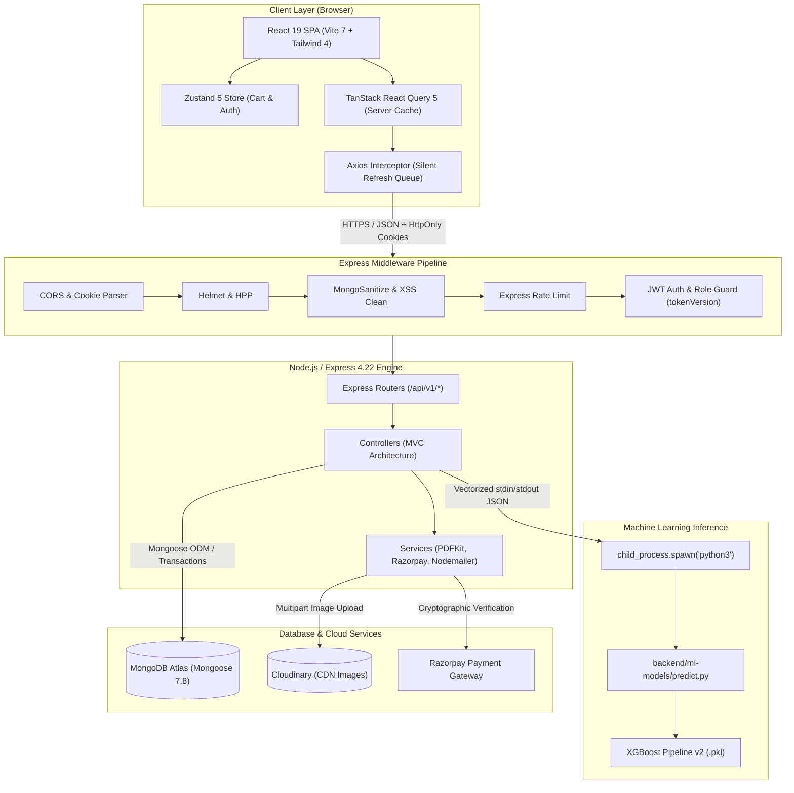
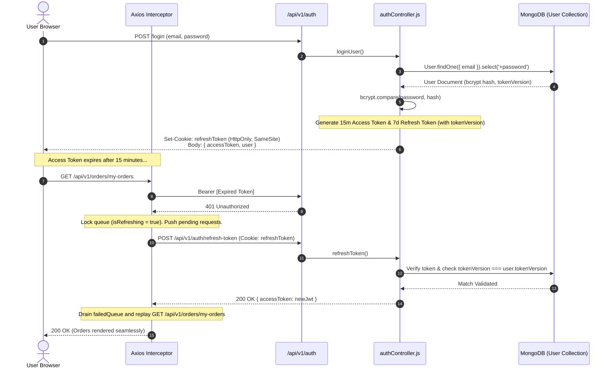
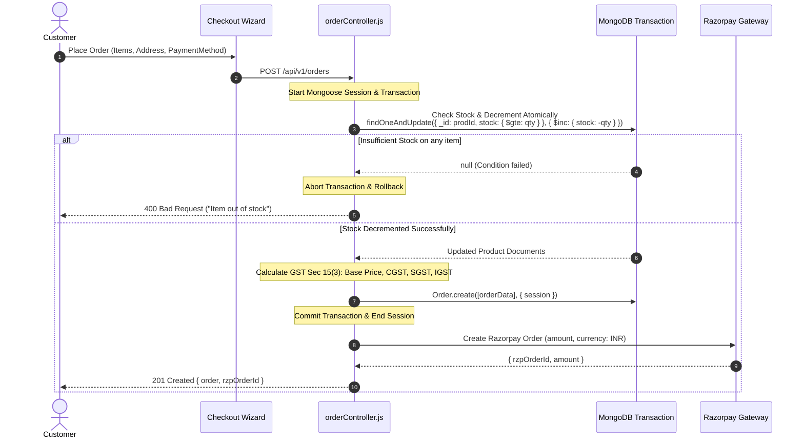
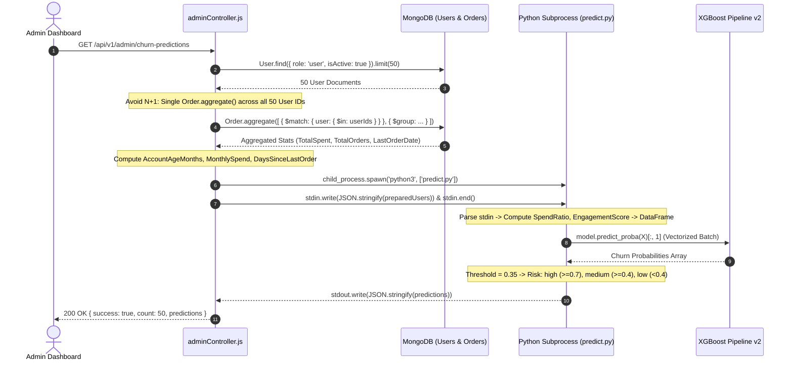

# CHAPTER 01: PROJECT OVERVIEW & ARCHITECTURE

> **Focus:** High-level system design, architectural patterns, data flows, elevator pitches, and design trade-offs.  
> **Source Files Referenced:** `backend/src/server.js`, `backend/src/app.js`, `frontend/src/App.jsx`, `frontend/src/router.jsx`, `Dockerfile`, `render.yaml`.

---

## 1. Elevator Pitches (Memorize & Rehearse)

### 30-Second Elevator Pitch
> *"I built **E-Shop**, a full-stack, enterprise-grade e-commerce platform developed with the MERN stack (React 19, Node.js, Express, and MongoDB) integrated with an end-to-end Python Machine Learning pipeline using XGBoost. The platform handles the complete shopping lifecycle—from catalog search and atomic cart management to Razorpay payments and automated GST-compliant PDF invoice generation. Its standout feature is an intelligent Customer Churn Prediction engine that aggregates customer purchasing behavior and predicts churn risk in real-time, allowing administrators to launch targeted retention strategies."*

---

### 1-Minute Elevator Pitch
> *"E-Shop is a production-ready, full-stack e-commerce web application with integrated machine learning capabilities. On the frontend, I used React 19, Vite, and Tailwind CSS 4, employing a dual-state architecture with Zustand for persistent local state and TanStack React Query for cached server state, complete with a silent Axios token refresh queue and Leaflet delivery pinpointing.*  
>  
> *The backend is built on Node.js and Express 4.22 using an MVC pattern, secured with HttpOnly JWTs, token revocation via `tokenVersion`, and cryptographic Razorpay HMAC-SHA256 verification. Multi-document checkouts are executed atomically using MongoDB sessions and atomic `$inc` operators to eliminate race conditions.*  
>  
> *To solve customer retention, I engineered a Python machine learning service running an XGBoost Pipeline v2. Node.js aggregates user purchase metrics in a single MongoDB query and streams batch JSON payloads via standard I/O into a Python subprocess, achieving sub-300ms inference for 50 users. The entire system is containerized with a multi-stage Dockerfile and deployed on Render with 115 automated test cases."*

---

### 3-Minute Comprehensive Technical Walkthrough
> *"When designing E-Shop, my goal was to solve two fundamental problems in modern e-commerce: reliable transactional data integrity and data-driven customer retention.*  
>  
> *Architecturally, the project is structured as a decoupled client-server monorepo. On the client side, React 19 communicates with our Express REST API. Rather than relying on a single monolithic global store like Redux, I separated state into **Client State** managed by Zustand—such as shopping cart persistence and user sessions—and **Server State** managed by TanStack React Query—which handles caching, background revalidation, and optimistic mutations for the product catalog. Our custom Axios interceptor handles expired access tokens automatically: when a 401 occurs, requests are paused in a mutex queue while a refresh call issues a new token via HttpOnly cookies, replaying the pending requests seamlessly.*  
>  
> *On the backend, security and data integrity were my top priorities. We protect against common web vulnerabilities using a defense-in-depth middleware pipeline including Helmet, MongoSanitize, HPP, and rate limiting. In our checkout pipeline, inventory updates are strictly atomic: we decrement stock in MongoDB using conditional `$inc` queries with `$gte` checks inside replica set transactions, preventing overselling under high concurrency. We also implemented Indian GST Section 15(3) tax compliance, generating statutory PDF invoices on the fly using PDFKit with embedded QR codes.*  
>  
> *For customer retention, I avoided naive rule-based heuristics and built an XGBoost Churn Prediction Pipeline in Python. The model evaluates base features like account age and total spend alongside engineered metrics such as Spend Ratio and Service Engagement Score. To integrate Python with Node.js without the overhead of HTTP networking or message brokers for our scale, I built a vectorized IPC bridge using `child_process.spawn`. The Node controller runs a single aggregation query across all users to eliminate N+1 queries, pipes a JSON stream to Python's `stdin`, and captures vectorized probabilities from `stdout` in under 300 milliseconds. We intentionally calibrated the decision threshold to 0.35 because in churn prediction, missing a churning customer is far more costly than offering an unnecessary promotion.*  
>  
> *The whole platform is containerized using a multi-stage Docker build that bundles the Node.js runtime, Python virtual environment, and compiled Vite assets into an optimized image, tested with 115 Jest integration tests."*

---

## 2. High-Level System Architecture Diagram

---

## 3. End-to-End Operational Data Flows

### A. Authentication & Silent Refresh Token Flow

---

### B. Checkout & Atomic Inventory Flow

---

### C. Machine Learning Batch Churn Prediction Flow

---

## 4. Technology Stack Justification Matrix

| Technology | Role in Project | Why Chosen Over Alternatives? |
| :--- | :--- | :--- |
| **React 19** | Frontend Framework | Native Actions support, automatic memoization optimizations, robust component hydration, and clean integration with React Hook Form. |
| **Vite 7** | Frontend Build Tool | Instant server start via native ES modules, millisecond Hot Module Replacement (HMR), and lightning-fast Rollup-based production builds compared to legacy Webpack. |
| **Tailwind CSS 4** | Styling Architecture | CSS-first `@theme` design tokens, zero-runtime overhead, eliminated CSS bloat, and unified mobile-first responsive utility classes. |
| **Zustand 5** | Client State Store | Minimal boilerplate (unlike Redux), zero Context re-render penalties, direct outside-component access, and seamless `localStorage` persistence. |
| **TanStack React Query 5** | Server State Engine | Eliminates redundant API calls through automatic caching, garbage collection, window refocus revalidation, and optimistic UI mutations. |
| **Node.js (v18+)** | Backend Runtime | Non-blocking, event-driven asynchronous I/O engine ideal for I/O-heavy REST endpoints and streaming child processes. |
| **Express 4.22** | Web Application Framework | Lightweight, unopinionated, enterprise-tested middleware pipeline allowing granular security, error interception, and MVC routing. |
| **MongoDB / Mongoose 7.8** | Database & ODM | Schema flexibility for dynamic product catalogs, rich aggregation pipelines for statistical reporting, and multi-document ACID transactions. |
| **XGBoost Pipeline v2** | ML Model | Gradient-boosted decision trees handle tabular e-commerce data with non-linear feature interactions significantly better than Deep Neural Networks. |
| **`child_process.spawn`** | Node-Python IPC | Zero networking overhead, no external microservice hosting cost, zero socket latency, and simple memory lifecycle management for batch jobs. |
| **Docker** | Containerization | Multi-stage build isolates Node dependencies and Python virtual environments into a reproducible, self-contained deployment unit. |

---

## 5. Architectural Design Principles Applied

1. **Separation of Concerns (SoC):**  
   Strict three-tier MVC pattern on the backend: Routes define endpoints and middleware; Controllers manage HTTP request/response lifecycles; Services execute isolated business logic (e.g., `invoiceService.js`, `paymentService.js`); Models define data contracts.
2. **Segregation of Duties (SoD):**  
   Admins are explicitly prevented from performing consumer shopping actions (`authorize('user')`). This prevents data pollution in order logs and churn training sets.
3. **Defense-in-Depth Security:**  
   Security is applied at every boundary: network rate limiting, HTTP security headers (`Helmet`), request body sanitization (`mongoSanitize`, `xss-clean`), and cryptographic signature checks on payments.
4. **Graceful Degradation:**  
   If the Python ML subprocess fails, encounters a timeout (15s), or lacks system dependencies, `adminController.js` automatically degrades to an in-memory heuristic calculation without throwing a 500 error to the admin.

---

## 6. Interview Questions & Model Answers

### Level 1: Basic Concept
**Question:** How is your project architected at a high level?  
**Interview Answer (English):**  
*"My project follows a decoupled client-server architecture organized as a monorepo. The client is a React 19 single-page application built with Vite and Tailwind CSS. The backend is an Express REST API running on Node.js, backed by MongoDB Atlas. In addition, we have an embedded Python machine learning pipeline that runs XGBoost for customer churn prediction. Node.js communicates with Python via standard input/output streams using `child_process.spawn`, keeping deployment unified in a single Docker container."*

---

### Level 2: Intermediate Technical
**Question:** Why did you choose a monolithic repository instead of separating frontend and backend into two different repositories?  
**Interview Answer (English):**  
*"I chose a unified monorepo structure because it simplifies development workflows, atomic versioning, and deployment synchronization. Since our production setup uses a multi-stage Docker container where the Node.js backend serves both the API endpoints and the compiled Vite static assets in production, maintaining a monorepo allows a single CI/CD build pipeline on Render. It also prevents schema divergence between client TypeScript/Zod types and backend Mongoose models."*

---

### Level 3: Advanced Architectural
**Question:** How does your system ensure data consistency during checkout when multiple customers compete for limited inventory?  
**Interview Answer (English):**  
*"We prevent overselling through a two-layered defense: atomic database queries and Mongoose replica set transactions. In `orderController.js`, we avoid the classic read-modify-write anti-pattern in Node memory. Instead, we issue an atomic `findOneAndUpdate` query with `{ stock: { $gte: quantity } }` and `$inc: { stock: -quantity }`. Because MongoDB document updates are atomic at the storage engine level, only the first request succeeds; concurrent requests receive a null return value. Furthermore, the entire checkout—stock decrement, order record creation, and cart clearance—is wrapped inside a Mongoose transaction session, ensuring that if any single step fails, all inventory decrements are rolled back immediately."*

---

### Level 4: Project-Specific Cross-Examination
**Interviewer:** *"You mentioned spawning a Python process from Node.js for ML inference. Isn't spawning child processes expensive? Why not build a separate Python FastAPI microservice?"*  
**Spoken Defense (English):**  
*"That is a valid architectural consideration. Spawning a process incurs OS-level fork overhead. However, we intentionally mitigated this through three critical design choices:  
First, we do not spawn Python on individual HTTP requests; we batch up to 50 users into a single array payload and execute vectorized inference using Pandas and XGBoost in one shot.  
Second, the total execution time for 50 users is under 300 milliseconds, which is well within acceptable latency for an administrative analytics dashboard.  
Third, running a separate FastAPI or Flask microservice would require maintaining separate server infrastructure, managing service discovery, handling cross-service network failures, and doubling our container hosting costs on Render. Spawning via standard I/O streams gave us complete process isolation with zero networking overhead. That said, if our analytics throughput exceeded 500 requests per minute, my next evolutionary step would be decoupling the ML pipeline into a Celery worker queue backed by Redis or an independent FastAPI service."*

---

## 7. Comparative Architectural Matrix

| Architectural Pattern | E-Shop Implementation | Alternative Approach | Why E-Shop Approach is Superior |
| :--- | :--- | :--- | :--- |
| **State Management** | Zustand (Client) + React Query (Server) | Redux Toolkit Monolith | Redux forces server cache into global client stores, creating boilerplate. React Query automates caching, deduplication, and refetching natively. |
| **ML Deployment** | Local `child_process.spawn` IPC | HTTP FastAPI Microservice | Spawning eliminates network latency, serialization overhead across HTTP, and external server costs for administrative batch workloads. |
| **Inventory Control** | Atomic `$inc` + Replica Transactions | In-memory stock check + save | In-memory checks cause race conditions where two simultaneous checkouts read `stock = 1` and both succeed, causing negative inventory. |
| **Authentication** | Dual Tokens (Access in memory + Refresh in HttpOnly) | Single JWT in `localStorage` | Tokens in `localStorage` are vulnerable to XSS theft. HttpOnly cookies cannot be accessed by malicious client JavaScript. |

---

## 8. Common Interview Traps & Pitfalls

> [!WARNING]
> **Trap 1: Claiming Node.js is multi-threaded because it runs Python.**  
> *Reality:* Node.js runs on a single event-driven JavaScript thread. Spawning Python creates an independent operating system process managed by the OS kernel, not an internal Node.js worker thread.
>
> **Trap 2: Saying transactions alone prevent race conditions.**  
> *Reality:* A database transaction does not prevent race conditions if you perform non-atomic reads followed by writes without locks. You must use atomic conditional operators like `$inc` with `$gte` to ensure hardware/engine-level locking.
>
> **Trap 3: Calling your app a microservices architecture.**  
> *Reality:* Be honest. E-Shop is a modular, decoupled monolithic architecture with multi-language execution. Calling it microservices will invite questions about Docker Swarm, Kubernetes, Consul, and Kafka that will weaken your credibility.

---

## 9. Quick Revision Rapid-Fire (15 Q&As)

1. **What is the entry point of the backend?** `backend/src/server.js`.
2. **What is the entry point of the frontend?** `frontend/src/main.jsx`.
3. **Where is the Express pipeline assembled?** `backend/src/app.js`.
4. **How are admin routes protected?** Via `protect` and `authorize('admin')` middlewares in `backend/src/middlewares/auth.js`.
5. **How is the admin seeded?** Using the CLI script `seed-admin.js`.
6. **What is the port configuration?** Backend runs on port `5000` (or `process.env.PORT`), frontend dev runs on `5173`.
7. **How does Vite proxy API requests during development?** Configured in `frontend/vite.config.js` targeting `http://localhost:5000`.
8. **What database is used?** MongoDB Atlas managed cluster via Mongoose ODM.
9. **Where is the ML model stored?** Serialized binary at `backend/ml-models/xgboost_churn_pipeline_v2.pkl`.
10. **How many integration tests are implemented?** 115 passing tests using Jest and Supertest in `backend/tests/`.
11. **What logging framework is used?** Winston 3.19 with daily file rotation in `backend/src/utils/logger.js`.
12. **How are images stored?** Uploaded via Multer and streamed to Cloudinary CDN.
13. **What is the decision threshold for churn?** `0.35` (calibrated to prioritize Recall).
14. **How are invoices generated?** Asynchronously created using PDFKit 0.20 in `backend/src/services/invoiceService.js`.
15. **What container technology is used?** Multi-stage Docker image using Node 18 and Python 3.11.

