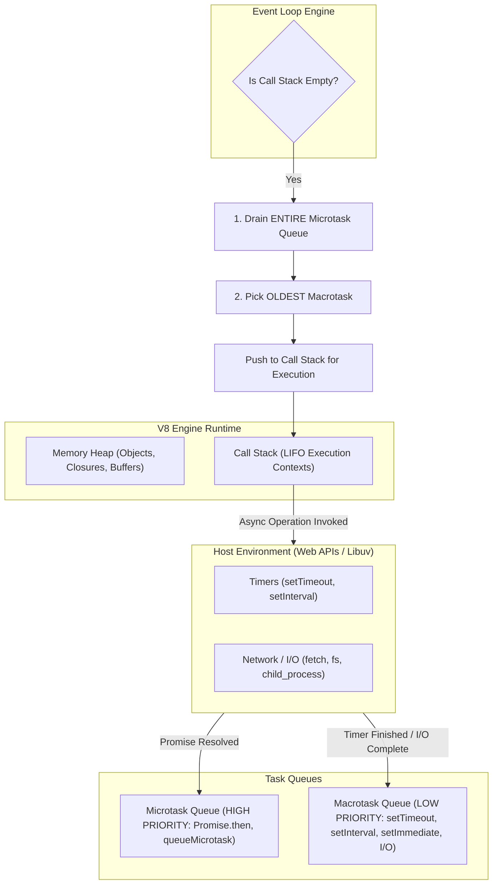

# CHAPTER 02: JAVASCRIPT FUNDAMENTALS

> **Focus:** V8 Engine mechanics, Call Stack, Event Loop, Microtasks vs. Macrotasks, Closures, Prototypal Inheritance, Asynchronous execution, and project code patterns.  
> **Source Files Referenced:** `frontend/src/services/api.js`, `backend/src/middlewares/errorHandler.js`, `backend/src/controllers/adminController.js`, `backend/src/controllers/orderController.js`.

---

## 1. Core Definitions (English)

- **JavaScript Runtime Engine (V8):** An open-source Google execution engine written in C++ that compiles JavaScript directly into native machine code using a Just-In-Time (JIT) compiler (Ignition interpreter + TurboFan optimizing compiler).
- **Call Stack:** A LIFO (Last-In, First-Out) data structure that tracks active execution contexts and function invocations in single-threaded JavaScript.
- **Event Loop:** A continuous coordination loop within the runtime that checks whether the call stack is empty; if empty, it pushes pending tasks from the microtask queue (first) and macrotask queue (second) onto the call stack.
- **Closure:** A function bundled together with references to its surrounding lexical environment, allowing inner functions to access variables from an outer enclosing scope even after the outer function has finished executing.
- **Promise:** An object representing the eventual completion (fulfillment) or failure (rejection) of an asynchronous operation and its resulting value.

---

## 2. Concept Explanations (Hinglish with Real-Life Metaphors)

### The Event Loop & Concurrency
> **Concept:** JavaScript single-threaded hai—iska matlab ek time par sirf ek hi kaam ho sakta hai. Agar koi heavy database query ya API call aayi, toh kya pura browser ya server freeze ho jayega? Bilkul nahi!  
> **Real-Life Analogy (Dhaba / Restaurant Counter):**  
> Socho ek busy restaurant ka single counter cashier (JavaScript Call Stack). Cashier order leta hai. Agar customer bolta hai *"Mujhe tandoori roti chahiye jisme 15 minute lagenge"*, toh cashier usko counter par khada nahi rakhta. Cashier kitchen token kaat kar customer ko de deta hai aur kitchen staff (Web APIs / Libuv Worker Threads) ko kaam saup deta hai. Counter agle customer ke liye free ho gaya!  
> Jab tandoori roti ban jaati hai, toh waiter usko counter par direct nahi lata; pehle woh "Ready Orders Queue" (Callback / Event Queue) mein rakhta hai. Jab cashier ka counter khali hota hai, Event Loop check karta hai aur us order ko customer ko handover karwa deta hai (Stack par execute kar deta hai).

---

### Closures & Lexical Scope
> **Concept:** Function apne parent function ke variables ko "yaad" rakhta hai, chahe parent function return hokar khatam hi kyu na ho chuka ho!  
> **Real-Life Analogy (Backpack Metaphor):**  
> Jab tum school ya college se ghar aate ho, toh class khatam ho chuki hoti hai (Outer function execution context destroyed). Lekin tumhara bag (Closure / Backpack) tumhare paas rehta hai jisme tumhari notebooks aur pens (Lexical Variables) saved hain. Jab bhi homework karna ho, tum bag khol kar unhi variables ko use kar sakte ho.

---

## 3. How It Works Internally



### Execution Priority Rules:
1. **Synchronous Code:** Executes immediately on the Call Stack.
2. **Microtasks (`process.nextTick`, `Promise.then/catch/finally`, `queueMicrotask`):** Executed immediately after the current synchronous script completes, *before* the browser renders or any macrotask runs.
3. **Macrotasks (`setTimeout`, `setInterval`, `setImmediate`, I/O callbacks):** Picked one by one *only* when the Microtask queue is completely empty.

---

## 4. Project Implementation & Code Snippets

### A. Closures in Action: Silent Refresh Token Mutex Queue
In `frontend/src/services/api.js`, we use closures to maintain a private subscription array of pending requests during a token refresh:

```javascript
// File: frontend/src/services/api.js
let isRefreshing = false;
let failedQueue = [];

// Closure: processQueue retains access to failedQueue in its outer lexical scope
const processQueue = (error, token = null) => {
  failedQueue.forEach((prom) => {
    if (error) {
      prom.reject(error);
    } else {
      prom.resolve(token);
    }
  });
  failedQueue = []; // Reset queue
};

api.interceptors.response.use(
  (response) => response,
  async (error) => {
    const originalRequest = error.config;

    if (error.response?.status === 401 && !originalRequest._retry) {
      if (isRefreshing) {
        // Enqueue Promise callbacks in closure
        return new Promise((resolve, reject) => {
          failedQueue.push({ resolve, reject });
        })
          .then((token) => {
            originalRequest.headers.Authorization = `Bearer ${token}`;
            return api(originalRequest);
          })
          .catch((err) => Promise.reject(err));
      }

      originalRequest._retry = true;
      isRefreshing = true;

      try {
        const { data } = await axios.post(
          `${BASE_URL}/auth/refresh-token`,
          {},
          { withCredentials: true }
        );
        const newToken = data.accessToken;
        processQueue(null, newToken);
        originalRequest.headers.Authorization = `Bearer ${newToken}`;
        return api(originalRequest);
      } catch (refreshError) {
        processQueue(refreshError, null);
        return Promise.reject(refreshError);
      } finally {
        isRefreshing = false;
      }
    }
    return Promise.reject(error);
  }
);
```

---

### B. Higher-Order Functions & Currying: `catchAsync` Error Wrapper
In `backend/src/middlewares/errorHandler.js`, we wrap every async controller in a higher-order closure function to eliminate repetitive `try-catch` blocks:

```javascript
// File: backend/src/middlewares/errorHandler.js
// fn is preserved inside the returned wrapper's closure
const catchAsync = (fn) => {
  return (req, res, next) => {
    fn(req, res, next).catch((err) => next(err));
  };
};

module.exports = { catchAsync };
```

---

### C. Promises & Event Stream Wrapping: Python ML Subprocess
In `backend/src/controllers/adminController.js`, we wrap asynchronous Node stream events (`data`, `close`, `error`) inside a native `new Promise((resolve, reject) => ...)`:

```javascript
// File: backend/src/controllers/adminController.js
const runPrediction = (inputData) => {
  return new Promise((resolve) => {
    const pythonCmd = process.env.PYTHON_CMD || 'python3';
    const proc = spawn(pythonCmd, [ML_SCRIPT], { timeout: 15000 });

    let output = '';
    let errorOutput = '';

    // Push JSON payload into Python's stdin stream
    proc.stdin.write(JSON.stringify(inputData));
    proc.stdin.end();

    // Event listener callbacks pushed to Macrotask queue when data is available
    proc.stdout.on('data', (data) => { output += data.toString(); });
    proc.stderr.on('data', (data) => { errorOutput += data.toString(); });

    proc.on('close', () => {
      try {
        if (output.trim()) resolve(JSON.parse(output.trim()));
        else resolve({ success: false, error: errorOutput || 'No output' });
      } catch (e) {
        resolve({ success: false, error: `Parse failed: ${output}` });
      }
    });

    proc.on('error', (err) => {
      resolve({ success: false, error: err.message });
    });
  });
};
```

---

## 5. Spoken Interview Answers

### Short Answer (30 Seconds)
> *"JavaScript is a single-threaded, non-blocking, asynchronous concurrent language running on an execution engine like V8. It uses a Call Stack for synchronous execution and delegates heavy operations like network requests, database I/O, and timers to the host environment—either Web APIs in the browser or Libuv in Node.js. When asynchronous operations resolve, their callbacks are queued in Microtask and Macrotask queues, which the Event Loop pushes onto the stack as soon as synchronous execution completes."*

---

### Detailed Answer (90 Seconds)
> *"In our project, understanding the JavaScript runtime model was fundamental to writing resilient code across both the frontend and backend.  
>  
> At the core of the V8 engine is the single-threaded Call Stack and the Memory Heap. Because JavaScript cannot execute two instructions simultaneously on the main thread, all non-blocking I/O operations—such as querying MongoDB with Mongoose, reading image files, or spawning Python child processes—are offloaded to Node.js's C++ Libuv thread pool.  
>  
> When these asynchronous operations complete, their completion handlers enter task queues based on priority. Microtasks—such as resolved Promise `.then()` handlers and `process.nextTick()`—always take precedence. The Event Loop will completely drain the microtask queue before picking a single macrotask, such as a `setTimeout` callback or an I/O event.  
>  
> We actively leverage functional closures and promises throughout our codebase. For instance, in our Axios interceptor (`frontend/src/services/api.js`), we maintain a request queue closure that holds pending HTTP requests in a paused Promise state while a silent token refresh occurs. Once the refresh call resolves, the closure allows us to replay all queued requests with the new bearer token without forcing the user to log in again or dropping their network state."*

---

## 6. Interview Questions & Model Answers

### Level 1: Basic
**Question:** What is the difference between `null` and `undefined` in JavaScript?  
**Interview Answer (English):**  
*"In JavaScript, `undefined` means a variable has been declared but has not yet been assigned a value. It is also the default return value of functions that do not explicitly return anything. `null`, on the other hand, is an intentional assignment representing the explicit absence of any object value. For example, in our Mongoose schemas, if an order has not been delivered yet, `deliveredAt` is explicitly set to `null` to indicate no delivery date exists."*

---

### Level 2: Intermediate
**Question:** What is the difference between `==` and `===`? Where can loose equality cause bugs in our e-commerce project?  
**Interview Answer (English):**  
*"The double equals `==` operator performs type coercion before comparison, converting both operands to a common type. The triple equals `===` operator performs strict equality comparison without coercion, checking both value and data type.  
In our e-commerce platform, using loose equality is dangerous when handling MongoDB ObjectIDs or query parameters. For instance, `req.params.id` is a string, while `user._id` is a BSON ObjectId object. Comparing `req.params.id == user._id` might succeed or fail unpredictably depending on how `.toString()` is called. We strictly use `===` and explicit conversions like `user._id.toString() === req.user.id` to guarantee predictable type safety."*

---

### Level 3: Advanced
**Question:** Explain how Memory Leaks can happen in Node.js or React applications, and how to prevent them.  
**Interview Answer (English):**  
*"Memory leaks in JavaScript occur when objects that are no longer needed by the application remain reachable from the root execution context, preventing the V8 Garbage Collector from reclaiming their allocated heap memory.  
Common sources include:
1. **Uncleared Event Listeners & Timers:** In React components, failing to return a cleanup function from `useEffect` when setting up `window.addEventListener` or `setInterval`.
2. **Accidental Global Variables:** Omitting `let`, `const`, or `var`, attaching variables to `global` in Node or `window` in browsers.
3. **Retained Closures:** In our Axios silent refresh queue, if we forgot to clear `failedQueue = []` after replaying requests, every queued request would indefinitely retain references to its enclosing Axios config, headers, and response buffers in memory. We explicitly reset `failedQueue = []` inside the `finally` block to allow instant garbage collection."*

---

### Level 4: Project-Specific Cross-Examination
**Interviewer:** *"In your `adminController.js`, you spawn a Python process and accumulate chunks in a string: `proc.stdout.on('data', (data) => { output += data.toString(); });`. What happens if Python outputs 50,000 users and exceeds the maximum V8 string length or memory buffer?"*  
**Spoken Defense (English):**  
*"That is an insightful edge-case question. In V8, strings have a hard limit (around 512MB in 64-bit systems), but long before reaching that, concatenating large string chunks in memory causes excessive GC thrashing and heap fragmentation.  
In our current implementation, we strictly limit the batch size to 50 users (`User.find().limit(50)`). 50 serialized JSON user objects produce approximately 15 kilobytes of data, which easily fits inside a single standard I/O buffer chunk (usually 64KB).  
However, if we scale to 50,000 users, I would not accumulate strings in memory. Instead, I would refactor the communication to use Node.js object streams with a streaming JSON parser like `JSONStream` or pipe the data directly to a temporary file on disk, or transition the architecture to an asynchronous worker queue where Python reads records directly in batches from MongoDB."*

---

## 7. Comparative Technical Matrix

| Concept | Microtask (`Promise.then`, `nextTick`) | Macrotask (`setTimeout`, I/O) |
| :--- | :--- | :--- |
| **Queue** | Microtask Queue | Macrotask (Callback) Queue |
| **Execution Timing** | Immediately after Call Stack empties, before any rendering | One task per loop tick, after microtasks drain |
| **Starvation Risk** | High (infinite recursive microtasks starve the UI and I/O) | Low (browser renders between macrotasks) |
| **Project Usage** | TanStack Query promise resolution, Axios interceptors | Python child process streaming, Nodemailer timeouts |

---

## 8. Common Interview Traps & Pitfalls

> [!WARNING]
> **Trap 1: Believing `async/await` makes JavaScript multi-threaded.**  
> *Reality:* `async/await` is purely syntactic sugar over native Promises and generators. It does not spawn threads; it merely yields execution of the current function back to the event loop until the promise settles.
>
> **Trap 2: Confusing `var`, `let`, and `const` scoping.**  
> *Reality:* `var` is function-scoped and hoisted with `undefined`. `let` and `const` are block-scoped and hoisted into the Temporal Dead Zone (TDZ)—accessing them before declaration throws a `ReferenceError`.
>
> **Trap 3: Forgetting that Arrow Functions do not have their own `this`.**  
> *Reality:* Arrow functions inherit `this` lexically from their enclosing scope. In Mongoose pre-save middleware hooks (`userSchema.pre('save', function(next) { ... })`), you MUST use a regular `function` declaration because Mongoose binds `this` to the document being saved. Using an arrow function binds `this` to `module.exports`, breaking password hashing!

---

## 9. Quick Revision Rapid-Fire (15 Q&As)

1. **What is hoisting?** JavaScript's default behavior of moving variable and function declarations to the top of their scope during compilation.
2. **What is the Temporal Dead Zone (TDZ)?** The time between entering a scope and the variable declaration with `let`/`const` where accessing the variable throws a `ReferenceError`.
3. **What is event bubbling?** The propagation of an event from the innermost target element up through its parent elements in the DOM tree.
4. **How do you stop event bubbling?** By calling `e.stopPropagation()`.
5. **What is event delegation?** Attaching a single event listener to a parent element to handle events for all current and future child elements.
6. **What is debouncing?** Delaying the execution of a function until a certain amount of time has elapsed since the last time it was invoked (e.g. search bar input).
7. **What is throttling?** Limiting the execution of a function to at most once in a specified time window (e.g. window resize or scroll).
8. **What are the states of a Promise?** `Pending`, `Fulfilled`, `Rejected`.
9. **What is the return value of `typeof null`?** `"object"` (a historical legacy bug in JavaScript).
10. **What is the return value of `typeof NaN`?** `"number"`.
11. **How do you check if a value is an Array?** `Array.isArray(value)`.
12. **What is shallow copy vs deep copy?** Shallow copy duplicates the top-level references (`Object.assign`, spread `{...obj}`); deep copy recursively duplicates all nested objects (`structuredClone(obj)`).
13. **Why does Mongoose pre-save require standard functions?** Because Mongoose dynamically binds `this` to the active document instance.
14. **What is the difference between `call`, `apply`, and `bind`?** `call` invokes immediately with comma-separated arguments; `apply` invokes with an array of arguments; `bind` returns a new function with bound `this`.
15. **What is prototype chaining?** The mechanism by which JavaScript objects inherit properties and methods from other objects via their `__proto__` link.

