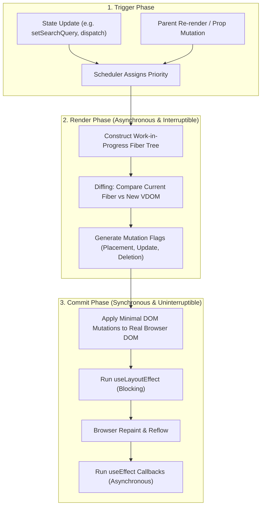

# CHAPTER 03: REACT 19 COMPLETE GUIDE

> **Focus:** React 19 fundamentals, Fiber architecture, Virtual DOM & Reconciliation, Component lifecycle, Hooks in depth, Leaflet map integration, and modular component architecture.  
> **Source Files Referenced:** `frontend/src/router.jsx`, `frontend/src/components/checkout/LocationPicker.jsx`, `frontend/src/components/chatbot/ChatWidget.jsx`, `frontend/src/pages/ProductDetails.jsx`, `frontend/src/App.jsx`.

---

## 1. Core Definitions (English)

- **React 19:** A declarative, component-based JavaScript library for building user interfaces that utilizes a Fiber-based reconciliation engine, concurrent rendering capabilities, and automated compiler optimizations.
- **Virtual DOM (VDOM):** A lightweight JavaScript object tree kept in memory that represents the desired UI state. React calculates diffs between old and new VDOM snapshots before selectively updating the actual browser DOM.
- **Reconciliation & Diffing Algorithm:** The heuristic $O(n)$ process by which React compares two Fiber trees to determine the minimum number of mutations required to update the browser's real DOM.
- **React Fiber:** The internal reconciliation engine introduced to enable incremental rendering by splitting rendering work into assignable, interruptible units called "fibers".
- **React Hooks:** Built-in functions that allow functional components to attach to React state and lifecycle features without writing ES6 class components.

---

## 2. Concept Explanations (Hinglish with Real-Life Metaphors)

### The Virtual DOM vs. Real DOM
> **Concept:** Direct browser DOM manipulation bohot costly (slow) hota hai kyunki browser ko Layout, Painting, aur Reflow dobara calculate karna padta hai.  
> **Real-Life Analogy (Architect Blueprint vs Construction Site):**  
> Socho tumhe ek 50-kamro ke banglow mein kitchen ki light change karni hai.  
> - **Real DOM Approach:** Tum sidha construction worker bula kar pura kitchen todte ho aur naya banate ho (Massive Reflow & Repaint).  
> - **Virtual DOM Approach:** Architect pehle paper par blueprint (Virtual DOM) banata hai. Purane blueprint aur naye blueprint ko compare karta hai (Diffing Algorithm). Usse pata chalta hai ki sirf ek switch board badalna hai. Phir construction site par jakar sirf wahi ek switch board replace karta hai (Targeted Real DOM Batch Update).

---

### React State vs. Props
> **Real-Life Analogy (Pocket Money vs DNA / Rules):**  
> - **Props:** Tumhare parents se mili hui properties ya rules (Read-Only DNA). Child component unko khud modify nahi kar sakta; parent se as-is receive hoti hain.  
> - **State:** Tumhari apni jeb ka paisa (Internal Mutable State). Tum decide karte ho kab kharch karna hai aur kab save karna hai (`setState`). Jab tumhara balance change hota hai, tumhari lifestyle re-render ho jaati hai!

---

## 3. How It Works Internally: The Fiber Lifecycle



### Key Internal Fiber Nodes Structure:
Every component in React 19 is represented as a Fiber node with:
- `tag`: Component type (Functional, Class, HostComponent like `div`).
- `key`: Reconciliation identifier for list reordering.
- `stateNode`: Reference to the actual real DOM node.
- `child`: Pointer to its first immediate child.
- `sibling`: Pointer to its next sibling.
- `return`: Pointer to its parent fiber (return address after completion).
- `memoizedState`: Linked list of all hooks (`useState`, `useEffect`, `useMemo`) attached to this component.

---

## 4. Project Implementation & Code Snippets

### A. Modular Component Architecture: AI Chatbot Widget
In `frontend/src/components/chatbot/`, instead of building a monolithic 500-line chat widget, we decomposed the feature into single-responsibility subcomponents:
- `ChatHeader.jsx`: Online status indicator, minimize, and close toggles.
- `ChatMessageItem.jsx`: Markdown parsing, timestamp formatting, and sender avatar.
- `ChatInput.jsx`: Controlled textarea with auto-resize and Enter-to-send bindings.
- `ChatWidget.jsx`: Master coordinator managing message history state.

```javascript
// File: frontend/src/components/chatbot/ChatWidget.jsx (Architecture snippet)
export default function ChatWidget() {
  const [isOpen, setIsOpen] = useState(false);
  const [messages, setMessages] = useState([
    { id: 1, sender: 'bot', text: 'Hello! How can I assist your shopping today?' }
  ]);
  const messagesEndRef = useRef(null);

  // Auto-scroll on new message
  useEffect(() => {
    messagesEndRef.current?.scrollIntoView({ behavior: 'smooth' });
  }, [messages]);

  const handleSendMessage = async (text) => {
    const userMsg = { id: Date.now(), sender: 'user', text };
    setMessages((prev) => [...prev, userMsg]);
    
    // Call chatbot API and append reply...
  };

  if (!isOpen) {
    return (
      <button 
        onClick={() => setIsOpen(true)}
        className="fixed bottom-6 right-6 bg-indigo-600 text-white p-4 rounded-full shadow-lg"
      >
        <ChatBubbleOvalLeftEllipsisIcon className="h-6 w-6" />
      </button>
    );
  }

  return (
    <div className="fixed bottom-6 right-6 w-96 bg-white rounded-2xl shadow-2xl border flex flex-col">
      <ChatHeader onClose={() => setIsOpen(false)} />
      <div className="flex-1 overflow-y-auto p-4 space-y-3 max-h-96">
        {messages.map((msg) => (
          <ChatMessageItem key={msg.id} message={msg} />
        ))}
        <div ref={messagesEndRef} />
      </div>
      <ChatInput onSend={handleSendMessage} />
    </div>
  );
}
```

---

### B. Third-Party Imperative DOM Wrapping: Leaflet Delivery Location Picker
Leaflet relies on direct DOM manipulation, which conflicts with React's Virtual DOM. In `frontend/src/components/checkout/LocationPicker.jsx`, we encapsulate Leaflet cleanly inside `useRef` and `useEffect`:

```javascript
// File: frontend/src/components/checkout/LocationPicker.jsx
import React, { useEffect, useRef } from 'react';
import L from 'leaflet';
import 'leaflet/dist/leaflet.css';

export default function LocationPicker({ onLocationSelect, initialCoords }) {
  const mapContainerRef = useRef(null);
  const mapInstanceRef = useRef(null);
  const markerRef = useRef(null);

  useEffect(() => {
    if (!mapContainerRef.current) return;

    // Initialize Leaflet Map imperatively
    const defaultCoords = initialCoords || [28.6139, 77.2090]; // New Delhi default
    const map = L.map(mapContainerRef.current).setView(defaultCoords, 13);
    mapInstanceRef.current = map;

    L.tileLayer('https://{s}.tile.openstreetmap.org/{z}/{x}/{y}.png', {
      attribution: '&copy; OpenStreetMap contributors'
    }).addTo(map);

    const marker = L.marker(defaultCoords, { draggable: true }).addTo(map);
    markerRef.current = marker;

    marker.on('dragend', (e) => {
      const { lat, lng } = e.target.getLatLng();
      onLocationSelect({ lat, lng });
    });

    map.on('click', (e) => {
      const { lat, lng } = e.latlng;
      marker.setLatLng([lat, lng]);
      onLocationSelect({ lat, lng });
    });

    // Cleanup: Avoid memory leaks when component unmounts
    return () => {
      map.remove();
      mapInstanceRef.current = null;
    };
  }, []);

  return (
    <div className="w-full">
      <label className="block text-sm font-medium text-gray-700 mb-1">
        Pinpoint Delivery Address on Map
      </label>
      <div 
        ref={mapContainerRef} 
        className="w-full h-64 rounded-xl border border-gray-300 z-0" 
      />
    </div>
  );
}
```

---

### C. Role Guarding via React Router 7 Layout Routes
In `frontend/src/router.jsx`, we implement clean route protection and role verification using functional wrappers:

```javascript
// File: frontend/src/router.jsx (Snippet)
import { Navigate, Outlet } from 'react-router-dom';
import useAuthStore from './store/authStore';

export const ProtectedRoute = ({ allowedRoles = ['user', 'admin'] }) => {
  const { user, isAuthenticated } = useAuthStore();

  if (!isAuthenticated || !user) {
    return <Navigate to="/login" replace />;
  }

  if (!allowedRoles.includes(user.role)) {
    return <Navigate to="/" replace />;
  }

  return <Outlet />;
};
```

---

## 5. Spoken Interview Answers

### Short Answer (30 Seconds)
> *"React 19 is a component-driven UI library that uses a declarative paradigm and a Fiber reconciliation engine. Instead of manipulating the browser's DOM directly, React maintains a Virtual DOM tree in memory. When state changes occur, React executes a two-phase reconciliation process: an asynchronous Render Phase that diffs the old and new fiber trees to compute changes, followed by a synchronous Commit Phase that applies minimal batch mutations to the real DOM, ensuring high rendering performance."*

---

### Detailed Answer (90 Seconds)
> *"In our E-Shop frontend, we chose React 19 to build a highly responsive and modular single-page application.  
>  
> At the architectural level, React's core power lies in its Fiber reconciliation engine. The engine splits rendering into two distinct phases. During the Render phase, React calculates differences between the current Fiber tree and the new virtual representation without touching the browser DOM. Because this phase has no side effects, React can pause, abort, or prioritize rendering work based on urgency. Once the diff is computed, React enters the Commit phase, which is synchronous and rapidly applies the computed patches directly to the real DOM.  
>  
> In our project, we maintain a clean separation between third-party imperative DOM libraries and React's declarative tree. A prime example is our `LocationPicker` component in the checkout wizard, where we embed the Leaflet mapping engine. We use a `useRef` hook to preserve a direct reference to the container `div` and initialize the map inside `useEffect`. Crucially, we return a cleanup function `map.remove()` to prevent DOM leaks when navigating across checkout steps.  
>  
> Furthermore, we follow strict functional component decomposition: our AI Chatbot widget is broken into four isolated components—Header, MessageItem, Input, and Container—ensuring that typing in the chat input only re-renders the input box rather than the entire message list."*

---

## 6. Interview Questions & Model Answers

### Level 1: Basic
**Question:** What are the Rules of Hooks in React?  
**Interview Answer (English):**  
*"There are two fundamental Rules of Hooks:  
1. Only call hooks at the top level of your component or custom hook. Never call hooks inside loops, conditions, or nested functions. This ensures React can maintain hook state across renders using an internal singly-linked list indexed by call order.  
2. Only call hooks from React functional components or custom hooks, never from regular JavaScript functions."*

---

### Level 2: Intermediate
**Question:** Why should you never mutate state directly in React (e.g. `cart.push(item)`)?  
**Interview Answer (English):**  
*"React relies on shallow object equality (`Object.is`) to detect whether state has changed and schedule a re-render. If you mutate an array or object in place using `cart.push(item)`, the object reference in memory remains identical. When React compares `oldState === newState`, it sees the same memory address, assumes nothing changed, and skips the re-render. To trigger updates reliably, we must always return a new reference using immutability, such as `setCart([...cart, item])` or using Zustand's immutable setter."*

---

### Level 3: Advanced
**Question:** Explain how React's Synthetic Event system works and how it differs from native browser events.  
**Interview Answer (English):**  
*"React's SyntheticEvent is a cross-browser wrapper around the browser’s native event system. It normalizes event properties so they behave identically across Chrome, Firefox, Safari, and Edge.  
Internally, React does not attach event listeners to individual DOM nodes. Instead, it uses **Event Delegation**: React attaches a single top-level event listener for each event type at the root DOM container (`#root`). When an event occurs on a button, it bubbles up to `#root`, where React maps it to the corresponding Fiber node and executes the SyntheticEvent callback. This dramatically reduces memory footprint when rendering large lists like our product catalog."*

---

### Level 4: Project-Specific Cross-Examination
**Interviewer:** *"In your `ProductDetails.jsx`, you fetch product data using TanStack Query, but you also have review submission forms and gallery images. How do you prevent unnecessary re-renders of the image gallery when a user types into the review comment box?"*  
**Spoken Defense (English):**  
*"We prevent unnecessary re-renders by enforcing state colocation and component isolation:  
First, the review form state (rating and comment text) is kept local to a dedicated `<ReviewForm />` subcomponent. It is not lifted up to the parent `ProductDetails` component. Therefore, as the user types, only the `<ReviewForm />` component re-renders.  
Second, the `<ProductGallery />` component receives static image URLs as props. If needed, we wrap `<ProductGallery />` in `React.memo` so that even if the parent re-renders due to a background refetch from React Query, React will perform a shallow comparison of props and completely skip re-rendering the gallery DOM and its heavy image decodes."*

---

## 7. Comparative Technical Matrix

| Hook | Primary Purpose | Timing / Execution | Common Project Use Case |
| :--- | :--- | :--- | :--- |
| `useState` | Local reactive state | Synchronous setter, triggers re-render | Form inputs, modal open/close toggles |
| `useReducer` | Complex state transitions | Action-based dispatch | Multi-step checkout wizard state |
| `useEffect` | Asynchronous side effects | Runs AFTER browser paint (passive) | API subscriptions, Leaflet map initialization |
| `useLayoutEffect`| Synchronous layout mutations | Runs BEFORE browser paint (blocking) | Measuring DOM dimensions, tooltip positioning |
| `useRef` | Mutable reference | Does NOT trigger re-render on mutation | DOM element binding (`messagesEndRef`), map instances |
| `useMemo` | Cached value memoization | Recalculates only when dependencies change | Filtering 100+ catalog products by price range |
| `useCallback` | Cached function definition | Returns same function reference | Callbacks passed to memoized child components |

---

## 8. Common Interview Traps & Pitfalls

> [!WARNING]
> **Trap 1: Using Array Index as `key` in dynamic lists.**  
> *Reality:* If a user filters or deletes an item from a list (e.g. deleting an item from the shopping cart), using indices (`key={index}`) causes React to associate state with the wrong DOM nodes, causing visual glitches and input value mismatches. Always use stable unique identifiers like MongoDB's `_id` (`key={item._id}`).
>
> **Trap 2: Creating infinite loops with `useEffect`.**  
> *Reality:* If you update a state variable inside `useEffect` and include that same state variable in the dependency array without a termination condition, the effect triggers a re-render, which re-triggers the effect, creating an infinite loop that crashes the browser tab.
>
> **Trap 3: Thinking `useMemo` should be used everywhere.**  
> *Reality:* `useMemo` has an overhead: allocating memory for dependency arrays and running comparison checks on every render. For inexpensive calculations (like adding two numbers), `useMemo` is slower than simply recalculating the value!

---

## 9. Quick Revision Rapid-Fire (15 Q&As)

1. **What is JSX?** A syntax extension for JavaScript that looks like HTML and compiles down to `React.createElement` or `jsxRuntime` function calls.
2. **Can browsers read JSX directly?** No, JSX must be transpiled into standard JavaScript using Babel, SWC, or Vite/ESBuild.
3. **What is a controlled component?** A form element whose value is controlled by React state via `value` and `onChange`.
4. **What is an uncontrolled component?** A form element whose value is handled directly by the browser DOM, typically accessed using a `ref`.
5. **What is prop drilling?** The process of passing data through multiple intermediate components that do not need it, just to reach a deeply nested child.
6. **How do you avoid prop drilling?** By using Zustand stores, React Context, or component composition.
7. **What is `React.Fragment`?** A component that allows grouping a list of children without adding extra DOM nodes (`<>...</>`).
8. **What is the difference between `useEffect` and `useLayoutEffect`?** `useEffect` is non-blocking and runs after browser paint; `useLayoutEffect` is synchronous and runs before the browser repaints the screen.
9. **What does the dependency array `[]` in `useEffect` mean?** The effect runs only once after the initial component mount and cleans up on unmount.
10. **What happens if you omit the dependency array in `useEffect`?** The effect executes after *every single render* of the component.
11. **What is the purpose of `React.memo`?** A higher-order component that prevents re-rendering if the component's incoming props have not changed.
12. **Why do we need a cleanup function in `useEffect`?** To unsubscribe from listeners, clear intervals, or tear down third-party instances (like Leaflet) to prevent memory leaks.
13. **What is React Fiber?** React’s internal reconciliation algorithm designed for incremental rendering and concurrency.
14. **What is an Error Boundary?** A special component that catches JavaScript errors anywhere in its child component tree, logs them, and displays a fallback UI.
15. **Can functional components act as Error Boundaries natively in React 19?** No, Error Boundaries still require class components (`componentDidCatch` and `getDerivedStateFromError`) or third-party wrappers like `react-error-boundary`.

