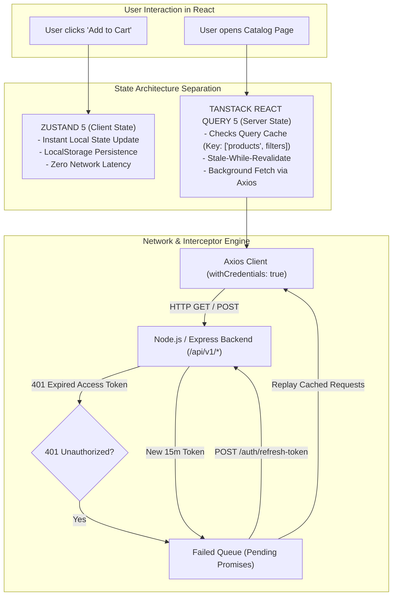

# CHAPTER 04: FRONTEND ARCHITECTURE & STATE MANAGEMENT

> **Focus:** Client State vs. Server State, Zustand 5 stores, TanStack React Query 5 caching & optimistic updates, Axios interceptors with silent refresh mutex queue, React Hook Form + Zod validation.  
> **Source Files Referenced:** `frontend/src/store/authStore.js`, `frontend/src/store/cartStore.js`, `frontend/src/services/api.js`, `frontend/src/App.jsx`, `frontend/src/pages/auth/Login.jsx`.

---

## 1. Core Definitions (English)

- **Client State:** Ephemeral or persistent UI-driven state owned entirely by the browser application that has no remote server origin (e.g., active modal state, dark mode toggles, offline shopping cart).
- **Server State:** Asynchronous state that persists remotely on the server database, requires asynchronous network calls to fetch or update, and is shared across multiple clients (e.g., product catalog, order history, inventory counts).
- **Zustand 5:** A lightweight, unopinionated client-side state management library built on the publisher-subscriber pattern and React's `useSyncExternalStore`, eliminating boilerplate without Context Provider re-rendering penalties.
- **TanStack React Query 5:** A dedicated server-state engine that manages asynchronous fetching, automatic caching, background revalidation (Stale-While-Revalidate), request deduplication, and optimistic mutations.
- **Axios Interceptor Mutex Queue:** A request orchestration pattern using promises and closures that intercepts 401 HTTP errors, pauses downstream requests, refreshes the authentication token via a refresh endpoint, and automatically replays failed calls seamlessly.

---

## 2. Concept Explanations (Hinglish with Real-Life Metaphors)

### Client State vs. Server State
> **Concept:** Har state ko ek hi global store (jaise pura Redux) mein daalna sabse badi galti hoti hai!  
> **Real-Life Analogy (Apni Personal Pocket Diary vs Bank Passbook):**  
> - **Client State (Pocket Diary):** Tumne apni diary mein likha ki aaj kya pehanna hai ya shopping cart mein kya items soch rakhe hain. Yeh tumhara private data hai, bank ko isse koi lena dena nahi hai. Yeh fast hai aur direct tumhare paas rehta hai (Zustand).  
> - **Server State (Bank Passbook):** Tumhare bank account ka balance! Tum isko direct pen se change nahi kar sakte. Tumhe bank server ko request bhejni hogi. Dusra banda bhi paisa bhej sakta hai toh balance badal sakta hai. Isliye isko continuously sync aur verify karna padta hai (React Query).

---

### Zustand vs. Redux Toolkit
> **Real-Life Analogy (Electric Scooter vs 18-Wheel Heavy Cargo Truck):**  
> - **Redux:** Ek heavy truck ki tarah hai. Chota sa package deliver karne ke liye bhi tumhe driver, conductor, toll tax, action types, dispatchers, reducers aur middleware setup karna padta hai (Boilerplate Hell).  
> - **Zustand:** Ek sleek electric scooter hai! Tumhe bas chabi lagani hai aur chalna hai—ek single function banao `create((set) => ({ count: 0, inc: () => set(...) }))` aur kisi bhi component mein direct use kar lo!

---

### React Query: The Smart Refrigerator
> **Real-Life Analogy:**  
> Jab tumhe pyas lagti hai, toh kya tum seedha kuaan (well / server) khodne chale jaate ho? Nahi! Pehle fridge (Cache) kholte ho. Agar thanda paani hai, turant pi lete ho (Instant Render). Sath mein tum fridge ko bolte ho ki piche se bottle bhar kar wapas rakh de (Background Revalidation). React Query bilkul yahi karta hai!

---

## 3. How It Works Internally



### Zustand Internal Mechanism:
Zustand creates an external closure object holding state and a `Set` of listener callbacks. When `set()` is invoked:
1. It shallow-merges or replaces the state.
2. It iterates through the listener set and notifies subscribers.
3. In React 18/19, it hooks into `useSyncExternalStoreWithSelector`, which guarantees tear-free, synchronous reads even during concurrent rendering transitions.

---

## 4. Project Implementation & Code Snippets

### A. Persistent Zustand Store: Shopping Cart
In `frontend/src/store/cartStore.js`, we use Zustand's `persist` middleware to ensure shopping cart state survives page refreshes and browser restarts:

```javascript
// File: frontend/src/store/cartStore.js
import { create } from 'zustand';
import { persist } from 'zustand/middleware';

export const useCartStore = create(
  persist(
    (set, get) => ({
      items: [],

      // Add item or increment quantity atomically
      addItem: (product, quantity = 1) => {
        const currentItems = get().items;
        const existingItem = currentItems.find((item) => item._id === product._id);

        if (existingItem) {
          set({
            items: currentItems.map((item) =>
              item._id === product._id
                ? { ...item, quantity: item.quantity + quantity }
                : item
            ),
          });
        } else {
          set({
            items: [...currentItems, { ...product, quantity }],
          });
        }
      },

      // Remove item
      removeItem: (productId) => {
        set({ items: get().items.filter((item) => item._id !== productId) });
      },

      // Update quantity
      updateQuantity: (productId, quantity) => {
        if (quantity <= 0) {
          get().removeItem(productId);
          return;
        }
        set({
          items: get().items.map((item) =>
            item._id === productId ? { ...item, quantity } : item
          ),
        });
      },

      // Clear Cart
      clearCart: () => set({ items: [] }),

      // Computed Selectors
      getTotalItems: () => get().items.reduce((sum, item) => sum + item.quantity, 0),
      getTotalPrice: () =>
        get().items.reduce((sum, item) => sum + item.price * item.quantity, 0),
    }),
    {
      name: 'eshop-cart-storage', // Key in localStorage
    }
  )
);
```

---

### B. TanStack React Query 5: Product Fetching & Cache Management
In `frontend/src/pages/Home.jsx` and catalog views, we query data declaratively with automatic cache invalidation:

```javascript
// File: frontend/src/pages/Home.jsx (Snippet)
import { useQuery } from '@tanstack/react-query';
import api from '../services/api';

export default function Home() {
  const { data, isLoading, isError, error } = useQuery({
    queryKey: ['featuredProducts'],
    queryFn: async () => {
      const response = await api.get('/products?featured=true&limit=8');
      return response.data.products;
    },
    staleTime: 1000 * 60 * 5, // 5 minutes fresh before re-fetching
    gcTime: 1000 * 60 * 30,    // 30 minutes in garbage collection cache
  });

  if (isLoading) return <ProductGridSkeleton />;
  if (isError) return <ErrorMessage message={error.message} />;

  return <ProductGrid products={data} />;
}
```

---

### C. Form Management: React Hook Form + Zod Resolvers
In `frontend/src/pages/auth/Login.jsx`, we eliminate unnecessary re-renders during typing by using uncontrolled inputs backed by Zod runtime schema validation:

```javascript
// File: frontend/src/pages/auth/Login.jsx
import { useForm } from 'react-hook-form';
import { zodResolver } from '@hookform/resolvers/zod';
import { z } from 'zod';
import useAuthStore from '../../store/authStore';

// Define strict validation contract
const loginSchema = z.object({
  email: z.string().email('Please enter a valid email address'),
  password: z.string().min(6, 'Password must be at least 6 characters long'),
});

export default function Login() {
  const { login, isLoading } = useAuthStore();
  const {
    register,
    handleSubmit,
    formState: { errors },
  } = useForm({
    resolver: zodResolver(loginSchema),
  });

  const onSubmit = async (values) => {
    await login(values.email, values.password);
  };

  return (
    <form onSubmit={handleSubmit(onSubmit)} className="space-y-4">
      <div>
        <label className="block text-sm font-medium">Email Address</label>
        <input
          type="email"
          {...register('email')}
          className="w-full px-3 py-2 border rounded-lg"
        />
        {errors.email && (
          <p className="text-red-500 text-xs mt-1">{errors.email.message}</p>
        )}
      </div>

      <div>
        <label className="block text-sm font-medium">Password</label>
        <input
          type="password"
          {...register('password')}
          className="w-full px-3 py-2 border rounded-lg"
        />
        {errors.password && (
          <p className="text-red-500 text-xs mt-1">{errors.password.message}</p>
        )}
      </div>

      <button
        type="submit"
        disabled={isLoading}
        className="w-full bg-indigo-600 text-white py-2 rounded-lg"
      >
        {isLoading ? 'Signing In...' : 'Sign In'}
      </button>
    </form>
  );
}
```

---

## 5. Spoken Interview Answers

### Short Answer (30 Seconds)
> *"In our frontend architecture, we decoupled state into two categories: **Client State** managed by Zustand, and **Server State** managed by TanStack React Query. Zustand handles instant, synchronous local actions like shopping cart persistence in `localStorage` and user authentication status without Context Provider boilerplate. TanStack React Query manages remote server data, providing automatic caching, background revalidation, and request deduplication. For API integration, our custom Axios client includes an interceptor queue that catches 401s, silently refreshes the access token, and transparently replays queued requests."*

---

### Detailed Answer (90 Seconds)
> *"One of the key architectural decisions I made on the frontend was avoiding a monolithic Redux store. Storing server-side API responses in Redux leads to massive boilerplate—actions, reducers, thunks—and forces developers to write manual logic for cache expiration, loading spinners, and network retries.  
>  
> Instead, we adopted TanStack React Query 5 for all server-origin data. React Query uses a declarative query key system—such as `['products', category, page]`—with built-in Stale-While-Revalidate caching. While cached data is displayed instantly to the user, React Query asynchronously verifies freshness in the background.  
>  
> For local, purely UI-driven state, we selected Zustand 5. Zustand is built on a subscription model using React’s `useSyncExternalStore`, meaning components only re-render when the exact slice of state they subscribe to changes. We use it for our shopping cart with `localStorage` persistence and our authentication session.  
>  
> Finally, our HTTP communication layer in `frontend/src/services/api.js` solves token expiration seamlessly. When an access token expires after 15 minutes, the backend returns a 401. Our Axios response interceptor intercepts this error, sets a mutex lock `isRefreshing = true`, and suspends downstream requests inside a promise queue. It dispatches a single call to `/auth/refresh-token` with HttpOnly cookies, receives a new access token, resolves the queued promises, and replays the failed requests without any interruption to the user's shopping experience."*

---

## 6. Interview Questions & Model Answers

### Level 1: Basic
**Question:** Why did you choose Zustand over React Context API for cart management?  
**Interview Answer (English):**  
*"React Context is designed for low-frequency updates, such as theme toggles or locale settings. When a Context value changes, all consumer components that call `useContext` re-render, even if they only care about a tiny property of that context.  
Zustand, however, supports granular selector subscriptions like `const totalItems = useCartStore(state => state.getTotalItems())`. When an item's price or description changes, a badge component that only subscribes to `totalItems` will not re-render. Additionally, Zustand stores exist outside the React component tree, making them accessible inside Axios interceptors or utility functions without passing props."*

---

### Level 2: Intermediate
**Question:** What does `staleTime` vs `gcTime` mean in TanStack React Query 5?  
**Interview Answer (English):**  
*"In TanStack Query:  
- **`staleTime` (default 0ms):** The duration during which fetched data is considered 'fresh'. As long as data is fresh, React Query will serve it from cache without triggering a background network refetch when a component mounts or windows refocus.  
- **`gcTime` (formerly `cacheTime`, default 5 minutes):** The duration that unused or inactive query data remains in memory before being garbage-collected from the cache. If all components using a query unmount, the data stays in cache for `gcTime` so it is instantly available if the user navigates back."*

---

### Level 3: Advanced
**Question:** How does React Hook Form achieve higher performance than traditional controlled inputs with `useState`?  
**Interview Answer (English):**  
*"In traditional controlled forms using `useState`, every single keystroke updates React state, triggering a re-render of the input, the form, and often the entire parent component. For a form with 10 fields, typing 50 characters causes 500 re-renders.  
React Hook Form leverages **uncontrolled inputs** via native HTML DOM refs. When the user types, the value updates directly in the DOM without triggering React re-renders. React Hook Form only validates and reads values during submission or when an isolated field error status changes, resulting in near-zero CPU and render overhead."*

---

### Level 4: Project-Specific Cross-Examination
**Interviewer:** *"In your Axios silent refresh queue, what happens if the refresh token itself is expired or revoked by the backend when `/auth/refresh-token` is called?"*  
**Spoken Defense (English):**  
*"If the refresh token itself is expired, invalid, or revoked (e.g. because `tokenVersion` changed on the server), the `/auth/refresh-token` call returns a 401 or 403.  
In our interceptor's `catch` block (`frontend/src/services/api.js`), we call `processQueue(refreshError, null)`. This rejects all queued pending promises, stopping their retry cycle.  
Simultaneously, we call `useAuthStore.getState().logout()`, which clears the authenticated user state in Zustand, wipes the persistent cart if configured, and redirects the user to the `/login` route with a toast notification stating 'Session expired. Please log in again.' This guarantees that an invalid session terminates cleanly without unhandled promise rejections."*

---

## 7. Comparative Technical Matrix

| Dimension | Redux Toolkit | Zustand 5 | React Context API |
| :--- | :--- | :--- | :--- |
| **Bundle Size** | ~11 KB | ~1.1 KB (10x smaller) | 0 KB (Built into React) |
| **Boilerplate** | High (Slices, Thunks, Dispatch) | Minimal (Single function call) | Medium (Providers, Reducers) |
| **Re-render Optimization** | Granular (via `useSelector`) | Granular (via Selectors) | Poor (All consumers re-render) |
| **Outside React Usage** | Yes (`store.dispatch`) | Yes (`useStore.getState()`) | No (Requires Component Tree) |
| **Middleware Support** | Built-in (Redux-Thunk, Saga) | Built-in (`persist`, `devtools`)| None (Manual implementation) |

---

## 8. Common Interview Traps & Pitfalls

> [!WARNING]
> **Trap 1: Putting API responses in Zustand stores.**  
> *Reality:* If you put fetched product catalogs into Zustand, you take on the responsibility of writing your own loading spinners, error states, polling, cache invalidation, and deduplication logic. Keep server data in React Query and keep Zustand purely for local UI state.
>
> **Trap 2: Mutex Race Condition in Refresh Interceptors.**  
> *Reality:* If you don't flag `isRefreshing = true` synchronously *before* calling the refresh endpoint, three simultaneous failing requests will trigger three separate refresh calls, which can cause token rotation desynchronization on the backend!
>
> **Trap 3: Not setting `withCredentials: true` in Axios.**  
> *Reality:* If you store your refresh token in an HttpOnly cookie, browsers will NOT send cookies on cross-origin requests unless `withCredentials: true` is explicitly configured on the Axios instance.

---

## 9. Quick Revision Rapid-Fire (15 Q&As)

1. **What is optimistic UI update?** Updating the client UI immediately assuming the server mutation will succeed, then rolling back if the server returns an error.
2. **What hook does TanStack Query use for data fetching?** `useQuery`.
3. **What hook does TanStack Query use for POST/PUT/DELETE operations?** `useMutation`.
4. **How do you manually invalidate a query in React Query?** `queryClient.invalidateQueries({ queryKey: ['products'] })`.
5. **Where is the cart state persisted?** In browser `localStorage` under the key `'eshop-cart-storage'`.
6. **How does Zustand persist state?** Using the `persist` middleware wrapping the store definition.
7. **What is `useSyncExternalStore`?** A React 18+ hook designed to subscribe to external mutable data sources without concurrent tearing.
8. **What is Zod?** A TypeScript-first schema declaration and runtime validation library.
9. **How does React Hook Form connect to Zod?** Via the `@hookform/resolvers/zod` adapter using `zodResolver(schema)`.
10. **What is an Axios interceptor?** Middleware functions that Axios executes before a request is sent (`onRequest`) or before a response reaches `.then()` (`onResponse`).
11. **Why use HttpOnly cookies for refresh tokens?** To completely protect the token from client-side JavaScript theft via Cross-Site Scripting (XSS).
12. **Where is the access token stored?** In memory inside the Zustand store (`authStore.js`) and passed as a `Bearer` token in the `Authorization` header.
13. **What does `originalRequest._retry = true` prevent?** It prevents an infinite loop of 401 retries if the refresh request itself fails.
14. **What is request deduplication?** When two components request the same query key simultaneously, React Query makes only one network call and shares the promise.
15. **How do you access Zustand state outside of a React component?** By calling `useCartStore.getState()` or `useAuthStore.getState()`.

