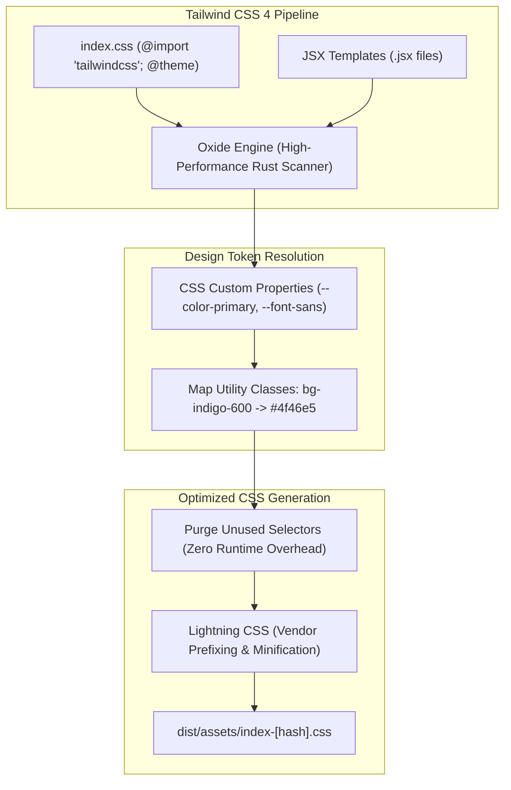

# CHAPTER 05: HTML, CSS & TAILWIND CSS 4

> **Focus:** Semantic HTML5, CSS Box Model, Flexbox vs. CSS Grid, Tailwind CSS 4 architecture, `@theme` design tokens, responsive mobile-first layouts, and accessible UI patterns.  
> **Source Files Referenced:** `frontend/src/index.css`, `frontend/src/components/layout/Navbar.jsx`, `frontend/src/pages/admin/AdminDashboard.jsx`, `frontend/src/components/product/ProductGrid.jsx`.

---

## 1. Core Definitions (English)

- **Semantic HTML5:** Markup that uses meaningful tags (e.g. `<header>`, `<main>`, `<nav>`, `<article>`, `<aside>`) that describe their content's purpose to browsers, screen readers, and search engines rather than generic `<div>` and `<span>` wrappers.
- **CSS Box Model:** The rectangular layout framework governing every HTML element, comprising four layers from inside out: **Content**, **Padding**, **Border**, and **Margin**.
- **Flexbox (Flexible Box Layout):** A one-dimensional CSS layout model designed for distributing space and aligning items along a single axis (either row or column).
- **CSS Grid:** A two-dimensional CSS layout model designed to handle both rows and columns simultaneously, enabling complex grid-based layouts.
- **Tailwind CSS 4:** A utility-first CSS framework built on a high-performance native engine (Oxide) featuring CSS-first `@theme` configuration, zero configuration files, and compile-time utility extraction.

---

## 2. Concept Explanations (Hinglish with Real-Life Metaphors)

### Semantic HTML5
> **Real-Life Analogy (Newspaper Headlines vs Plain White Paper):**  
> Socho agar ek newspaper mein koi headline, date, weather box ya sports column ka structure na ho—sab kuch ek hi font size mein plain paragraph ho! Padhne wale ko kuch samajh nahi aayega ki main khabar kaunsi hai. Semantic HTML newspaper ke structure ki tarah hai: `<header>` masthead hai, `<nav>` index table hai, aur `<main>` lead story hai.

---

### The CSS Box Model
> **Real-Life Analogy (Amazon Parcel Packaging):**  
> - **Content:** Jo smartphone tumne order kiya (Actual dimensions).  
> - **Padding:** Phone ke charo taraf lipta hua Bubble Wrap (Inside space between product and cardboard).  
> - **Border:** Amazon ka Cardboard Box (The visible physical boundary).  
> - **Margin:** Do alag-alag delivery parcels ke beech ka fasla delivery van ke floor par (Outside distance between elements).  
> - **`box-sizing: border-box`:** Jab Amazon bolta hai ki *"Box ka total size 10cm hi rahega, bubble wrap chahe jitna daalo box ka size nahi badhega"*.

---

### Flexbox vs. CSS Grid
> **Real-Life Analogy (Train Seats vs Chess Board):**  
> - **Flexbox (1D):** Train ki ek row wali seat. Log line se baithenge (Row axis). Agar jagah kam hui toh ya toh shrink honge ya agle row mein wrap honge.  
> - **CSS Grid (2D):** Ek Chess Board (Shatranj). Yahan rows (1 to 8) aur columns (A to H) pehle se defined hain. Tumhe pata hai ghoda (knight) ya haathi (rook) kis exact square (Row + Column coordinate) par baithega.

---

## 3. How It Works Internally: Tailwind CSS 4 Architecture



### Major Differences in Tailwind CSS 4:
1. **No `tailwind.config.js`:** All design tokens, custom colors, and font definitions are configured directly in CSS using `@theme` blocks:
   ```css
   @import "tailwindcss";

   @theme {
     --color-brand-primary: #4f46e5;
     --color-brand-dark: #0f172a;
   }
   ```
2. **Native Lightning CSS:** Replaces PostCSS/Autoprefixer pipelines with a native Rust-based compiler that is 10x faster.
3. **Container Queries Built-In:** Native support for `@container` without requiring external plugins.

---

## 4. Project Implementation & Code Snippets

### A. Responsive Grid Layout: Product Catalog Grid
In `frontend/src/components/product/ProductGrid.jsx`, we implement a responsive grid that automatically scales from 1 column on mobile to 4 columns on large screens:

```javascript
// File: frontend/src/components/product/ProductGrid.jsx
import React from 'react';
import ProductCard from './ProductCard';

export default function ProductGrid({ products, isLoading }) {
  if (isLoading) {
    return (
      <div className="grid grid-cols-1 sm:grid-cols-2 md:grid-cols-3 lg:grid-cols-4 gap-6">
        {[...Array(8)].map((_, i) => (
          <div key={i} className="animate-pulse bg-gray-200 h-80 rounded-2xl" />
        ))}
      </div>
    );
  }

  return (
    <div className="grid grid-cols-1 sm:grid-cols-2 md:grid-cols-3 lg:grid-cols-4 gap-6">
      {products.map((product) => (
        <ProductCard key={product._id} product={product} />
      ))}
    </div>
  );
}
```

---

### B. Dark-Themed Admin Layout: Mobile-Responsive Sidebar
In `frontend/src/pages/admin/AdminDashboard.jsx`, we implement an enterprise dark layout using Flexbox, CSS Grid, and conditional responsive display utilities:

```javascript
// File: frontend/src/pages/admin/AdminDashboard.jsx (Snippet)
export default function AdminDashboard() {
  const [isSidebarOpen, setSidebarOpen] = useState(false);

  return (
    <div className="min-h-screen bg-slate-950 text-slate-100 flex">
      {/* Mobile Backdrop */}
      {isSidebarOpen && (
        <div 
          onClick={() => setSidebarOpen(false)}
          className="fixed inset-0 bg-black/60 z-40 lg:hidden"
        />
      )}

      {/* Sidebar Navigation */}
      <aside className={`
        fixed inset-y-0 left-0 z-50 w-64 bg-slate-900 border-r border-slate-800 p-4 transition-transform duration-300
        ${isSidebarOpen ? 'translate-x-0' : '-translate-x-full lg:translate-x-0 lg:static'}
      `}>
        <div className="flex items-center justify-between mb-8">
          <span className="text-xl font-bold tracking-tight text-indigo-400">E-Shop Admin</span>
          <button onClick={() => setSidebarOpen(false)} className="lg:hidden text-slate-400">
            <XMarkIcon className="h-6 w-6" />
          </button>
        </div>
        {/* Navigation Links */}
      </aside>

      {/* Main Content Area */}
      <main className="flex-1 flex flex-col min-w-0 overflow-hidden">
        {/* Top Header */}
        <header className="h-16 bg-slate-900/50 backdrop-blur border-b border-slate-800 flex items-center justify-between px-6">
          <button onClick={() => setSidebarOpen(true)} className="lg:hidden text-slate-300">
            <Bars3Icon className="h-6 w-6" />
          </button>
          <div className="flex items-center space-x-4">
            <span className="text-sm text-slate-400">Super Admin</span>
          </div>
        </header>

        {/* Dashboard Analytics Grid */}
        <div className="p-6 overflow-y-auto space-y-6">
          <div className="grid grid-cols-1 sm:grid-cols-2 lg:grid-cols-4 gap-6">
            {/* Stat Cards */}
          </div>
        </div>
      </main>
    </div>
  );
}
```

---

## 5. Spoken Interview Answers

### Short Answer (30 Seconds)
> *"For our UI layer, we use semantic HTML5 styled with Tailwind CSS 4. Tailwind CSS 4 uses a modern CSS-first architecture configured via `@theme` variables, compiled through a Rust-based engine for high-speed builds with zero unused CSS bloat. We build with a mobile-first philosophy, using Flexbox for one-dimensional navigation and alignments, and CSS Grid for two-dimensional product catalogs and dashboard analytics. We maintain accessibility by incorporating ARIA labels and keyboard navigation."*

---

### Detailed Answer (90 Seconds)
> *"When designing the UI architecture for E-Shop, performance, responsiveness, and accessibility were our primary benchmarks.  
>  
> Instead of traditional component CSS files or runtime CSS-in-JS libraries like Styled Components—which incur runtime style calculation penalties—we adopted Tailwind CSS 4. Tailwind scans our JSX templates during compilation and emits only the exact utility classes used, resulting in an exceptionally lightweight production stylesheet under 20 kilobytes.  
>  
> For responsive layouts, we strictly follow a mobile-first approach. For example, in our `ProductGrid` component, classes like `grid grid-cols-1 sm:grid-cols-2 md:grid-cols-3 lg:grid-cols-4` ensure that smartphones render a readable single-column flow, while larger screens expand into a balanced multi-column grid without writing separate media queries.  
>  
> We also deliberately separate layout paradigms: we use Flexbox for one-dimensional directional components—such as our sticky navbar with centered search and spaced action icons—while reserving CSS Grid for two-dimensional data arrangements like our admin dashboard metric widgets.  
>  
> In terms of accessibility (a11y), all interactive icon buttons—such as our cart toggle and mobile hamburger menu—include explicit `aria-label` tags and focus ring states, ensuring full keyboard navigability and screen-reader compatibility."*

---

## 6. Interview Questions & Model Answers

### Level 1: Basic
**Question:** What is the difference between `display: none` and `visibility: hidden`?  
**Interview Answer (English):**  
*"`display: none` completely removes the element from the document layout flow; it takes up zero space on the screen, and browsers skip layout calculations for its children. `visibility: hidden`, however, hides the element visually, but the element still retains its physical box dimensions, space, and layout position on the page."*

---

### Level 2: Intermediate
**Question:** What does `box-sizing: border-box` do, and why is it standard in modern CSS?  
**Interview Answer (English):**  
*"By default in legacy CSS, `box-sizing: content-box` means that adding padding or borders increases the outer width of an element beyond its defined `width`. For example, a `div` with `width: 100px`, `padding: 10px`, and `border: 2px` ends up occupying `124px`.  
`box-sizing: border-box` forces the browser to calculate padding and borders *inside* the defined width and height. In the same example, the total width remains exactly `100px`, with content shrinking to accommodate padding. This eliminates accidental layout overflow and is why Tailwind applies it globally across all elements via its preflight base styles."*

---

### Level 3: Advanced
**Question:** Explain Cumulative Layout Shift (CLS) in Web Core Vitals and how you prevent it when rendering product images.  
**Interview Answer (English):**  
*"Cumulative Layout Shift (CLS) measures visual stability by tracking unexpected layout shifts during page load—for instance, when a product card's text suddenly jumps downward because an image above it just finished downloading.  
We eliminate CLS in our product cards using two strategies:  
1. **Aspect Ratio Containers:** We use Tailwind's `aspect-square` or `aspect-video` utility classes on parent containers so the browser reserves the exact height before the image loads.  
2. **Skeleton Shimmer Placeholders:** While TanStack Query is fetching products, we render animated pulse skeletons (`animate-pulse bg-gray-200`) with identical dimensions to the final cards. When real data arrives, it occupies the exact allocated footprint with zero visual jump."*

---

### Level 4: Project-Specific Cross-Examination
**Interviewer:** *"In Tailwind CSS 4, how does CSS specificity work when you want to override a base utility class in a custom subcomponent?"*  
**Spoken Defense (English):**  
*"Tailwind CSS 4 organizes utilities into native CSS `@layer` rules: `@layer base`, `@layer components`, and `@layer utilities`. Because standard utility classes reside within `@layer utilities`, they always win over component styles regardless of selector ordering in the file.  
When we need to override a utility dynamically—for example, conditionally applying an active border on an address card—we use utility mergers like `clsx` or `tailwind-merge`. Instead of simple string concatenation, `tailwind-merge` understands conflicting Tailwind classes (e.g., `p-4` vs `p-6`, `border-gray-200` vs `border-indigo-600`) and removes the superseded class, ensuring deterministic styling without resorting to the `!important` anti-pattern."*

---

## 7. Comparative Technical Matrix

| Dimension | Flexbox | CSS Grid |
| :--- | :--- | :--- |
| **Dimensionality** | One-dimensional (Row OR Column) | Two-dimensional (Rows AND Columns) |
| **Approach** | Content-first (Size depends on content) | Layout-first (Content adapts to grid tracks) |
| **Overlap Support** | Difficult (requires absolute positioning) | Native (elements can share grid cells/areas) |
| **Project Example** | `Navbar.jsx` (Header alignments) | `ProductGrid.jsx` (Catalog cards) |

---

## 8. Common Interview Traps & Pitfalls

> [!WARNING]
> **Trap 1: Forgetting mobile-first default breakpoints.**  
> *Reality:* In Tailwind, unprefixed utilities apply to ALL screens (`w-full`), while prefixed utilities apply at that breakpoint and ABOVE (`md:w-1/2` means screen width $\ge 768px$). Writing `lg:hidden` hides an element ONLY on desktops, keeping it visible on mobile and tablets.
>
> **Trap 2: Using pixel values instead of rem/relative units.**  
> *Reality:* Hardcoding `font-size: 16px` breaks user browser accessibility settings (e.g., if a visually impaired user increases their default browser font size). Tailwind's `text-base` compiles to `1rem`, which dynamically scales with user preferences.
>
> **Trap 3: Inline dynamic Tailwind class names.**  
> *Reality:* Writing `className={`bg-${color}-500`}` will fail in production! Tailwind's compiler statically parses templates for complete class strings. If `bg-red-500` is constructed via string interpolation, the compiler will not detect it and will purge the style from the final CSS bundle.

---

## 9. Quick Revision Rapid-Fire (15 Q&As)

1. **What is mobile-first design?** Designing for the smallest screen viewport first, then progressively enhancing the layout for larger displays via `min-width` media queries.
2. **What does `z-index` require to work?** A CSS `position` property other than `static` (e.g. `relative`, `absolute`, `fixed`, `sticky`).
3. **What is the difference between `em` and `rem`?** `em` is relative to the font-size of its direct parent element; `rem` (root em) is relative to the root `<html>` element's font size.
4. **What is the default font size in most web browsers?** `16px` (equals `1rem`).
5. **What does `overflow: hidden` do?** Clips any content that overflows an element's padding box, preventing scrollbars.
6. **What is Flexbox `justify-content` vs `align-items`?** `justify-content` aligns along the primary axis; `align-items` aligns along the cross axis.
7. **What is a CSS pseudo-class?** A keyword added to a selector that specifies a special state of the element (e.g. `:hover`, `:focus`, `:disabled`).
8. **What is a CSS pseudo-element?** A keyword added to a selector to style a specific part of an element (e.g. `::before`, `::after`, `::placeholder`).
9. **What does `transform: translateZ(0)` trigger in the browser?** Hardware acceleration by prompting the browser to promote the element to its own GPU compositor layer.
10. **What is the CSS cascade?** The algorithm browsers use to resolve conflicts when multiple CSS rules match the same element, based on Origin, Specificity, and Order.
11. **How do you center a `div` using Flexbox?** `display: flex; justify-content: center; align-items: center;`.
12. **How do you center a `div` using CSS Grid?** `display: grid; place-items: center;`.
13. **What is the Tailwind utility for `display: flex`?** `flex`.
14. **What is the Tailwind utility for `position: sticky; top: 0`?** `sticky top-0`.
15. **What is the benefit of Tailwind CSS 4's Oxide engine?** High-speed compilation written in Rust that eliminates PostCSS overhead.

