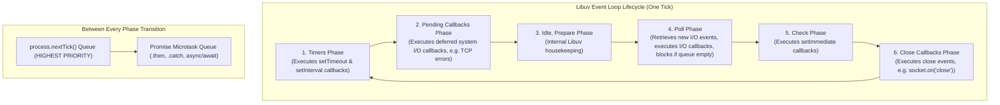

# CHAPTER 06: NODE.JS COMPLETE ARCHITECTURE GUIDE

> **Focus:** Node.js runtime, V8 + Libuv internals, Event Loop phases, Non-blocking asynchronous I/O, Thread Pool (`UV_THREADPOOL_SIZE`), Streams & Buffers, and `child_process` IPC.  
> **Source Files Referenced:** `backend/src/server.js`, `backend/src/controllers/adminController.js`, `backend/src/services/invoiceService.js`, `backend/src/utils/logger.js`.

---

## 1. Core Definitions (English)

- **Node.js:** An open-source, cross-platform, single-threaded JavaScript runtime environment built on Google Chrome's V8 engine and the Libuv C library, designed to build scalable network applications using event-driven, non-blocking I/O.
- **Libuv:** A multi-platform C library that provides Node.js with an asynchronous event loop, non-blocking network socket abstractions, file system watching, and a configurable background worker thread pool (default 4 threads).
- **Non-Blocking I/O:** An execution model where system calls (e.g., file reads, database queries, socket writes) return control to the calling thread immediately, notifying the runtime of completion via callback functions pushed to event queues.
- **Node.js Streams:** Abstract interfaces for handling streaming data in chunks, allowing applications to read or write large files without buffering the entire payload into physical RAM.
- **`child_process` Module:** A core Node.js module that enables spawning external operating system processes, establishing bidirectional IPC communication channels over standard I/O streams (`stdin`, `stdout`, `stderr`).

---

## 2. Concept Explanations (Hinglish with Real-Life Metaphors)

### The Single-Threaded Event Loop & Libuv Thread Pool
> **Concept:** Agar Node.js single-threaded hai, toh file system read karte waqt ya password hash karte waqt baaki users ki requests rukti kyu nahi?  
> **Real-Life Analogy (Head Chef aur Assistant Helpers):**  
> Socho ek 5-star restaurant ka Master Chef (Node.js Main JavaScript Thread). Master Chef har order khud verify karta hai aur recipe instructions deta hai. Lekin agar pyaaz kaatne ho ya masale peesne ho (Heavy CPU/IO: Bcrypt hashing, File reading, DNS resolution), toh Chef khud khada hokar 20 minute tak pyaaz nahi kaat-ta!  
> Kitchen mein 4 background helpers khade hain (Libuv Thread Pool). Chef helper ko bolta hai *"Yeh 5 kilo pyaaz kaat do"*. Helper background mein apna kaam karte hain, aur Master Chef agle customer ka order lene chala jaata hai. Jab helper ka kaam ho jaata hai, woh Chef ke table par tray rakh dete hain (Callback Queue). Master Chef agle free moment par us tray ko utha kar dish complete kar deta hai!

---

### Streams vs. Buffers
> **Real-Life Analogy (Nal se Glass Bhar Kar Peena vs Pura Water Tank Ek Saath Peena):**  
> - **Buffer:** Ek 1GB ki video file ko pura memory mein load karna. Yeh waisa hi hai jaise koi bole *"Pehle pura 500-liter ka water tank pet mein daalo, phir pyas bujhegi!"* Server ki RAM turant crash (`JavaScript heap out of memory`) ho jayegi!  
> - **Stream:** Ek nal (tap) kholna aur ghoont-ghoont (chunk-by-chunk) paani peena! Video ka 64KB chunk aayega, client ko send hoga, aur memory se delete ho jayega. Server par sirf kuch kilobytes ki RAM use hogi chahe file 10GB ki kyu na ho!

---

## 3. How It Works Internally: The 6 Event Loop Phases



### Critical Execution Rules:
1. `process.nextTick()` does **not** belong to any Event Loop phase. Node.js executes the entire `nextTick` queue immediately after the current operation finishes, before the Event Loop advances to any other phase.
2. `Promise.then()` callbacks run immediately after `process.nextTick()` drains.
3. In the **Poll Phase**, if the queue is empty:
   - If `setImmediate()` callbacks are waiting in the **Check Phase**, the loop advances directly to Check.
   - If no timers or callbacks are pending, the loop blocks and waits for new OS I/O events.

---

## 4. Project Implementation & Code Snippets

### A. Server Bootstrap & Graceful Shutdown: `backend/src/server.js`
In `backend/src/server.js`, we listen for OS process termination signals (`SIGTERM`, `SIGINT`) and unhandled promise rejections to close database connections and HTTP sockets cleanly:

```javascript
// File: backend/src/server.js (Production snippet)
const app = require('./app');
const { connectDB } = require('./config/db');
const logger = require('./utils/logger');

const PORT = process.env.PORT || 5000;

// Connect to MongoDB Atlas
connectDB();

const server = app.listen(PORT, () => {
  logger.info(`Server running in ${process.env.NODE_ENV} mode on port ${PORT}`);
});

// Handle unhandled Promise rejections
process.on('unhandledRejection', (err) => {
  logger.error(`UNHANDLED REJECTION: ${err.name} - ${err.message}`);
  logger.error(err.stack);
  // Graceful shutdown: Stop accepting new requests, finish ongoing ones, then exit
  server.close(() => {
    process.exit(1);
  });
});

// Handle uncaught synchronous exceptions
process.on('uncaughtException', (err) => {
  logger.error(`UNCAUGHT EXCEPTION: ${err.name} - ${err.message}`);
  logger.error(err.stack);
  process.exit(1);
});

// Graceful container shutdown on Render/Docker
process.on('SIGTERM', () => {
  logger.info('SIGTERM received. Shutting down gracefully...');
  server.close(() => {
    logger.info('Process terminated.');
  });
});
```

---

### B. Standard I/O Stream Piping: Python ML Subprocess
In `backend/src/controllers/adminController.js`, we use `child_process.spawn` to pipe data directly through writable and readable streams:

```javascript
// File: backend/src/controllers/adminController.js (Stream IPC snippet)
const { spawn } = require('child_process');
const path = require('path');

const ML_SCRIPT = path.join(__dirname, '../../ml-models/predict.py');

const runPrediction = (inputData) => {
  return new Promise((resolve) => {
    const pythonCmd = process.env.PYTHON_CMD || 'python3';
    // Spawn OS process with 15s execution timeout
    const proc = spawn(pythonCmd, [ML_SCRIPT], { timeout: 15000 });

    let output = '';
    let errorOutput = '';

    // Write batch payload into Writable Stream (proc.stdin)
    proc.stdin.write(JSON.stringify(inputData));
    proc.stdin.end(); // Signal EOF to Python's sys.stdin.read()

    // Read chunks from Readable Stream (proc.stdout)
    proc.stdout.on('data', (chunk) => {
      output += chunk.toString();
    });

    proc.stderr.on('data', (errChunk) => {
      errorOutput += errChunk.toString();
    });

    proc.on('close', (code) => {
      if (code === 0 && output.trim()) {
        try {
          resolve(JSON.parse(output.trim()));
        } catch (e) {
          resolve({ success: false, error: 'JSON parse error' });
        }
      } else {
        resolve({ success: false, error: errorOutput || `Process exited with code ${code}` });
      }
    });

    proc.on('error', (err) => {
      resolve({ success: false, error: err.message });
    });
  });
};
```

---

### C. PDF Generation via Writable Response Streams: `invoiceService.js`
In `backend/src/services/invoiceService.js`, rather than saving multi-megabyte PDF files to physical disk, we stream the generated PDFKit document directly into the Express HTTP response stream (`res`):

```javascript
// File: backend/src/services/invoiceService.js (Stream snippet)
const PDFDocument = require('pdfkit');

exports.generateInvoicePDF = async (order, res) => {
  const doc = new PDFDocument({ margin: 50 });

  // Set HTTP headers for PDF stream download
  res.setHeader('Content-Type', 'application/pdf');
  res.setHeader(
    'Content-Disposition',
    `attachment; filename=Invoice-${order._id}.pdf`
  );

  // Pipe the PDF document directly into the HTTP response stream
  doc.pipe(res);

  // Write PDF content...
  doc.fontSize(20).text('TAX INVOICE', { align: 'center' });
  doc.moveDown();
  doc.fontSize(12).text(`Order ID: ${order._id}`);
  doc.text(`Customer: ${order.user.name}`);
  doc.text(`Total Amount: INR ${order.totalPrice}`);

  // Finalize document and close stream
  doc.end();
};
```

---

## 5. Spoken Interview Answers

### Short Answer (30 Seconds)
> *"Node.js is an event-driven, non-blocking asynchronous JavaScript runtime environment built on Chrome's V8 engine and Libuv. It operates on a single execution thread for JavaScript evaluation while offloading intensive tasks—such as file system operations, cryptographic hashing, and network I/O—to operating system asynchronous mechanisms or Libuv's C++ worker thread pool. This allows Node.js to handle tens of thousands of concurrent connections efficiently with minimal memory overhead."*

---

### Detailed Answer (90 Seconds)
> *"In our E-Shop architecture, Node.js serves as our core API gateway and backend orchestration engine.  
>  
> Many engineers mistake Node.js as purely single-threaded. In reality, while our JavaScript code executes on a single main thread, the underlying C++ runtime powered by Libuv is multi-threaded. Libuv manages a thread pool of worker threads—defaulting to 4—which execute blocking operations such as `bcrypt.hash()` in our auth controller, DNS lookups, and disk operations without blocking our main event loop.  
>  
> The Event Loop itself coordinates work across six distinct phases during each tick: Timers, Pending I/O Callbacks, Idle/Prepare, Poll, Check (for `setImmediate`), and Close Callbacks. High-priority microtasks like `process.nextTick()` and resolved Promises drain completely between each phase transition.  
>  
> We also take advantage of Node.js streams to optimize server memory. For instance, in our `invoiceService.js`, when a customer downloads a statutory tax invoice, we do not write the PDF to the server's hard drive or buffer the binary into RAM. Instead, we use `doc.pipe(res)`, streaming the chunks directly from the PDFKit generator into the outgoing HTTP response socket.  
>  
> Finally, we establish resilient process lifecycles in `server.js` by listening to `unhandledRejection` and `SIGTERM` signals. When Render triggers a deployment or restart, our server stops accepting new connections, allows ongoing checkout transactions to settle, and exits gracefully without data corruption."*

---

## 6. Interview Questions & Model Answers

### Level 1: Basic
**Question:** What is the difference between `process.nextTick()` and `setImmediate()`?  
**Interview Answer (English):**  
*"`process.nextTick()` is not part of the Libuv Event Loop phases; it fires immediately after the current operation finishes on the call stack, before the event loop continues to any other phase. `setImmediate()`, on the other hand, is specifically queued in the Check Phase of the Event Loop and runs only after the Poll phase has completed its I/O operations. Therefore, recursive calls to `process.nextTick()` can completely starve the Event Loop and freeze I/O."*

---

### Level 2: Intermediate
**Question:** What is the difference between `child_process.spawn()` and `child_process.exec()`? Why did we use `spawn` for our ML model?  
**Interview Answer (English):**  
*"`child_process.exec()` launches a shell, executes the command, buffers the entire output in memory (default 1MB buffer), and returns it all at once in a single callback. If the output exceeds the buffer limit, it crashes with `maxBuffer exceeded`.  
`child_process.spawn()`, which we use in `adminController.js`, does not launch a shell by default. Instead, it streams data in real-time through standard streams (`stdin`, `stdout`, `stderr`). This allows our Node.js server to pipe arbitrary JSON payloads into Python without buffer size limitations, lower latency, and significantly lower memory overhead."*

---

### Level 3: Advanced
**Question:** What is the Libuv Thread Pool, what operations use it, and how do you scale it?  
**Interview Answer (English):**  
*"While network I/O (like HTTP calls or incoming Express requests) is handled asynchronously by native OS kernel non-blocking mechanisms (like epoll on Linux or kqueue on macOS), other operations cannot be handled asynchronously at the OS level. Libuv delegates these to an internal C++ worker thread pool.  
Operations using the thread pool include:  
1. **File System (`fs`):** All synchronous and asynchronous file system operations.  
2. **Cryptographic Functions (`crypto` / `bcrypt`):** Hashing passwords and generating random bytes.  
3. **DNS Lookups:** `dns.lookup()`.  
The default thread pool size is 4. If four users simultaneously log in and run Bcrypt hashing, a fifth user's file upload or crypto operation will be queued and delayed. We can scale this by setting the environment variable `UV_THREADPOOL_SIZE=8` or `16` before starting the Node process."*

---

### Level 4: Project-Specific Cross-Examination
**Interviewer:** *"In `adminController.js`, you set a 15-second timeout on `spawn`: `{ timeout: 15000 }`. What happens if Python hangs indefinitely on a complex model inference? Does the Node.js event loop get blocked?"*  
**Spoken Defense (English):**  
*"No, the Node.js event loop will NOT get blocked. Spawning Python creates an independent operating system process running in its own process space with its own PID. The Node.js event loop simply listens to stream file descriptors.  
If Python hangs (for example, in an infinite loop or deadlock), Node's 15-second timeout triggers: Node sends a `SIGTERM` signal to kill the Python child process, which emits an `error` or `close` event on the process object.  
Our `adminController.js` handles this cleanly: the Promise resolves with `{ success: false, error: 'Process timeout' }`, and the controller immediately falls back to our in-memory heuristic function (`getFallback`), calculating risk based on account age and monthly spend. The administrator receives a valid response in 15 seconds rather than the request hanging forever."*

---

## 7. Comparative Technical Matrix

| Method | Spawns Shell? | Data Handling | Output Limit | Ideal Use Case |
| :--- | :---: | :--- | :--- | :--- |
| `spawn` | No (by default) | Continuous Streams (`Stream`) | Unlimited (chunked) | Long-running tasks, ML inference, streaming large data |
| `exec` | Yes (`/bin/sh` or `cmd.exe`) | Buffered String (`Buffer`) | Default 1 MB (configurable) | Quick system commands (e.g. `ls`, `git --version`) |
| `execFile` | No | Buffered String (`Buffer`) | Default 1 MB | Executing binary executables directly without shell |
| `fork` | No | IPC messaging channel (`send`) | V8 Object Serialization | Running separate Node.js scripts in isolated V8 instances |

---

## 8. Common Interview Traps & Pitfalls

> [!WARNING]
> **Trap 1: Believing `console.log` is always synchronous.**  
> *Reality:* In Node.js, whether `console.log` is synchronous or asynchronous depends on the OS and the stream target! On Windows, writes to console pipes are synchronous, while on Linux/Unix pipes, writes are asynchronous. This is why we use Winston with file streams for production logging rather than raw `console.log`.
>
> **Trap 2: Forgetting to close `stdin` after writing.**  
> *Reality:* In `adminController.js`, if you write `proc.stdin.write(data)` but omit `proc.stdin.end()`, Python's `sys.stdin.read()` will wait forever for more input! The child process will never finish, and the request will hit the 15-second timeout every single time.
>
> **Trap 3: Modifying `UV_THREADPOOL_SIZE` inside JavaScript code.**  
> *Reality:* Setting `process.env.UV_THREADPOOL_SIZE = 8` inside your JavaScript file after Node has started does NOT work! Libuv initializes its thread pool when the C++ runtime boots up, *before* user JavaScript executes. It must be set in the shell command: `UV_THREADPOOL_SIZE=8 node src/server.js`.

---

## 9. Quick Revision Rapid-Fire (15 Q&As)

1. **What is the V8 engine?** Google’s open-source C++ engine that compiles JavaScript to native machine code.
2. **What is Libuv?** The multi-platform C library providing Node.js with its Event Loop and thread pool.
3. **What is the default size of the Libuv thread pool?** 4 threads.
4. **How do you change the Libuv thread pool size?** By setting `UV_THREADPOOL_SIZE` environment variable before running Node.
5. **Which event loop phase executes `setTimeout`?** The Timers phase.
6. **Which event loop phase executes `setImmediate`?** The Check phase.
7. **What is backpressure in Node.js streams?** When data is read faster than the writable stream can consume it, pausing the readable stream to prevent memory overflow.
8. **What does `stream.pipe()` do?** Attaches a readable stream to a writable stream, managing backpressure automatically.
9. **What is a Buffer in Node.js?** A fixed-length chunk of raw binary memory allocated outside the V8 heap.
10. **What is the difference between synchronous and asynchronous code in Node?** Synchronous blocks the main thread; asynchronous delegates work and triggers callbacks/promises without blocking.
11. **Why should you avoid `fs.readFileSync` in Express controllers?** Because it blocks the main thread, preventing all other users from being served during the disk read.
12. **What signal does Docker send when stopping a container?** `SIGTERM`, followed by `SIGKILL` if the container does not exit within the grace period.
13. **What is the purpose of `uncaughtException`?** To catch unhandled synchronous runtime errors at the process level before the application crashes.
14. **What is the purpose of `unhandledRejection`?** To catch Promise rejections that have no `.catch()` handler attached.
15. **What is IPC?** Inter-Process Communication—the mechanism that allows separate operating system processes to exchange data.

