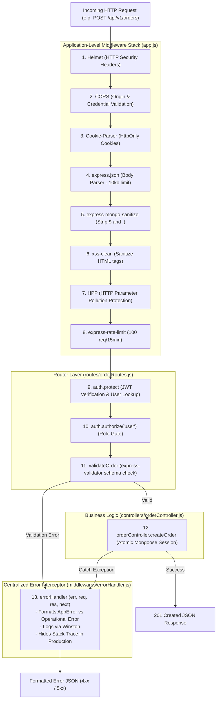

# CHAPTER 07: EXPRESS.JS & BACKEND ARCHITECTURE

> **Focus:** Express 4.22 middleware pipeline, MVC architecture, Centralized error handling (`AppError`, `catchAsync`), Security middlewares, and Request validation.  
> **Source Files Referenced:** `backend/src/app.js`, `backend/src/middlewares/errorHandler.js`, `backend/src/middlewares/validation.js`, `backend/src/controllers/orderController.js`, `backend/src/routes/authRoutes.js`.

---

## 1. Core Definitions (English)

- **Express.js:** A minimal, flexible, unopinionated web application framework for Node.js that provides a robust set of features for building web and mobile applications and RESTful APIs.
- **Middleware:** A function that has access to the request object (`req`), response object (`res`), and the `next` function in the application’s request-response cycle, capable of executing code, altering request/response data, ending cycles, or delegating control.
- **MVC (Model-View-Controller) Architecture:** A design pattern that separates application logic into three interconnected components: **Model** (data contracts & schemas), **View** (JSON responses for APIs / React templates), and **Controller** (business workflows & orchestration).
- **Centralized Error Handling:** An architectural pattern where all synchronous and asynchronous runtime exceptions are routed to a single dedicated error-handling middleware function, guaranteeing consistent response contracts and preventing leaked stack traces in production.
- **Idempotency:** A property of certain HTTP operations whereby an identical request can be made repeatedly with the same effect as making it once (e.g. `GET`, `PUT`, `DELETE`).

---

## 2. Concept Explanations (Hinglish with Real-Life Metaphors)

### The Express Middleware Pipeline
> **Concept:** Express mein har incoming request ek pipeline se guzarti hai jahan alag-alag security guards (middlewares) usko inspect aur verify karte hain.  
> **Real-Life Analogy (Airport Security & Boarding Checkpoints):**  
> Socho tum international flight pakadne airport jaa rahe ho (`req` incoming HTTP request):  
> 1. **Entry Gate:** Guard tumhara ID card aur passport check karta hai (`cors` aur `helmet` headers).  
> 2. **Baggage Scanner:** Tumhare bag se metal items aur liquid hataye jaate hain (`mongoSanitize` NoSQL injection protection aur `xss-clean`).  
> 3. **Crowd Controller:** Ek limit se zyada log aane par entry rok deta hai (`express-rate-limit`).  
> 4. **Security Officer:** Boarding pass stamp karta hai aur bolta hai *"Aage badho"* (`next()`).  
> Agar kisi point par tumhare paas ticket nahi milti (Validation error / Unauthorized), toh guard wahi se tumko bahar nikal deta hai (`res.status(401).json(...)`). Agar sab clear ho, tabhi tum airplane seat (Controller execution) tak pahunchte ho!

---

### The MVC Pattern
> **Real-Life Analogy (Fine Dining Restaurant):**  
> - **Controller (Waiter):** Customer se order leta hai (`req.body`), kitchen mein instruction pass karta hai, aur ready plate table par serve karta hai (`res.json()`).  
> - **Model (Pantry & Recipe Book):** Ingredients ke rules aur quality standards (MongoDB schemas, Mongoose validation, stock constraints).  
> - **View / Service (Kitchen Cook):** Chef jo khana banata hai (PDF invoice generation, Razorpay encryption).

---

## 3. How It Works Internally: Express Request-Response Pipeline



---

## 4. Project Implementation & Code Snippets

### A. The Express Application Pipeline: `backend/src/app.js`
In `backend/src/app.js`, middlewares are ordered deliberately from outermost security boundaries to inner route handlers:

```javascript
// File: backend/src/app.js (Pipeline excerpt)
const express = require('express');
const helmet = require('helmet');
const cors = require('cors');
const cookieParser = require('cookie-parser');
const mongoSanitize = require('express-mongo-sanitize');
const xss = require('xss-clean');
const hpp = require('hpp');
const rateLimit = require('express-rate-limit');
const compression = require('compression');
const morgan = require('morgan');

const { errorHandler } = require('./middlewares/errorHandler');
const AppError = require('./utils/AppError');

// Route Imports
const authRoutes = require('./routes/authRoutes');
const productRoutes = require('./routes/productRoutes');
const orderRoutes = require('./routes/orderRoutes');
const adminRoutes = require('./routes/adminRoutes');

const app = express();

// 1. Security HTTP Headers
app.use(helmet());

// 2. CORS configuration with credentials support
app.use(cors({
  origin: process.env.CLIENT_URL || 'http://localhost:5173',
  credentials: true
}));

// 3. Cookie parser for HttpOnly refresh tokens
app.use(cookieParser());

// 4. Body parser with payload limit
app.use(express.json({ limit: '10kb' }));
app.use(express.urlencoded({ extended: true, limit: '10kb' }));

// 5. Data sanitization against NoSQL query injection
app.use(mongoSanitize());

// 6. Data sanitization against XSS
app.use(xss());

// 7. Prevent HTTP parameter pollution
app.use(hpp());

// 8. Compression
app.use(compression());

// 9. Rate Limiting: 100 requests per 15 minutes
const limiter = rateLimit({
  windowMs: 15 * 60 * 1000,
  max: 100,
  message: 'Too many requests from this IP, please try again in 15 minutes'
});
app.use('/api', limiter);

// 10. Route Mounting
app.use('/api/v1/auth', authRoutes);
app.use('/api/v1/products', productRoutes);
app.use('/api/v1/orders', orderRoutes);
app.use('/api/v1/admin', adminRoutes);

// 11. Unhandled Route 404 Handler
app.all('*', (req, res, next) => {
  next(new AppError(`Cannot find ${req.originalUrl} on this server`, 404));
});

// 12. Centralized Global Error Handler Middleware
app.use(errorHandler);

module.exports = app;
```

---

### B. Custom `AppError` & `catchAsync` Wrapper: `errorHandler.js`
In `backend/src/middlewares/errorHandler.js`, we standardize operational error objects and capture unhandled async promise rejections:

```javascript
// File: backend/src/middlewares/errorHandler.js
const logger = require('../utils/logger');

// Custom Operational Error Class
class AppError extends Error {
  constructor(message, statusCode) {
    super(message);
    this.statusCode = statusCode;
    this.status = `${statusCode}`.startsWith('4') ? 'fail' : 'error';
    this.isOperational = true; // Distinguishes operational from programming bugs
    Error.captureStackTrace(this, this.constructor);
  }
}

// Higher-order function to remove try-catch boilerplate
const catchAsync = (fn) => (req, res, next) => {
  fn(req, res, next).catch(next);
};

// 4-Argument Global Error Handling Middleware
const errorHandler = (err, req, res, next) => {
  err.statusCode = err.statusCode || 500;
  err.status = err.status || 'error';

  // Log all 500 errors to Winston
  if (err.statusCode === 500) {
    logger.error(`INTERNAL ERROR: ${err.message}`, { stack: err.stack, path: req.originalUrl });
  }

  // Development vs Production response contracts
  if (process.env.NODE_ENV === 'development') {
    res.status(err.statusCode).json({
      success: false,
      status: err.status,
      error: err,
      message: err.message,
      stack: err.stack
    });
  } else {
    // Production: Do not leak technical stack traces to clients
    if (err.isOperational) {
      res.status(err.statusCode).json({
        success: false,
        status: err.status,
        message: err.message
      });
    } else {
      res.status(500).json({
        success: false,
        status: 'error',
        message: 'Something went wrong on our end. Please try again later.'
      });
    }
  }
};

module.exports = { AppError, catchAsync, errorHandler };
```

---

### C. Request Validation: `backend/src/middlewares/validation.js`
We intercept invalid client payloads *before* they reach the controllers using `express-validator`:

```javascript
// File: backend/src/middlewares/validation.js (Snippet)
const { body, validationResult } = require('express-validator');

exports.validateRegister = [
  body('name').trim().notEmpty().withMessage('Name is required'),
  body('email').isEmail().normalizeEmail().withMessage('Please provide a valid email'),
  body('password')
    .isLength({ min: 6 })
    .withMessage('Password must be at least 6 characters long'),

  (req, res, next) => {
    const errors = validationResult(req);
    if (!errors.isEmpty()) {
      return res.status(400).json({
        success: false,
        errors: errors.array().map((err) => ({ field: err.path, message: err.msg }))
      });
    }
    next();
  }
];
```

---

## 5. Spoken Interview Answers

### Short Answer (30 Seconds)
> *"We architected our Express.js backend using an enterprise three-tier MVC model. The incoming HTTP request flows through a strict security middleware pipeline—including Helmet, CORS with credentials, cookie parsing, rate limiting, and NoSQL sanitization. Controllers are decoupled from business logic and wrapped in a higher-order `catchAsync` wrapper that forwards unhandled promise rejections directly to a centralized 4-argument error-handling middleware, separating predictable operational errors from unexpected programming bugs."*

---

### Detailed Answer (90 Seconds)
> *"Express 4.22 serves as our core REST routing framework, structured around the principle of modularity and defense-in-depth security.  
>  
> When an incoming request reaches our server, `backend/src/app.js` runs it through an intentional middleware pipeline. First, `helmet` sets secure HTTP response headers. Second, `cors` validates allowed origins and enables credentials for HttpOnly cookie transfer. Third, `mongoSanitize` strips dollar signs and dots from query params and request bodies to prevent NoSQL query injection attacks. Finally, `express-rate-limit` throttles brute-force attempts to 100 requests per 15 minutes per IP.  
>  
> In our routing tier, we separate authentication from authorization. Every protected endpoint calls `auth.protect` to verify the JWT and check against our `tokenVersion` revocation mechanism, followed by `auth.authorize('admin')` for administrative operations.  
>  
> For error handling, we avoid cluttered `try-catch` blocks across our controllers. Instead, we wrote a higher-order utility `catchAsync` that catches any rejected promises and invokes `next(error)`. In Express, passing an argument to `next()` immediately bypasses all standard routes and jumps to our centralized error handler. The error handler differentiates between operational errors instantiated via our custom `AppError` class (such as insufficient stock or invalid credentials) and unknown 500 bugs, logging critical exceptions to Winston while returning clean, sanitized JSON error responses in production without exposing server stack traces."*

---

## 6. Interview Questions & Model Answers

### Level 1: Basic
**Question:** What does the `next()` function do in Express middleware?  
**Interview Answer (English):**  
*"`next()` is a callback passed to middleware functions that passes execution control to the next middleware function in the routing stack. If a middleware does not call `next()` and does not send a response via `res.send()` or `res.json()`, the HTTP request hangs indefinitely until the client times out."*

---

### Level 2: Intermediate
**Question:** How does Express recognize that a middleware is an error-handling middleware rather than a normal middleware?  
**Interview Answer (English):**  
*"Express inspects the function’s `length` property (the number of declared parameters) using JavaScript reflection. A standard middleware declares 3 parameters: `(req, res, next)`. An error-handling middleware MUST declare exactly 4 parameters: `(err, req, res, next)`. Even if you do not use the `next` argument, omitting it reduces the parameter count to 3, causing Express to treat it as a standard middleware and skip it when an error is passed via `next(err)`."*

---

### Level 3: Advanced
**Question:** What is the difference between an Operational Error and a Programming Error? How does our codebase handle each?  
**Interview Answer (English):**  
*"In backend engineering:  
- **Operational Errors:** Predictable, unavoidable runtime failures that occur in normal operation—such as invalid user input, an expired JWT, insufficient product stock, or a database duplicate key error (code 11000). In our codebase, we instantiate these using `new AppError(message, statusCode)` with `isOperational = true`. They return friendly 4xx status codes.  
- **Programming Errors:** Unexpected bugs in our code—such as calling a method on `undefined`, a syntax error, or a failed database connection. These have `isOperational = false`. Our global error handler logs their full stack trace to Winston daily log files and returns a generic `500 Internal Server Error` to the user in production, concealing internal server paths from attackers."*

---

### Level 4: Project-Specific Cross-Examination
**Interviewer:** *"In `orderController.js`, you initiate an atomic Mongoose session during checkout. What happens if a payment service throws an error midway? How does your error handling prevent orphaned records?"*  
**Spoken Defense (English):**  
*"In our `orderController.js`, checkout is executed within a Mongoose transaction session (`session = await mongoose.startSession(); session.startTransaction()`).  
If Razorpay order creation fails, stock decrement fails, or any unexpected exception is thrown, the execution jumps to the `catch` block where we explicitly execute `await session.abortTransaction()` and `session.endSession()`.  
Because the decrement and order creation are bound to that specific session, MongoDB rolls back all document changes automatically. No products remain decremented, and no half-created orders persist in the database. The error is then forwarded to `next(err)` to return a clean 400 Bad Request to the client."*

---

## 7. Comparative Technical Matrix

| Dimension | Express.js 4.x | Fastify | NestJS |
| :--- | :--- | :--- | :--- |
| **Architecture** | Unopinionated Minimalist | Schema-based High Performance | Opinionated Enterprise Modular (Angular-like) |
| **Language** | Plain JavaScript / TypeScript | JavaScript / TypeScript | Pure TypeScript |
| **Speed (Req/sec)** | ~15,000 req/sec | ~30,000 req/sec (2x faster) | ~14,000 req/sec |
| **Middleware Model** | Linear Stack (`req, res, next`) | Hook Lifecycles (`onRequest`, etc.) | Dependency Injection, Interceptors, Guards |
| **Why E-Shop Used Express**| Ubiquitous ecosystem, mature security packages (Helmet, MongoSanitize), and rapid prototyping |

---

## 8. Common Interview Traps & Pitfalls

> [!WARNING]
> **Trap 1: Calling `next()` after sending a response (`res.json()`).**  
> *Reality:* If you call `res.json()` and subsequently call `next()`, Express will attempt to execute downstream middleware and write headers again, triggering the notorious error: `Error [ERR_HTTP_HEADERS_SENT]: Cannot set headers after they are sent to the client`. Always return immediately: `return res.status(200).json(...)`.
>
> **Trap 2: Placing `app.use(errorHandler)` before route mounts.**  
> *Reality:* Middleware order in Express is strictly linear. If you mount `errorHandler` before `app.use('/api/v1/orders', orderRoutes)`, any error thrown inside the order routes will never reach the error handler! The global error handler MUST be mounted at the very end of `app.js`.
>
> **Trap 3: Not parsing JSON body before route matching.**  
> *Reality:* If `express.json()` is placed below route definitions, `req.body` will be `undefined` inside all POST and PUT controllers!

---

## 9. Quick Revision Rapid-Fire (15 Q&As)

1. **What is `req.params`?** Route parameters defined in the URL path (e.g. `/products/:id` -> `req.params.id`).
2. **What is `req.query`?** Query string parameters in the URL (e.g. `/products?category=electronics` -> `req.query.category`).
3. **What is `req.body`?** The parsed payload sent by the client in the HTTP request body.
4. **What does `express.json({ limit: '10kb' })` do?** Parses incoming JSON bodies and rejects any payload larger than 10 kilobytes to prevent Denial-of-Service (DoS) memory floods.
5. **What does `helmet()` do?** Sets secure HTTP headers (e.g. `X-Content-Type-Options: nosniff`, `X-Frame-Options: DENY`, `Strict-Transport-Security`).
6. **What does `express-mongo-sanitize` do?** Strips keys starting with `$` or containing `.` from inputs to block NoSQL operator injection.
7. **What is HTTP Parameter Pollution (HPP)?** An attack where multiple query parameters with the same name are sent (e.g. `?role=user&role=admin`), causing `req.query.role` to become an array and bypassing security checks.
8. **What does `hpp()` middleware do?** Normalizes duplicate query parameters by selecting the last value passed.
9. **How do you handle 404 routes in Express?** By registering `app.all('*', (req, res, next) => next(new AppError(..., 404)))` after all valid route mounts.
10. **What is CORS?** Cross-Origin Resource Sharing—a browser security mechanism restricting cross-origin HTTP requests.
11. **Why do we need `cookie-parser`?** To populate `req.cookies` from incoming `Cookie` request headers.
12. **What is the difference between `app.use` and `app.all`?** `app.use` matches any route starting with the specified prefix regardless of HTTP method; `app.all` matches the exact path across all HTTP methods.
13. **What does `res.status(200).end()` do?** Sends a 200 response immediately without any response body.
14. **What does `compression()` middleware do?** Gzips HTTP response bodies to reduce network transfer size.
15. **Why use Winston over `console.log`?** Supports log levels (info, warn, error), structured JSON logs, timestamps, and automated daily file rotation.

