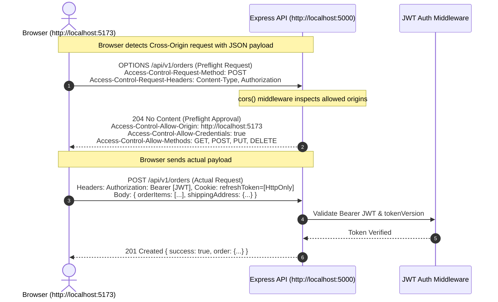

# CHAPTER 08: REST API & HTTP PROTOCOL FUNDAMENTALS

> **Focus:** REST architectural constraints, HTTP Methods, HTTP Status Codes, Idempotency & Safety, Statelessness, CORS preflight mechanisms, and API design standards.  
> **Source Files Referenced:** `backend/src/routes/productRoutes.js`, `backend/src/controllers/productController.js`, `backend/src/routes/orderRoutes.js`, `backend/src/app.js`.

---

## 1. Core Definitions (English)

- **REST (Representational State Transfer):** An architectural style for distributed hypermedia systems defined by Roy Fielding in 2000, governed by six core constraints: Client-Server separation, Statelessness, Cacheability, Uniform Interface, Layered System, and optional Code-on-Demand.
- **Statelessness:** The architectural constraint requiring that each client request contains all necessary context and credentials for the server to process it; the server never stores client session state between requests.
- **Idempotent HTTP Method:** An HTTP method where making multiple identical requests has the exact same side-effect on the server as making a single request (e.g. `GET`, `PUT`, `DELETE`, `HEAD`, `OPTIONS`).
- **Safe HTTP Method:** An HTTP method that does not modify server resource state—it is strictly read-only (e.g. `GET`, `HEAD`, `OPTIONS`).
- **CORS Preflight (`OPTIONS`):** An automatic browser HTTP request sent prior to cross-origin "non-simple" requests (e.g., requests with `Content-Type: application/json` or custom headers) to verify server permissions.

---

## 2. Concept Explanations (Hinglish with Real-Life Metaphors)

### REST Statelessness
> **Concept:** Server ko pichle request ka koi memory ya session yaad nahi rakhna hota.  
> **Real-Life Analogy (Hospital Token System vs Personal Family Doctor):**  
> - **Stateful:** Tumhara bachpan ka family doctor. Tum jate ho, woh tumhara chehra dekh kar bolta hai *"Arey Rahul, pichle hafte wali dawai kaam aayi kya?"* Doctor ke dimaag mein tumhara session saved hai. Lekin agar doctor badal gaya, toh system fail!  
> - **Stateless (REST):** Ek bada AIIMS Hospital! Har baar naya token lena padta hai aur file mein sari purani reports, blood test aur prescriptions (JWT Token, Headers, Request Body) saath le jaani padti hain. Chahe Counter 1 par doctor ho ya Counter 10 par, file dekh kar koi bhi doctor turant illaj kar sakta hai. Isse hospital lakho mareezo (Scalability) ko handle kar sakta hai!

---

### Idempotency
> **Real-Life Analogy (Lift ka Button vs ATM Cash Withdrawal):**  
> - **Idempotent (`PUT` / `DELETE` / `GET`):** Lift (Elevator) ka button! Tum 5th floor ka button 1 baar dabao ya gusse mein 20 baar dabao, lift 5th floor par hi aayegi (Same server state).  
> - **Non-Idempotent (`POST`):** ATM se paise nikalna! Agar tumne "Withdraw \$500" ka button 3 baar daba diya, toh tumhare account se \$1500 kat jayenge (Har request naya effect create karti hai)!

---

## 3. How It Works Internally: CORS Preflight & Request Execution



---

## 4. Project Implementation & Code Snippets

### A. RESTful Product Catalog Controller: `productController.js`
In `backend/src/controllers/productController.js`, we adhere strictly to REST conventions, supporting filtering, sorting, field selection, and pagination:

```javascript
// File: backend/src/controllers/productController.js (REST Query Parsing)
const Product = require('../models/Product');
const { catchAsync } = require('../middlewares/errorHandler');

exports.getAllProducts = catchAsync(async (req, res) => {
  // 1. Filtering: Copy query parameters and exclude pagination keys
  const queryObj = { ...req.query };
  const excludedFields = ['page', 'sort', 'limit', 'fields', 'search'];
  excludedFields.forEach((el) => delete queryObj[el]);

  // Support price filtering: { price: { $gte: 500 } }
  let queryStr = JSON.stringify(queryObj);
  queryStr = queryStr.replace(/\b(gte|gt|lte|lt)\b/g, (match) => `$${match}`);
  let query = Product.find(JSON.parse(queryStr));

  // Search by keyword in title/description
  if (req.query.search) {
    query = query.find({
      $or: [
        { title: { $regex: req.query.search, $options: 'i' } },
        { description: { $regex: req.query.search, $options: 'i' } }
      ]
    });
  }

  // 2. Sorting (e.g. ?sort=-price,rating)
  if (req.query.sort) {
    const sortBy = req.query.sort.split(',').join(' ');
    query = query.sort(sortBy);
  } else {
    query = query.sort('-createdAt'); // Default sort: newest first
  }

  // 3. Field Limiting (e.g. ?fields=title,price,category)
  if (req.query.fields) {
    const fields = req.query.fields.split(',').join(' ');
    query = query.select(fields);
  } else {
    query = query.select('-__v'); // Exclude Mongoose internal version
  }

  // 4. Pagination (e.g. ?page=2&limit=10)
  const page = parseInt(req.query.page, 10) || 1;
  const limit = parseInt(req.query.limit, 10) || 12;
  const skip = (page - 1) * limit;

  query = query.skip(skip).limit(limit);

  // Execute query and total count for metadata
  const [products, totalProducts] = await Promise.all([
    query.lean(),
    Product.countDocuments(JSON.parse(queryStr))
  ]);

  // Consistent REST Response Envelope
  res.status(200).json({
    success: true,
    results: products.length,
    totalProducts,
    totalPages: Math.ceil(totalProducts / limit),
    currentPage: page,
    products
  });
});
```

---

### B. REST Resource Route Mapping: `productRoutes.js`
In `backend/src/routes/productRoutes.js`, we use standard RESTful path conventions where nouns represent resources and HTTP verbs dictate actions:

```javascript
// File: backend/src/routes/productRoutes.js
const express = require('express');
const router = express.Router();
const productController = require('../controllers/productController');
const { protect, authorize } = require('../middlewares/auth');

router
  .route('/')
  .get(productController.getAllProducts)                           // GET /api/v1/products (List)
  .post(protect, authorize('admin'), productController.createProduct); // POST /api/v1/products (Create)

router
  .route('/:id')
  .get(productController.getProductById)                          // GET /api/v1/products/:id (Read)
  .put(protect, authorize('admin'), productController.updateProduct)  // PUT /api/v1/products/:id (Replace/Update)
  .delete(protect, authorize('admin'), productController.deleteProduct); // DELETE /api/v1/products/:id (Remove)

router
  .route('/:id/reviews')
  .post(protect, productController.addProductReview);             // POST /api/v1/products/:id/reviews (Sub-resource)

module.exports = router;
```

---

## 5. Spoken Interview Answers

### Short Answer (30 Seconds)
> *"REST is an architectural pattern for web services that relies on the stateless, standard conventions of the HTTP protocol. In our project, resources are modeled as nouns—such as `/products` and `/orders`—and manipulated using standard HTTP verbs: `GET` to retrieve, `POST` to create, `PUT` or `PATCH` to update, and `DELETE` to remove. We enforce statelessness by transmitting authentication via self-contained JWT tokens, communicate across domains via CORS preflight validation, and return standard HTTP status codes like 200, 201, 400, 401, 403, and 404."*

---

### Detailed Answer (90 Seconds)
> *"When designing the API architecture for E-Shop, we strictly adhered to Fielding's REST constraints and HTTP/1.1 specifications.  
>  
> First, our API adheres to complete **Statelessness**. The Node.js server preserves zero client session state in memory. Every request carries its own authorization context—either via a Bearer JWT in the `Authorization` header or an HttpOnly cookie. This allows our backend to scale horizontally across multiple instances or containers without needing sticky sessions or synchronized session stores.  
>  
> Second, we follow clean **Resource-Oriented URI design**. We never embed verbs in endpoints (such as `/api/getProducts` or `/api/deleteProduct`). Instead, we use plural nouns (`/api/v1/products`) and let standard HTTP verbs dictate the operation. Sub-resources follow hierarchical paths; for example, adding a review to a product is mapped to `POST /api/v1/products/:id/reviews`.  
>  
> Third, we respect **Idempotency and Safety**. Our catalog retrieval endpoints (`GET`) are strictly safe—they never mutate database records. Resource deletions (`DELETE`) and full updates (`PUT`) are idempotent; sending the same delete request five times produces the same end state (the item is removed). In contrast, order creation (`POST /api/v1/orders`) is non-idempotent because each submission creates a distinct transaction and decrements stock.  
>  
> Finally, we enforce a consistent **JSON Response Envelope** across the entire API containing `success`, `message`, `data`, and pagination metadata (`page`, `totalPages`, `totalProducts`), making client-side consumption predictable for TanStack React Query."*

---

## 6. Interview Questions & Model Answers

### Level 1: Basic
**Question:** What is the difference between `PUT` and `PATCH`?  
**Interview Answer (English):**  
*"`PUT` is designed to completely replace an existing resource with the payload sent in the request body. If any optional fields are omitted from the payload, they should be cleared or reset to defaults. `PATCH`, on the other hand, performs a partial update, modifying only the specific fields provided in the payload while leaving all other fields intact."*

---

### Level 2: Intermediate
**Question:** What is the difference between `401 Unauthorized` and `403 Forbidden`?  
**Interview Answer (English):**  
*"The difference comes down to authentication versus authorization:  
- **`401 Unauthorized`:** The user has not provided valid authentication credentials (e.g., token missing, expired, or malformed). The user is unauthenticated.  
- **`403 Forbidden`:** The server knows who the user is (they are authenticated), but that user does not have permission to access the requested resource. For example, in our platform, if a logged-in customer attempts to call `GET /api/v1/admin/users`, our `authorize('admin')` middleware returns a `403 Forbidden` because their role is `'user'`."*

---

### Level 3: Advanced
**Question:** Why do browsers send an `OPTIONS` request before certain API calls, and when is an `OPTIONS` request skipped?  
**Interview Answer (English):**  
*"Browsers send an `OPTIONS` request as a CORS Preflight security check to verify whether the cross-origin server permits the upcoming request.  
The browser skips the preflight and sends a 'Simple Request' ONLY if all three conditions are met:  
1. The HTTP method is `GET`, `POST`, or `HEAD`.  
2. The request only uses standard headers (`Accept`, `Accept-Language`, `Content-Language`, or `Content-Type`).  
3. The `Content-Type` is strictly `application/x-www-form-urlencoded`, `multipart/form-data`, or `text/plain`.  
In our React SPA, because our requests send `Content-Type: application/json` and carry an `Authorization: Bearer <token>` header, the browser ALWAYS sends an `OPTIONS` preflight first."*

---

### Level 4: Project-Specific Cross-Examination
**Interviewer:** *"If an admin tries to delete a product that has already been deleted, what status code should your API return: 200, 204, or 404? And why is `DELETE` considered idempotent if the status codes might differ?"*  
**Spoken Defense (English):**  
*"In our API (`productController.js`), deleting a product returns `200 OK` (with `{ success: true, message: 'Product deleted' }`) or `204 No Content` on the first call. If the request is repeated, the controller finds no matching document and returns `404 Not Found`.  
However, returning 404 on subsequent calls does NOT violate idempotency!  
In RFC specifications, **Idempotency is measured by the state of the server resource, not the HTTP response code.**  
After the first `DELETE`, the product is absent from the database. After the second, third, and tenth `DELETE`, the product is still absent from the database. The side-effect on the system state is identical, making the operation strictly idempotent."*

---

## 7. Comparative Technical Matrix: HTTP Status Codes

| Code | Standard Reason Phrase | Project Usage in E-Shop |
| :---: | :--- | :--- |
| **`200`** | OK | Successful `GET` catalog list, `PUT` product updates, user login |
| **`201`** | Created | Successful `POST /api/v1/orders` or `POST /api/v1/auth/register` |
| **`204`** | No Content | Successful deletion when no response body is returned |
| **`400`** | Bad Request | Validation failures (e.g. invalid email format, insufficient stock) |
| **`401`** | Unauthorized | Missing or expired JWT access token |
| **`403`** | Forbidden | Role mismatch (e.g. regular user accessing `/api/v1/admin/*`) |
| **`404`** | Not Found | Resource ID does not exist in MongoDB |
| **`409`** | Conflict | Duplicate registration email (MongoDB E11000 duplicate key error) |
| **`429`** | Too Many Requests | Rate limit exceeded (more than 100 requests per 15 minutes) |
| **`500`** | Internal Server Error | Uncaught programming errors or database connection drops |

---

## 8. Common Interview Traps & Pitfalls

> [!WARNING]
> **Trap 1: Returning `200 OK` with `{ success: false, error: 'User not found' }`.**  
> *Reality:* This is the "200 OK Anti-Pattern". It breaks HTTP protocol contracts, confuses reverse proxies, prevents TanStack Query from recognizing errors automatically, and breaks CDN caching. Always return proper 4xx/5xx status codes.
>
> **Trap 2: Using verbs in endpoint URLs.**  
> *Reality:* Writing `/api/v1/products/create` or `/api/v1/orders/cancel` is an RPC (Remote Procedure Call) anti-pattern. Use standard REST conventions: `POST /api/v1/products` and `PATCH /api/v1/orders/:id` with `{ status: 'Cancelled' }`.
>
> **Trap 3: Believing `GET` requests can never have a body.**  
> *Reality:* Technically, the HTTP/1.1 specification does not forbid a body in `GET` requests, but it defines that `GET` has no defined semantics for a body. Many proxies, CDNs, and browsers discard the body entirely. Never design an API that expects a payload in a `GET` request.

---

## 9. Quick Revision Rapid-Fire (15 Q&As)

1. **What does REST stand for?** Representational State Transfer.
2. **Who created REST?** Roy Fielding in his 2000 doctoral dissertation.
3. **What is an idempotent method?** A method where multiple identical requests produce the same server state as a single request.
4. **List three idempotent HTTP methods.** `GET`, `PUT`, `DELETE`.
5. **Is `POST` idempotent?** No, calling `POST` repeatedly creates multiple resources.
6. **What is a Safe HTTP method?** A read-only method that does not modify server state (`GET`, `HEAD`, `OPTIONS`).
7. **What is the difference between `401` and `403`?** 401 is Unauthenticated; 403 is Unauthorized (Authenticated, but lacking permissions).
8. **What header indicates the data format sent in the request body?** `Content-Type: application/json`.
9. **What header indicates what data format the client expects in response?** `Accept: application/json`.
10. **What is HTTP Keep-Alive?** Reusing a single underlying TCP connection for multiple HTTP requests to reduce TLS handshake overhead.
11. **What is the purpose of HTTP `HEAD`?** Identical to `GET`, but retrieves only headers without downloading the response body.
12. **What status code represents Rate Limiting?** `429 Too Many Requests`.
13. **What status code represents an unsupported HTTP verb?** `405 Method Not Allowed`.
14. **Why do we use URI versioning (`/api/v1/`)?** To introduce breaking API changes in `/api/v2/` without breaking existing mobile or third-party clients.
15. **What is the CORS header allowing credentialed requests?** `Access-Control-Allow-Credentials: true`.

