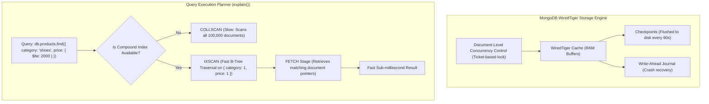

# CHAPTER 09: MONGODB & MONGOOSE 7.8 COMPLETE GUIDE

> **Focus:** MongoDB document architecture, BSON format, WiredTiger engine, Mongoose 7.8 schemas & models, Compound & TTL Indexes, Aggregation pipelines, Atomic operations (`$inc`), and ACID Transactions.  
> **Source Files Referenced:** `backend/src/models/User.js`, `backend/src/models/Product.js`, `backend/src/models/Order.js`, `backend/src/models/Otp.js`, `backend/src/controllers/adminController.js`, `backend/src/controllers/orderController.js`.

---

## 1. Core Definitions (English)

- **MongoDB:** A source-available, cross-platform, document-oriented NoSQL database that stores data in flexible, binary JSON-like documents called BSON, running on the high-concurrency WiredTiger storage engine.
- **Mongoose 7.8:** An Object Data Modeling (ODM) library for MongoDB and Node.js that manages relationships between data, provides schema validation, translates between code objects and database representations, and implements lifecycle middleware hooks.
- **Database Index:** A specialized data structure (typically a balanced B-Tree) that stores a small portion of the collection's data set in an easily traversable form, allowing queries to locate documents in $O(\log n)$ time rather than performing a full collection scan ($O(n)$).
- **Aggregation Pipeline:** A framework for data transformation and statistical computation modeled on the concept of data processing pipelines, where documents enter a multi-stage pipeline that transforms them into aggregated results.
- **Atomic Operation:** An indivisible, irreducible operation that executes completely or fails completely; in MongoDB, write operations on a single document are always atomic at the hardware and storage engine level.

---

## 2. Concept Explanations (Hinglish with Real-Life Metaphors)

### SQL vs. NoSQL
> **Real-Life Analogy (Rigid Excel Grid vs Multi-Pocket File Folder):**  
> - **SQL (Relational):** Ek bohot strict, fixed Excel sheet! Har column pehle se locked hai. Agar tum shoes, mobile aur grocery ek hi table mein rakhna chaho, toh shoes ke liye "Battery Capacity" ka column khali chhodna padega aur mobile ke liye "Shoe Size" khali chhodna padega (Sparse columns & rigid migration pain).  
> - **NoSQL (MongoDB):** Ek multi-pocket plastic folder! Har product ka apna alag document (BSON) hai. Shoes ke document mein `{ size: 9, color: 'blue' }` ho sakta hai, aur phone ke document mein `{ ram: '8GB', battery: '5000mAh' }`. Dono bina kisi schema conflict ke ek hi collection mein shaanti se reh sakte hain!

---

### Database Indexing: `COLLSCAN` vs. `IXSCAN`
> **Real-Life Analogy (Library Book Search):**  
> Socho tumhe 10,000 kitabon wali library mein *"Introduction to Algorithms"* dhoondhni hai:  
> - **Collection Scan (`COLLSCAN`):** Tum Pehli kitab uthate ho, title padhte ho. Dusri uthate ho... 10,000 kitabein ek-ek karke check karte ho! Library mein 5 ghante lag jayenge (CPU 100% and massive disk read).  
> - **Index Scan (`IXSCAN`):** Library ke reception par ek alphabetical card index rack (B-Tree Index) rakha hai. Tum direct "I" section mein jaate ho, card number dekhte ho, aur seedha Shelf 4, Row B se kitab nikaal lete ho in 5 seconds!

---

### Atomic Stock Update vs Read-Modify-Write Race Condition
> **Real-Life Analogy (Bus Seat Booking):**  
> Socho bus mein sirf 1 last seat bachi hai:  
> - **Wrong Way (In-Memory Read-Modify-Write):** User A conductor ko bolta hai *"Seat hai kya?"* Conductor bolta hai *"Haan 1 bachi hai"*. User B bhi bolta hai *"Seat hai kya?"* Conductor User B ko bhi bolta hai *"Haan 1 bachi hai"*. Dono paisa dete hain aur conductor dono ko ticket de deta hai! Bus mein ladayi shuru (Negative inventory / Overselling)!  
> - **Atomic Way (`$inc: { stock: -1 }` with `{ stock: { $gte: 1 } }`):** Conductor ticket machine ka ek single switch dabata hai jo hardware level par lock hota hai. Machine pehle transaction ko ticket nikal deti hai aur counter turant 0 kar deti hai. Dusre bande ke switch dabate hi machine seedha "BEEP - Sold Out" bol deti hai!

---

## 3. How It Works Internally: WiredTiger & B-Tree Indexing



### `.lean()` Internal Mechanics:
When executing `User.find()`, Mongoose wraps raw BSON data inside a heavy JavaScript `MongooseDocument` instance with getters, setters, dirty state tracking, and schema validation methods.  
When executing `User.find().lean()`, Mongoose skips document hydration entirely and returns a **Plain Old JavaScript Object (POJO)**. This delivers:
- **5x faster query execution**.
- **70% lower memory allocation**.
- Ideal for read-heavy operations like our batch ML feature aggregation and catalog browsing.

---

## 4. Project Implementation & Code Snippets

### A. Pre-Save Middleware & Token Revocation: `backend/src/models/User.js`
In `backend/src/models/User.js`, we hash passwords before saving and track `tokenVersion` for global session invalidation:

```javascript
// File: backend/src/models/User.js (Excerpt)
const mongoose = require('mongoose');
const bcrypt = require('bcryptjs');

const userSchema = new mongoose.Schema(
  {
    name: { type: String, required: [true, 'Please provide a name'], trim: true },
    email: {
      type: String,
      required: [true, 'Please provide an email'],
      unique: true,
      lowercase: true,
      index: true // Single-field B-Tree index
    },
    password: {
      type: String,
      required: [true, 'Please provide a password'],
      minlength: 6,
      select: false // Excluded from query results by default
    },
    role: {
      type: String,
      enum: ['user', 'admin'],
      default: 'user'
    },
    isActive: { type: Boolean, default: true },
    tokenVersion: { type: Number, default: 0 } // Incremented to invalidate all active JWTs
  },
  { timestamps: true }
);

// Mongoose Pre-Save Hook (MUST use standard function for lexical `this`)
userSchema.pre('save', async function (next) {
  // Only hash password if it was modified (or is new)
  if (!this.isModified('password')) return next();

  const salt = await bcrypt.genSalt(12);
  this.password = await bcrypt.hash(this.password, salt);
  next();
});

// Compare password helper method
userSchema.methods.matchPassword = async function (enteredPassword) {
  return await bcrypt.compare(enteredPassword, this.password);
};

module.exports = mongoose.model('User', userSchema);
```

---

### B. Compound Indexing & Catalog Search: `backend/src/models/Product.js`
In `backend/src/models/Product.js`, compound and text indexes optimize multi-field search and category filtering:

```javascript
// File: backend/src/models/Product.js (Indexing excerpt)
const mongoose = require('mongoose');

const productSchema = new mongoose.Schema(
  {
    title: { type: String, required: true, trim: true },
    description: { type: String, required: true },
    price: { type: Number, required: true, min: 0 },
    discountPercentage: { type: Number, default: 0 },
    category: { type: String, required: true, lowercase: true },
    stock: { type: Number, required: true, min: 0, index: true },
    rating: { type: Number, default: 0, min: 0, max: 5 },
    numReviews: { type: Number, default: 0 }
  },
  { timestamps: true }
);

// 1. Compound Index: Optimizes queries filtering by category AND sorting by price
productSchema.index({ category: 1, price: 1 });

// 2. Text Index: Enables full-text search across title and description
productSchema.index({ title: 'text', description: 'text' });

module.exports = mongoose.model('Product', productSchema);
```

---

### C. Self-Expiring Data with TTL Indexes: `backend/src/models/Otp.js`
In `backend/src/models/Otp.js`, we use MongoDB's Time-To-Live (TTL) index to automatically purge one-time passwords after 5 minutes:

```javascript
// File: backend/src/models/Otp.js
const mongoose = require('mongoose');

const otpSchema = new mongoose.Schema({
  email: { type: String, required: true, lowercase: true },
  otp: { type: String, required: true },
  createdAt: {
    type: Date,
    default: Date.now,
    // TTL Index: MongoDB background thread automatically purges document after 300s (5 mins)
    expires: 300
  }
});

module.exports = mongoose.model('Otp', otpSchema);
```

---

### D. Single Batch Aggregation Pipeline (Solving N+1): `adminController.js`
In `backend/src/controllers/adminController.js`, rather than executing 50 individual queries to calculate user purchase stats, we use a single aggregation query:

```javascript
// File: backend/src/controllers/adminController.js (Aggregation Pipeline)
const allOrderStats = await Order.aggregate([
  // Stage 1: Filter orders belonging to the 50 users
  { $match: { user: { $in: userIds } } },

  // Stage 2: Group by user and compute aggregate statistics
  {
    $group: {
      _id: '$user',
      totalOrders: { $sum: 1 },
      totalSpent: { $sum: { $ifNull: ['$totalPrice', '$total', 0] } },
      lastOrderDate: { $max: '$createdAt' }
    }
  }
]);
```

---

### E. Atomic Concurrency Control & Transactions: `orderController.js`
In `backend/src/controllers/orderController.js`, inventory is decremented atomically inside a Mongoose transaction session:

```javascript
// File: backend/src/controllers/orderController.js (Atomic Inventory Decrement)
const session = await mongoose.startSession();
session.startTransaction();

try {
  for (const item of orderItems) {
    // Hardware-level atomic update: Check stock >= requested quantity AND decrement in one operation
    const updatedProduct = await Product.findOneAndUpdate(
      { _id: item.product, stock: { $gte: item.quantity } },
      { $inc: { stock: -item.quantity } },
      { new: true, session }
    );

    if (!updatedProduct) {
      throw new AppError(`Item "${item.title}" is out of stock!`, 400);
    }
  }

  // Create order within transaction
  const order = await Order.create([orderData], { session });

  await session.commitTransaction();
  session.endSession();
} catch (error) {
  await session.abortTransaction();
  session.endSession();
  throw error;
}
```

---

## 5. Spoken Interview Answers

### Short Answer (30 Seconds)
> *"We use MongoDB Atlas with Mongoose 7.8 as our database tier. MongoDB stores data as BSON documents on the WiredTiger storage engine, which provides document-level concurrency control. We leverage single, compound, and TTL indexes for sub-millisecond lookups, execute aggregation pipelines to compute statistical metrics in a single query, and enforce data integrity using Mongoose replica set transactions and atomic `$inc` operators to eliminate race conditions during inventory updates."*

---

### Detailed Answer (90 Seconds)
> *"Database architecture was one of the most critical aspects of our E-Shop platform, given the concurrent nature of e-commerce checkout.  
>  
> We chose MongoDB over traditional relational databases for catalog flexibility. Products have diverse attributes—electronics have technical specifications, clothing has sizing—which fit naturally into MongoDB's schema-flexible BSON format without requiring sparse relational columns or complex table joins.  
>  
> To guarantee high-throughput read performance, we designed intentional indexes. For our catalog, we created a compound index on `{ category: 1, price: 1 }` so users can filter by category and sort by price using a single index scan (`IXSCAN`). In our authentication flow, we implemented an `Otp` schema with a Time-To-Live index that instructs MongoDB's internal background thread to automatically purge expired OTPs after 300 seconds, eliminating manual cleanup jobs.  
>  
> To eliminate the N+1 database query problem in our admin analytics and churn prediction endpoints, we avoid querying orders inside a `users.map()` loop. Instead, we run a single aggregation pipeline using `$match` and `$group` across all 50 user IDs, grouping stats like `totalSpent` and `lastOrderDate` in one round-trip.  
>  
> Finally, we solve race conditions using atomic operations. During checkout, we never read stock into Node memory, calculate `stock - quantity`, and call `.save()`. Instead, we issue an atomic `findOneAndUpdate` with `{ stock: { $gte: quantity } }` and `$inc: { stock: -quantity }` inside a Mongoose transaction session. Because MongoDB document modifications are atomic, simultaneous checkouts on limited inventory cannot cause overselling."*

---

## 6. Interview Questions & Model Answers

### Level 1: Basic
**Question:** What is the difference between BSON and JSON?  
**Interview Answer (English):**  
*"JSON is a human-readable, text-based data format that supports basic types: strings, numbers, booleans, arrays, and objects.  
BSON (Binary JSON) is a binary-encoded serialization format used internally by MongoDB. BSON extends JSON by adding data types essential for databases, including `ObjectId`, `Date`, `int32`, `int64`, and raw `Binary` data, allowing for faster traversal and lower storage footprint."*

---

### Level 2: Intermediate
**Question:** Why do we use `.lean()` in read-only Mongoose queries?  
**Interview Answer (English):**  
*"By default, Mongoose returns query results as full Mongoose Documents. These documents include internal methods (`.save()`, `.validate()`), getters, setters, and change tracking, which consumes significant CPU and memory.  
When we append `.lean()` to a query, Mongoose skips this hydration step and returns plain JavaScript objects. This executes up to 5 times faster and consumes up to 70% less memory, making it ideal for our catalog browsing, analytics aggregations, and ML batch preprocessing."*

---

### Level 3: Advanced
**Question:** Explain the difference between Embedding (Denormalization) and Referencing (Normalization) in MongoDB schema design. How did you decide between them in E-Shop?  
**Interview Answer (English):**  
*"In MongoDB schema design:  
- **Embedding (Denormalization):** Storing related data as subdocuments inside a single document. Pros: Fast single-document atomic reads with zero joins. Cons: Document size can approach the 16MB limit, and data duplication occurs if updated frequently.  
- **Referencing (Normalization):** Storing ObjectIDs pointing to documents in another collection, resolved via Mongoose `.populate()` or aggregation `$lookup`. Pros: Normalized, clean updates. Cons: Requires additional query lookups.  
In our project:  
1. **Embedding:** In `Order.js`, we embed line items (`orderItems`) and the shipping snapshot. Once an order is placed, the product price, title, and address at that exact moment must never change, even if the main product catalog updates later. Embedding guarantees historical immutability.  
2. **Referencing:** In `Order.js`, the `user` field is a reference (`ref: 'User'`). User credentials and profiles update frequently, so referencing prevents stale duplicate records."*

---

### Level 4: Project-Specific Cross-Examination
**Interviewer:** *"You mentioned using Mongoose transactions (`session.startTransaction()`). Do transactions work on a standalone local MongoDB instance? What infrastructure does MongoDB require for transactions?"*  
**Spoken Defense (English):**  
*"That is a classic operational catch. Multi-document ACID transactions in MongoDB REQUIRE a **Replica Set**; they do not work on a standalone local MongoDB instance.  
This is because MongoDB transactions rely on the replication Oplog (Operations Log) to track, coordinate, and rollback multi-document state changes across the WiredTiger storage engine.  
In our production deployment on MongoDB Atlas, replica sets (3-node minimum) are enabled by default. During local development, developers must either run MongoDB configured as a single-node replica set (`mongod --replSet rs0`) or mock sessions in test environments using tools like `mongodb-memory-server` which supports replica set simulation."*

---

## 7. Comparative Technical Matrix

| Dimension | MongoDB (NoSQL) | PostgreSQL (Relational SQL) |
| :--- | :--- | :--- |
| **Data Model** | Hierarchical BSON Documents | Relational Tables (Rows & Columns) |
| **Schema** | Dynamic / Schema-flexible | Strict, pre-defined DDL Schemas |
| **Scaling** | Native horizontal sharding | Primarily vertical scaling (read replicas) |
| **Concurrency Lock**| Document-level (WiredTiger) | Row-level locking |
| **Complex Joins** | `$lookup` (Performance penalty) | Optimized ANSI SQL JOINs |
| **Why E-Shop Chose It**| Dynamic e-commerce catalogs, rapid prototyping, JSON alignment |

---

## 8. Common Interview Traps & Pitfalls

> [!WARNING]
> **Trap 1: The 16MB Document Limit.**  
> *Reality:* A single BSON document in MongoDB cannot exceed 16 megabytes. Never design an unbounded embedded array (e.g. storing an unlimited number of product reviews or activity logs inside a single product document). In our project, if reviews grow indefinitely, we would separate them into a distinct `Review` collection referenced by product ID.
>
> **Trap 2: Creating too many indexes.**  
> *Reality:* Indexes accelerate read operations (`find`), but they slow down write operations (`insert`, `update`, `delete`) because every index B-Tree must be updated on every write. Only index fields used in frequent `$match`, `$sort`, and `$group` operations.
>
> **Trap 3: Forgetting `unique: true` does not validate in Mongoose if the index isn't built.**  
> *Reality:* Setting `unique: true` in a Mongoose schema is an index directive, not an in-memory Mongoose validation rule. If the database index does not exist in MongoDB, duplicate records will still be inserted without error!

---

## 9. Quick Revision Rapid-Fire (15 Q&As)

1. **What is BSON?** Binary JSON—the binary serialization format used by MongoDB to store documents.
2. **What is the default storage engine of MongoDB?** WiredTiger.
3. **What is the maximum size of a single MongoDB document?** 16 MB.
4. **What is a compound index?** An index containing references to multiple fields within a collection (e.g. `{ category: 1, price: -1 }`).
5. **What is a TTL index?** A Time-To-Live index that automatically deletes documents after a specified time interval.
6. **What is the difference between `$set` and `$inc`?** `$set` replaces or assigns a value; `$inc` increments or decrements a numeric field atomically.
7. **What is the purpose of Mongoose `.populate()`?** Replaces specified ObjectIDs in a document with the actual documents from another collection (similar to a SQL join).
8. **What does `.lean()` do?** Skips Mongoose document instantiation and returns plain JavaScript objects for faster reads.
9. **What is the N+1 query problem?** Executing 1 query to fetch parent records, followed by N separate queries to fetch related child records for each parent.
10. **How do you avoid N+1 queries in MongoDB?** By using aggregation pipelines with `$match` and `$group` or querying with `$in`.
11. **What is the command to inspect query performance in MongoDB?** `.explain('executionStats')`.
12. **What does `COLLSCAN` mean in an execution plan?** A full collection scan (no index was used).
13. **What does `IXSCAN` mean in an execution plan?** An index scan (a B-Tree index was successfully used).
14. **What are Mongoose middleware types?** Document middleware, Model middleware, Aggregate middleware, and Query middleware.
15. **What is the primary key field in MongoDB documents?** `_id` (a 12-byte BSON ObjectId containing timestamp, machine ID, process ID, and counter).

