# CHAPTER 10: AUTHENTICATION, AUTHORIZATION & WEB SECURITY

> **Focus:** JWT anatomy, Dual-token lifecycle (Access + Refresh), Global token invalidation (`tokenVersion`), Role-Based Access Control (RBAC), Cryptographic Razorpay HMAC verification, and Defense-in-Depth web security (CORS, CSRF, XSS, NoSQL Injection, HPP).  
> **Source Files Referenced:** `backend/src/controllers/authController.js`, `backend/src/middlewares/auth.js`, `backend/src/models/User.js`, `backend/src/services/paymentService.js`, `backend/src/app.js`.

---

## 1. Core Definitions (English)

- **JSON Web Token (JWT):** An open industry standard (RFC 7519) for representing claims securely between two parties, consisting of three Base64URL-encoded parts separated by dots: **Header**, **Payload**, and **Cryptographic Signature**.
- **Access Token:** A short-lived credential (e.g. 15 minutes) kept in client application memory used to authenticate requests to protected API resources.
- **Refresh Token:** A long-lived credential (e.g. 7 days) stored in a secure, `HttpOnly`, `SameSite` cookie used exclusively to obtain new access tokens when the active access token expires.
- **Token Invalidation (`tokenVersion`):** An architectural mechanism where a numeric version counter stored in the database record is embedded inside the JWT payload; incrementing the counter immediately invalidates all active tokens issued prior to the increment.
- **Role-Based Access Control (RBAC):** An authorization mechanism that restricts system access to authorized users based on predefined roles (e.g., `'user'`, `'admin'`).
- **HMAC (Hash-based Message Authentication Code):** A cryptographic construction that uses a shared secret key and a cryptographic hash function (e.g. SHA-256) to verify both the data integrity and authenticity of a message.

---

## 2. Concept Explanations (Hinglish with Real-Life Metaphors)

### Access Token vs. Refresh Token
> **Concept:** Access token ko chhota (15 mins) aur refresh token ko lamba (7 days) kyu rakhte hain?  
> **Real-Life Analogy (Amusement Park Wristband vs VIP Season Pass):**  
> - **Access Token (Paper Wristband):** Amusement park mein ride par baithne ke liye tumhe ek paper wristband milta hai jo 15 minute baad expire ho jata hai. Agar koi chor tumhara wristband chura bhi le, toh 15 minute baad woh kachra ban jayega (Damage is strictly limited).  
> - **Refresh Token (Locker mein rakha Plastic VIP Card):** Tumhara VIP membership card safe locker (HttpOnly Cookie) mein band rehta hai. Jab wristband expire hota hai, tum locker se card nikal kar counter ko dikhate ho aur naya wristband le lete ho. Chor locker nahi tod sakta kyunki browser JavaScript ko HttpOnly cookie padhne ki permission hi nahi deta!

---

### Global Token Invalidation via `tokenVersion`
> **Concept:** Stateless JWT ka sabse bada disadvantage yeh hota hai ki ek baar token sign ho gaya, toh server usko expire hone se pehle delete nahi kar sakta. Toh agar user ka phone chori ho gaya ya password reset hua, toh purana token kaise rokein?  
> **Real-Life Analogy (Hotel Keycard Reprogramming):**  
> Socho hotel ka room keycard (JWT). Keycard par likha hai *"Room 302, Version 1"*. Darwaze ke lock par bhi code set hai *"Version 1"*.  
> Agar guest bolta hai *"Mera purse chori ho gaya!"*, toh manager seedha door lock ka version badal kar *"Version 2"* kar deta hai (`user.tokenVersion += 1`). Purana keycard lekar chor darwaze par aata hai, lock check karta hai: card par Version 1 hai lekin darwaze par Version 2 hai—**ACCESS DENIED!**

---

### Cryptographic HMAC Payment Verification
> **Real-Life Analogy (Raja ki Mohar / Wax Seal on Official Royal Letter):**  
> Razorpay ek payment receipt bhejta hai. Lekin kya pata kisi hacker ne beech mein request pakad kar `isPaid = true` modify kar diya ho?  
> Razorpay receipt par Raja ki Secret Seal (HMAC-SHA256 Signature using `RAZORPAY_KEY_SECRET`) laga kar bhejta hai. Hamara backend us secret key se receipt ko dobara encrypt karke check karta hai: agar seal match hui, tabhi order ko `Paid` mark kiya jaata hai!

---

## 3. How It Works Internally: JWT Signing & Verification

```mermaid
flowchart TD
    subgraph JWTCreation ["JWT Generation (authController.js)"]
        Header["Header: { alg: 'HS256', typ: 'JWT' }"]
        Payload["Payload: { id: user._id, role: user.role, tokenVersion: 0, exp: ... }"]
        Secret["Secret: process.env.JWT_SECRET"]
        
        B64Header["Base64Url(Header)"]
        B64Payload["Base64Url(Payload)"]
        Header --> B64Header
        Payload --> B64Payload
        
        Signature["HMACSHA256(B64Header + '.' + B64Payload, Secret)"]
        Secret --> Signature
        B64Header --> Signature
        B64Payload --> Signature
        
        FinalJWT["JWT Token: B64Header.B64Payload.Signature"]
        Signature --> FinalJWT
    end

    subgraph JWTVerification ["JWT Verification Pipeline (middlewares/auth.js)"]
        IncomingHeader["Incoming Request: Authorization: Bearer [JWT]"]
        Split["Extract Token & Verify Signature with Secret"]
        CheckExp{"Is Token Expired?"}
        DBLookup["User.findById(decoded.id)"]
        VersionCheck{"decoded.tokenVersion === user.tokenVersion?"}
        AllowReq["req.user = user; next();"]
        DenyReq["401 Unauthorized / Token Revoked"]

        IncomingHeader --> Split --> CheckExp
        CheckExp -- Expired --> DenyReq
        CheckExp -- Valid --> DBLookup --> VersionCheck
        VersionCheck -- Mismatch --> DenyReq
        VersionCheck -- Match --> AllowReq
    end
```



---

## 4. Project Implementation & Code Snippets

### A. Dual Token Issuance & Refresh: `backend/src/controllers/authController.js`
In `backend/src/controllers/authController.js`, access tokens are returned in the response body, while refresh tokens are set as secure HttpOnly cookies:

```javascript
// File: backend/src/controllers/authController.js (Token helpers excerpt)
const jwt = require('jsonwebtoken');

// 1. Generate short-lived Access Token (15m)
const generateAccessToken = (user) => {
  return jwt.sign(
    { id: user._id, role: user.role, tokenVersion: user.tokenVersion },
    process.env.JWT_ACCESS_SECRET,
    { expiresIn: '15m' }
  );
};

// 2. Generate long-lived Refresh Token (7d)
const generateRefreshToken = (user) => {
  return jwt.sign(
    { id: user._id, tokenVersion: user.tokenVersion },
    process.env.JWT_REFRESH_SECRET,
    { expiresIn: '7d' }
  );
};

// 3. Send tokens with secure cookie
const sendTokens = (user, statusCode, res) => {
  const accessToken = generateAccessToken(user);
  const refreshToken = generateRefreshToken(user);

  const cookieOptions = {
    expires: new Date(Date.now() + 7 * 24 * 60 * 60 * 1000), // 7 days
    httpOnly: true, // Inaccessible to client JavaScript (Anti-XSS)
    secure: process.env.NODE_ENV === 'production', // HTTPS only in prod
    sameSite: 'lax' // CSRF protection
  };

  res.cookie('refreshToken', refreshToken, cookieOptions);

  user.password = undefined; // Strip password from output

  res.status(statusCode).json({
    success: true,
    accessToken,
    user: {
      id: user._id,
      name: user.name,
      email: user.email,
      role: user.role
    }
  });
};
```

---

### B. Authentication & Token Invalidation Middleware: `backend/src/middlewares/auth.js`
In `backend/src/middlewares/auth.js`, we verify token integrity and validate the `tokenVersion` against the database:

```javascript
// File: backend/src/middlewares/auth.js
const jwt = require('jsonwebtoken');
const User = require('../models/User');
const { AppError, catchAsync } = require('./errorHandler');

exports.protect = catchAsync(async (req, res, next) => {
  let token;

  // 1. Extract Bearer token from Authorization header
  if (req.headers.authorization && req.headers.authorization.startsWith('Bearer')) {
    token = req.headers.authorization.split(' ')[1];
  }

  if (!token) {
    return next(new AppError('You are not logged in! Please log in to get access.', 401));
  }

  // 2. Cryptographic signature verification
  const decoded = jwt.verify(token, process.env.JWT_ACCESS_SECRET);

  // 3. Verify user still exists in database
  const currentUser = await User.findById(decoded.id);
  if (!currentUser || !currentUser.isActive) {
    return next(new AppError('The user belonging to this token no longer exists.', 401));
  }

  // 4. Token Invalidation Check: Did password change or session get revoked?
  if (decoded.tokenVersion !== currentUser.tokenVersion) {
    return next(new AppError('User credentials recently changed. Please log in again.', 401));
  }

  // Grant access: attach user to request object
  req.user = currentUser;
  next();
});

// Role-Based Access Control (RBAC) Gate
exports.authorize = (...roles) => {
  return (req, res, next) => {
    if (!roles.includes(req.user.role)) {
      return next(
        new AppError('You do not have permission to perform this action', 403)
      );
    }
    next();
  };
};
```

---

### C. Password Reset & Instant Session Revocation: `backend/src/controllers/authController.js`
When a user resets their password or logs out of all devices, we atomically increment `tokenVersion`:

```javascript
// File: backend/src/controllers/authController.js (Session Revocation snippet)
exports.logoutAllDevices = catchAsync(async (req, res, next) => {
  // Atomically increment tokenVersion in database
  await User.findByIdAndUpdate(req.user._id, { $inc: { tokenVersion: 1 } });

  // Clear client-side refresh cookie
  res.clearCookie('refreshToken');

  res.status(200).json({
    success: true,
    message: 'Successfully logged out of all active devices.'
  });
});
```

---

### D. Cryptographic HMAC Payment Signature Verification: `paymentService.js`
In `backend/src/services/paymentService.js`, orders are marked as paid ONLY after HMAC-SHA256 validation:

```javascript
// File: backend/src/services/paymentService.js
const crypto = require('crypto');
const AppError = require('../utils/AppError');

exports.verifyRazorpayPayment = (razorpay_order_id, razorpay_payment_id, razorpay_signature) => {
  // 1. Construct raw payload as per Razorpay protocol: "order_id|payment_id"
  const payload = `${razorpay_order_id}|${razorpay_payment_id}`;

  // 2. Compute expected HMAC-SHA256 signature using secret key
  const expectedSignature = crypto
    .createHmac('sha256', process.env.RAZORPAY_KEY_SECRET)
    .update(payload.toString())
    .digest('hex');

  // 3. Timing-safe comparison to prevent timing attacks
  const isMatch = crypto.timingSafeEqual(
    Buffer.from(expectedSignature),
    Buffer.from(razorpay_signature)
  );

  if (!isMatch) {
    throw new AppError('Payment verification failed! Invalid cryptographic signature.', 400);
  }

  return true;
};
```

---

## 5. Spoken Interview Answers

### Short Answer (30 Seconds)
> *"Our project implements a stateless authentication architecture using JSON Web Tokens combined with an HttpOnly cookie refresh strategy. We issue a 15-minute access token for API authorization and a 7-day refresh token stored in a secure cookie. To solve the classic inability to revoke stateless JWTs, we engineered a `tokenVersion` counter in MongoDB. If a user resets their password, `tokenVersion` increments, immediately invalidating all active access tokens. For authorization, we use Role-Based Access Control, and all payment transactions are validated using timing-safe HMAC-SHA256 cryptographic signatures."*

---

### Detailed Answer (90 Seconds)
> *"Security in E-Shop is designed around defense-in-depth across the entire network and application layer.  
>  
> For user authentication, we completely rejected the risky practice of storing JWTs in browser `localStorage`, which leaves them vulnerable to theft via Cross-Site Scripting (XSS). Instead, our architecture uses a dual-token system: a short-lived 15-minute access token held in React client memory, and a long-lived 7-day refresh token stored in an `HttpOnly`, `SameSite: 'lax'` cookie. Because the cookie is marked `HttpOnly`, malicious scripts injected into the browser cannot read it. When the access token expires, our Axios client interceptor transparently calls `/auth/refresh-token` to rotate tokens without disrupting the user session.  
>  
> A fundamental challenge with stateless JWTs is immediate revocation. If a user's account is compromised, a standard JWT remains valid until its expiration timestamp. We solved this by embedding a `tokenVersion` integer in the JWT payload. In `middlewares/auth.js`, every protected route verifies that `decoded.tokenVersion === user.tokenVersion`. If a user logs out of all devices or changes their password, we run an atomic `$inc: { tokenVersion: 1 }` in MongoDB. All existing JWTs across all active devices are invalidated instantly.  
>  
> Finally, for payment integrity, we never trust client-side checkout status. In `paymentService.js`, when Razorpay returns a payment callback, we recompute an HMAC-SHA256 hash using our private server secret and compare it against the incoming signature using `crypto.timingSafeEqual`. Only when the cryptographic signature matches is the order status updated to `Paid`."*

---

## 6. Interview Questions & Model Answers

### Level 1: Basic
**Question:** What are the three parts of a JWT and what does each part contain?  
**Interview Answer (English):**  
*"A JSON Web Token consists of three parts separated by periods:  
1. **Header:** Contains the metadata about the token—specifically the token type (`typ: 'JWT'`) and the hashing algorithm used (`alg: 'HS256'`).  
2. **Payload:** Contains the claims (user ID, role, expiration timestamp, and `tokenVersion`). It is Base64URL encoded, meaning anyone can decode and read it; therefore, sensitive secrets like passwords must never be placed in the payload.  
3. **Signature:** The cryptographic verification string calculated by taking the encoded header, encoded payload, and signing them with a secret key using the specified algorithm."*

---

### Level 2: Intermediate
**Question:** What is the difference between XSS and CSRF? How does our application protect against both?  
**Interview Answer (English):**  
*"In web application security:  
- **XSS (Cross-Site Scripting):** An attacker injects malicious client-side JavaScript into the website. If JWTs are stored in `localStorage`, the attacker's script reads `localStorage.getItem('token')` and transmits it to their server. We mitigate XSS by keeping refresh tokens in `HttpOnly` cookies (which JavaScript cannot read) and sanitizing input via `xss-clean`.  
- **CSRF (Cross-Site Request Forgery):** An attacker tricks an authenticated user into executing unwanted actions on a trusted site by embedding malicious requests in a third-party site (e.g. an invisible `` tag hitting `/transfer`). We mitigate CSRF by requiring `SameSite: 'lax'` on cookies and requiring an `Authorization: Bearer` header on sensitive write operations, which cross-origin scripts cannot forge without explicit CORS approval."*

---

### Level 3: Advanced
**Question:** Why did you use `crypto.timingSafeEqual()` instead of standard string equality (`===`) when verifying the Razorpay HMAC signature?  
**Interview Answer (English):**  
*"Standard string comparison (`a === b`) is non-constant time: it compares characters sequentially from left to right and terminates immediately upon finding the first mismatch.  
An attacker can exploit this using a **Timing Attack**: by measuring the nanosecond response times of thousands of requests, they can deduce which character caused the comparison to fail early, gradually discovering the signature character-by-character.  
`crypto.timingSafeEqual()` executes in strict constant time ($O(n)$) regardless of where or whether characters differ, completely closing the timing side-channel vulnerability."*

---

### Level 4: Project-Specific Cross-Examination
**Interviewer:** *"If you check `tokenVersion` against MongoDB in `auth.protect` on every single authenticated request, doesn't that defeat the purpose of stateless JWTs by querying the database on every call?"*  
**Spoken Defense (English):**  
*"That is a perceptive architectural trade-off. Pure stateless JWTs avoid database lookups entirely, but they introduce a severe security flaw: the inability to revoke tokens immediately upon compromise.  
In our design, we chose security and session control over pure statelessness.  
However, to minimize database overhead:  
First, `User.findById(decoded.id).select('tokenVersion isActive role')` is a primary key lookup on `_id`, which is a clustered B-Tree index in WiredTiger RAM cache executing in under 1 millisecond.  
Second, in a higher-throughput production environment, this exact pattern would be optimized by caching the `tokenVersion` in Redis with a 5-minute TTL (`SET user:tokenVersion:<id> 0 EX 300`). This preserves instant token revocation while reducing MongoDB primary key lookups by 95%."*

---

## 7. Comparative Technical Matrix: Authentication Strategies

| Parameter | Traditional Sessions (Express-Session) | Pure Stateless JWT | Dual-Token + `tokenVersion` (E-Shop) |
| :--- | :--- | :--- | :--- |
| **Server Memory** | High (stores session for every user) | Zero | Minimal (single integer field) |
| **Instant Revocation** | Immediate (delete session) | Impossible until token expires | Immediate (increment `tokenVersion`) |
| **Multi-Server Scaling**| Requires sticky sessions or Redis | Effortless | Effortless |
| **XSS Vulnerability** | Protected if HttpOnly | High if in `localStorage` | Protected (Refresh in HttpOnly) |
| **CSRF Vulnerability**| Vulnerable without CSRF tokens | Immune (Bearer Header) | Immune (Bearer Header for actions) |

---

## 8. Common Interview Traps & Pitfalls

> [!WARNING]
> **Trap 1: Believing JWTs are encrypted.**  
> *Reality:* Standard JWTs are **signed**, NOT encrypted. Anyone can copy your token, paste it into `jwt.io`, and inspect every field in the payload. Never store passwords, credit card numbers, or API secrets in a JWT payload!
>
> **Trap 2: Generating predictable Bcrypt salts.**  
> *Reality:* Always use `bcrypt.genSalt(12)`. A work factor of 12 represents $2^{12} = 4096$ hashing iterations, balancing security against brute-force attacks with sub-100ms server response times.
>
> **Trap 3: Trusting client-side payment success callbacks.**  
> *Reality:* Never mark an order as paid simply because the frontend received a success callback from Razorpay or Stripe. Malicious users can intercept network traffic or craft artificial POST requests. Verification MUST occur cryptographically on the server using the shared secret.

---

## 9. Quick Revision Rapid-Fire (15 Q&As)

1. **What is the default signature algorithm in jsonwebtoken?** HMAC SHA-256 (`HS256`).
2. **What does the `httpOnly: true` cookie flag do?** Prevents client-side scripts from accessing the cookie via `document.cookie`.
3. **What does the `secure: true` cookie flag do?** Ensures the cookie is only transmitted over encrypted HTTPS connections.
4. **What does `SameSite: 'lax'` do?** Restricts the cookie from being sent on cross-site requests, mitigating CSRF attacks.
5. **How long is our access token valid?** 15 minutes.
6. **How long is our refresh token valid?** 7 days.
7. **What is the salt rounds (work factor) used for Bcrypt?** 12 rounds.
8. **What is NoSQL injection?** An attack where malicious query operators (like `{"$gt": ""}`) are injected into input fields to bypass authentication.
9. **How do we prevent NoSQL injection?** Using the `express-mongo-sanitize` middleware to strip `$` and `.` characters.
10. **What is Cross-Site Scripting (XSS)?** Injecting executable JavaScript code into web pages viewed by other users.
11. **How do we prevent XSS?** Using `xss-clean` middleware and React’s automatic string escaping.
12. **What is a Timing Attack?** An attack where execution time differences are analyzed to guess cryptographic secrets.
13. **How do we prevent Timing Attacks during payment verification?** Using `crypto.timingSafeEqual()`.
14. **What is Role-Based Access Control?** Restricting API access based on user role (`'user'` vs `'admin'`).
15. **What happens when `tokenVersion` is incremented?** All tokens issued prior to that increment are rejected by the authentication middleware.

