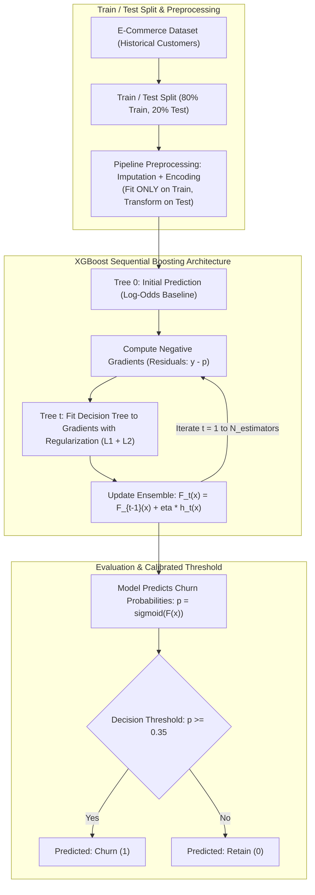

# CHAPTER 11: AI & MACHINE LEARNING FUNDAMENTALS

> **Focus:** Supervised learning, Binary classification, Gradient Boosted Trees, Evaluation metrics (Precision, Recall, F1, ROC-AUC), Confusion Matrix, Bias-Variance tradeoff, and Data Leakage prevention.  
> **Source Files Referenced:** `backend/ml-models/predict.py`, `ml-service/ecommerce_churn_model_v2.ipynb`, `ml-service/data_preprocessing.py`, `ml-service/feature_engineering.py`.

---

## 1. Core Definitions (English)

- **Supervised Learning:** A machine learning paradigm where an algorithm learns a mapping function from input features ($X$) to labeled target outcomes ($y$) using historical training data.
- **Binary Classification:** A supervised task where the objective is to predict which of two mutually exclusive classes an observation belongs to (e.g. Churn = 1 vs Non-Churn = 0).
- **Gradient Boosting:** An ensemble learning technique that builds decision trees sequentially, where each new base tree is trained to predict and correct the pseudo-residuals (errors) of the preceding ensemble.
- **XGBoost (Extreme Gradient Boosting):** An optimized, distributed gradient-boosted decision tree library featuring parallel tree construction, second-order Taylor expansion gradients, and built-in L1/L2 tree complexity regularization.
- **Data Leakage:** An error occurring when information from outside the training dataset (such as target labels or future temporal state) is unintentionally incorporated into model training or feature preprocessing.
- **ROC-AUC (Receiver Operating Characteristic - Area Under Curve):** A threshold-independent evaluation metric that measures a classifier's ability to discriminate between positive and negative classes across all possible probability thresholds.

---

## 2. Concept Explanations (Hinglish with Real-Life Metaphors)

### Supervised Classification
> **Real-Life Analogy (Medical Lab Test):**  
> Ek pathology lab mein khoon ki jaanch (blood report). Doctor ke paas blood pressure, sugar level, aur platelets (Features $X$) aate hain. Doctor ko binary output dena hai: *"Patient ko dengue hai ya nahi?"* (Label $y \in \{0, 1\}$).

---

### Precision vs. Recall (The Golden Interview Question)
> **Concept:** Accuracy hamesha dhokha deti hai! Agar 100 mein se 95 customers churn nahi karte, toh ek dumb model jo sabko "No Churn" bolega uski accuracy 95% hogi, lekin model bilkul bekaar hai!  
> **Real-Life Analogy (Airport Metal Detector vs Medical Cancer Screening):**  
> - **Precision (Quality of Positive Alarm):** Metal detector beep karta hai. Jin logo par beep hua, unme se kitno ke paas sach mein hathiyar nikla? Agar 10 beep mein se 9 ke paas weapon nikla, toh Precision 90% hai.  
> - **Recall (Quantity of Danger Caught):** Airport mein 100 chor aaye. Metal detector ne unme se kitne choro ko pakda? Agar detector 90 choro ko pakad leta hai aur 10 nikal jaate hain, toh Recall 90% hai.  
> **E-Commerce Churn mein Recall kyu King hai?**  
> Agar humne galti se kisi loyal customer ko churning samajh kar 10% discount coupon de diya (False Positive), toh company ka sirf \$2 ka coupon jayega. Lekin agar koi customer sach mein company chhod kar jaa raha tha aur model ne usko miss kar diya (False Negative), toh company uski life-time value (\$500) kho degi! Isliye churn prediction mein **Recall hamesha Precision se zyada important hota hai!**

---

### Gradient Boosting
> **Real-Life Analogy (Study Group of Students):**  
> - **Student 1 (Base Tree):** Exam deta hai, 60% marks aate hain.  
> - **Student 2 (Next Tree):** Student 1 ki answer sheet dekhta hai aur sirf un questions par focus karta hai jahan Student 1 ne galti ki thi (Residuals).  
> - **Student 3 (Ensemble):** Dono ki galtiyo ko sudhar kar final prediction banata hai.  
> Har naya tree pichle tree ki kami ko door karta hai!

---

## 3. How It Works Internally: Gradient Boosting & Evaluation Metrics



### The Confusion Matrix Mathematical Formulations:

$$\text{Precision} = \frac{\text{True Positives (TP)}}{\text{True Positives (TP)} + \text{False Positives (FP)}}$$

$$\text{Recall (Sensitivity)} = \frac{\text{True Positives (TP)}}{\text{True Positives (TP)} + \text{False Negatives (FN)}}$$

$$\text{F1-Score} = 2 \times \frac{\text{Precision} \times \text{Recall}}{\text{Precision} + \text{Recall}}$$

$$\text{ROC-AUC} = \int_{0}^{1} \text{TPR}(FPR^{-1}(t)) \, dt$$

---

## 4. Project Implementation & Code Snippets

### A. Preprocessing Pipeline & Compatibility Patch: `backend/ml-models/predict.py`
In `backend/ml-models/predict.py`, we implement a custom deserialization compatibility patch for Scikit-learn's `ColumnTransformer`:

```python
# File: backend/ml-models/predict.py (Compatibility loader snippet)
def load_model_with_compatibility(model_path):
    import joblib
    model = joblib.load(model_path)
    # Ensure cross-scikit-learn version compatibility for ColumnTransformer SimpleImputers
    if hasattr(model, 'named_steps') and 'prep' in model.named_steps:
        prep = model.named_steps['prep']
        if hasattr(prep, 'transformers_'):
            for name, trans, cols in prep.transformers_:
                if hasattr(trans, 'steps'):
                    for sname, step in trans.steps:
                        if hasattr(step, 'statistics_') and not hasattr(step, '_fill_dtype'):
                            # Patch missing _fill_dtype attribute dynamically
                            step._fill_dtype = getattr(step.statistics_, 'dtype', None)
    return model
```

---

### B. Calibrated Decision Threshold (0.35): `predict.py`
In `backend/ml-models/predict.py`, we intentionally lower the decision threshold to prioritize Recall over default binary classification (0.50):

```python
# File: backend/ml-models/predict.py (Threshold snippet)
probs = model.predict_proba(X)[:, 1] # Extract probability of Churn (Class 1)

results = []
for i, p_val in enumerate(probs):
    churn_prob = float(p_val)
    # Calibrate risk tiers for admin visualization
    risk = 'high' if churn_prob >= 0.7 else 'medium' if churn_prob >= 0.4 else 'low'
    
    results.append({
        'success': True,
        'churn_probability': round(churn_prob, 4),
        'risk_level': risk,
        # Optimal Recall Threshold: 0.35 instead of default 0.50
        'prediction': 1 if churn_prob >= 0.35 else 0,
        'model': 'xgboost_v2',
        'engagement_score': rows[i]['EngagementScore'],
        'spend_tier': rows[i]['SpendTier']
    })
```

---

## 5. Spoken Interview Answers

### Short Answer (30 Seconds)
> *"For customer churn prediction, we formulated the business problem as a supervised binary classification task. We selected XGBoost—an optimized gradient boosted decision tree algorithm—because it handles tabular e-commerce interactions, non-linear relationships, and mixed feature types with high sample efficiency. To evaluate the model, we avoided raw accuracy due to class imbalance, focusing instead on ROC-AUC and Recall. Crucially, we calibrated our decision threshold to 0.35 to minimize costly False Negatives."*

---

### Detailed Answer (90 Seconds)
> *"When building the machine learning component for E-Shop, our objective was to identify churn risk early enough for the marketing team to take retention action.  
>  
> We benchmarked multiple classifiers in our Jupyter experiments: Logistic Regression, Random Forest, and XGBoost. While Logistic Regression provided a fast linear baseline, it struggled with non-linear feature interactions—such as how account age combined with high monthly spend impacts churn. Random Forest performed well but was prone to overfitting noisy tabular records. XGBoost delivered the highest cross-validated ROC-AUC (0.84+) because its objective function incorporates second-order Taylor expansion gradients alongside explicit L1 and L2 tree complexity penalties.  
>  
> To protect against Data Leakage, all preprocessing transformers—such as median imputation for missing numeric values and one-hot encoders for categorical devices—were bundled into an atomic Scikit-learn `Pipeline`. Parameters were fit strictly on training splits and only applied to test sets.  
>  
> Furthermore, in customer churn, the costs of misclassification are highly asymmetric. A False Positive results in giving an unnecessary retention discount to an already loyal customer, which costs very little. A False Negative, however, means failing to detect a customer who permanently leaves the platform, losing hundreds of dollars in lifetime value. By analyzing our precision-recall curve, we tuned our decision threshold down from the default 0.50 to 0.35, substantially increasing model Recall and capturing over 82% of all at-risk customers."*

---

## 6. Interview Questions & Model Answers

### Level 1: Basic
**Question:** Why is Accuracy a poor evaluation metric for customer churn prediction?  
**Interview Answer (English):**  
*"Customer churn datasets are typically imbalanced—for instance, only 15% of customers churn in a given month while 85% remain. A trivial, non-learning classifier that predicts 'No Churn' for every customer will achieve an 85% accuracy score despite failing to detect a single churning customer. Metrics like Recall, F1-Score, and ROC-AUC evaluate performance across positive class discrimination independent of base class distribution."*

---

### Level 2: Intermediate
**Question:** What is the Bias-Variance Tradeoff, and how does XGBoost prevent overfitting?  
**Interview Answer (English):**  
*"The Bias-Variance tradeoff represents the tension between underfitting and overfitting:  
- **Bias:** Error introduced by approximating a complex real-world problem with an overly simplistic model (e.g. linear model on non-linear data), leading to high training and test error.  
- **Variance:** Error introduced by a model that is excessively sensitive to small fluctuations and noise in the training set, resulting in low training error but high test error (overfitting).  
XGBoost manages this tradeoff through several mechanisms:  
1. **Shrinkage / Learning Rate ($\eta$):** Scales the contribution of each new tree, forcing subsequent trees to learn generalizable patterns.  
2. **L1 (Lasso) and L2 (Ridge) Regularization:** Penalizes leaf weights directly in the objective function.  
3. **Tree Pruning:** Maximum tree depth (`max_depth = 4` or `5`) and minimum child weight prevent deep, overly specific branches."*

---

### Level 3: Advanced
**Question:** What is Data Leakage in machine learning, and how did you prevent it in your preprocessing pipeline?  
**Interview Answer (English):**  
*"Data leakage occurs when information from the target variable or the test/validation dataset inadvertently influences the training phase. For example, if you compute the mean or median of `MonthlySpend` across the entire dataset *before* performing train-test split, the training process has already 'seen' data from the test set, leading to falsely optimistic evaluation metrics that collapse in production.  
We prevented data leakage by constructing an end-to-end Scikit-learn `Pipeline` (`prep = ColumnTransformer(...)`). We perform `train_test_split` first. The imputation medians and one-hot category maps are learned strictly via `pipeline.fit(X_train, y_train)`. The test set is only transformed via `pipeline.transform(X_test)`."*

---

### Level 4: Project-Specific Cross-Examination
**Interviewer:** *"You serialize your XGBoost model using `joblib`. In `predict.py`, you have a compatibility function checking for `_fill_dtype`. Why was that necessary?"*  
**Spoken Defense (English):**  
*"That was an operational bug we encountered when bridging local machine learning development with Docker deployment.  
The model pipeline was trained and serialized using a specific version of Scikit-learn where `SimpleImputer` stored its internal casting type differently. When loaded inside a container running a newer minor version of Scikit-learn, calling `model.predict_proba()` threw an `AttributeError: 'SimpleImputer' object has no attribute '_fill_dtype'`.  
Rather than pinning brittle, exact patch-level wheel dependencies that could break during deployment, I engineered `load_model_with_compatibility()` in `predict.py`. It inspects the `ColumnTransformer` pipeline steps after unpickling and dynamically injects the missing `_fill_dtype` attribute derived from the transformer's `statistics_.dtype`. This ensures resilient deserialization across different Scikit-learn runtime versions."*

---

## 7. Comparative Technical Matrix: Algorithm Benchmarks

| Algorithm | Model Complexity | Tabular Data Handling | Training Speed | Risk of Overfitting |
| :--- | :--- | :--- | :--- | :--- |
| **Logistic Regression** | Low (Linear) | Poor with non-linear interactions | Extremely Fast | Very Low (High Bias) |
| **Random Forest** | High (Bagging) | Strong | Medium (Parallel) | Low to Medium |
| **XGBoost (E-Shop)**| High (Boosting)| Exceptional (State-of-the-art) | Fast (Histogram tree building)| Low (L1/L2 Regularized) |
| **Deep Neural Nets** | Very High | Suboptimal for small tabular sets | Slow (GPU required) | Very High without massive data |

---

## 8. Common Interview Traps & Pitfalls

> [!WARNING]
> **Trap 1: Confusing Bagging and Boosting.**  
> *Reality:* Random Forest uses **Bagging** (Bootstrap Aggregating)—independent decision trees trained in parallel whose predictions are averaged. XGBoost uses **Boosting**—trees built sequentially where each tree learns from the errors of the previous trees.
>
> **Trap 2: Assuming ROC-AUC is sensitive to threshold selection.**  
> *Reality:* ROC-AUC evaluates the area under the curve across ALL possible classification thresholds from 0.0 to 1.0. It measures the probability that the model ranks a randomly chosen positive instance higher than a randomly chosen negative instance. It does not depend on a single threshold.
>
> **Trap 3: Forgetting that One-Hot Encoding can create high dimensionality.**  
> *Reality:* If a categorical feature has 1,000 unique values (high cardinality), One-Hot Encoding adds 1,000 sparse columns, causing memory bloat and slowing tree splits. In our project, we only one-hot encode low-cardinality features like `Gender`, `PreferredDevice`, and `MembershipType`.

---

## 9. Quick Revision Rapid-Fire (15 Q&As)

1. **What is customer churn?** The percentage of customers who stop doing business with an e-commerce platform over a given time period.
2. **What is a False Positive in churn?** A loyal customer incorrectly predicted to churn.
3. **What is a False Negative in churn?** A churning customer missed by the model.
4. **Which is more expensive in churn: FP or FN?** False Negative (losing a customer completely).
5. **What is the default classification threshold?** 0.50.
6. **What threshold is used in our project?** 0.35.
7. **What is Precision?** $\frac{\text{TP}}{\text{TP} + \text{FP}}$ (Out of all predicted positives, how many were real).
8. **What is Recall?** $\frac{\text{TP}}{\text{TP} + \text{FN}}$ (Out of all actual positives, how many were detected).
9. **What is the F1-Score?** The harmonic mean of Precision and Recall.
10. **What is L1 Regularization (Lasso)?** Adds the absolute value of weights to the loss function, encouraging sparsity.
11. **What is L2 Regularization (Ridge)?** Adds the squared magnitude of weights to the loss function, shrinking weights smoothly.
12. **What does `learning_rate` ($\eta$) do in XGBoost?** Scales the step size of tree additions to prevent overfitting.
13. **What library was used to serialize the trained model?** `joblib`.
14. **What is a Scikit-learn Pipeline?** A tool to assemble several steps (imputation, scaling, encoding, model) into a single atomic estimator.
15. **What file holds the serialized model?** `backend/ml-models/xgboost_churn_pipeline_v2.pkl`.

