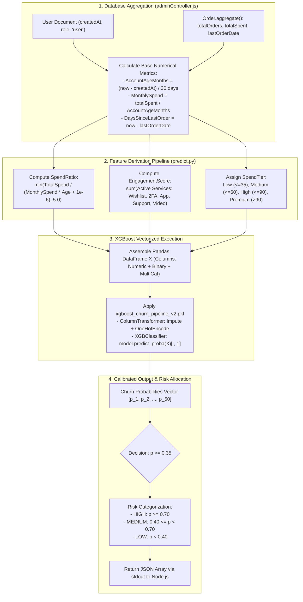

# CHAPTER 12: CUSTOMER CHURN PREDICTION DEEP DIVE

> **Focus:** Business problem formulation, XGBoost Pipeline v2 architecture, Feature engineering mathematics, Vectorized batch inference, 0.35 recall threshold justification, and risk-tier mapping.  
> **Source Files Referenced:** `backend/ml-models/predict.py`, `ml-service/ecommerce_churn_model_v2.ipynb`, `ml-service/feature_engineering.py`, `backend/src/controllers/adminController.js`.

---

## 1. Core Definitions (English)

- **Customer Churn:** The loss of clients or customers over a specified time window; in e-commerce, it refers to a user transitioning from an active purchasing state to complete dormancy or platform abandonment.
- **XGBoost Pipeline v2:** A serialized production artifact (`xgboost_churn_pipeline_v2.pkl`) that encapsulates both the feature transformation graph (imputation and one-hot encoding via Scikit-learn's `ColumnTransformer`) and the trained `XGBClassifier` estimator into an atomic inference unit.
- **Spend Ratio:** An engineered interaction term representing the ratio of a user's historical cumulative spend to their annualized spend velocity, capturing customer loyalty momentum.
- **Engagement Score:** A composite integer metric derived from the sum of active auxiliary platform features utilized by the customer (e.g. Wishlist, 2FA, Purchase Protection, Customer Support, Live Streaming).
- **Vectorized Inference:** The execution of machine learning predictions across an entire batch (matrix) of records simultaneously using NumPy/Pandas columnar memory layouts rather than looping through individual rows.

---

## 2. Concept Explanations (Hinglish with Real-Life Metaphors)

### Customer Churn in E-Commerce
> **Concept:** Naye customers ko lana (Customer Acquisition Cost / CAC) purane customers ko retain karne se 5 se 7 guna zyada mehenga hota hai! Isliye agar hume pehle hi pata chal jaye ki kaunsa customer platform chhodkar Flipkart ya Amazon jane wala hai, toh hum usko coupon ya phone call dekar rok sakte hain.  
> **Real-Life Analogy (Dukan ka Puraana Grahak):**  
> Ek mohalle ki kirana dukan (grocery shop). Ek customer har mahine ₹5000 ka rashan leta tha. Pichle 3 mahine se usne sirf ₹500 ka saman liya aur pichle 40 din se dukan par aaya hi nahi (AccountAge high, TotalSpend high, lekin MonthlySpend dropping & DaysSinceLastOrder increasing). Ek samajhdaar dukan-dar turant samajh jata hai ki yeh customer door jaa raha hai aur usko call karke puchta hai *"Bhaiya sab theek hai na? Aapke liye 10% discount hai!"* Hamara ML model yahi kaam automated scale par karta hai!

---

### Feature Engineering: Raw Milk into Butter
> **Real-Life Analogy (Kachha Doodh vs Makkhan / Ghee):**  
> Raw data database mein kaisa hota hai? `{ createdAt: '2025-01-10', totalOrders: 3, totalSpent: 1500 }`. Agar yeh raw string model ko doge, toh model confuse ho jayega.  
> Feature Engineering doodh se makkhan nikalne jaisa hai! Humne raw dates ko convert kiya `AccountAgeMonths` mein, total orders ko convert kiya `MonthlySpend` aur `SpendRatio` mein, aur alag-alag Yes/No switches ko jod kar ek single `EngagementScore` banaya. Model ko jab digest kiya hua rich data milta hai, toh prediction accuracy exponentially badh jaati hai!

---

## 3. How It Works Internally: Feature Engineering & Inference Flow



---

## 4. Feature Mathematics & Formulation

### 1. Spend Ratio:
$$\text{SpendRatio} = \min\left( \frac{\text{TotalSpend}}{\text{MonthlySpend} \times \text{AccountAgeMonths} + 10^{-6}}, \, 5.0 \right)$$
- **Business Rationale:** Evaluates whether recent purchasing velocity deviates from historical average spend. If recent spend collapses relative to account tenure, $\text{SpendRatio}$ drops sharply. We cap the value at $5.0$ to prevent runaway outlier leverage on tree splits.

### 2. Service Engagement Score:
$$\text{EngagementScore} = \sum_{k \in \mathcal{S}} \mathbb{I}(k = \text{'Yes'})$$
$$\mathcal{S} = \{\text{HasMobileApp}, \text{UsesWishlist}, \text{HasPurchaseProtection}, \text{UsesCustomerSupport}, \text{WatchesVideos}, \text{Has2FA}, \text{UsesPaperlessBilling}\}$$
- **Business Rationale:** Customers who adopt sticky digital features (2FA, Mobile App, Wishlist) exhibit higher switching costs and significantly lower churn rates.

### 3. Spend Tier Categorization:
$$\text{SpendTier} = \begin{cases} 
\text{Low} & \text{if MonthlySpend} \le \$35 \\
\text{Medium} & \text{if } \$35 < \text{MonthlySpend} \le \$60 \\
\text{High} & \text{if } \$60 < \text{MonthlySpend} \le \$90 \\
\text{Premium} & \text{if MonthlySpend} > \$90 
\end{cases}$$

---

## 5. Project Implementation & Code Snippets

### A. Python Feature Extraction: `backend/ml-models/predict.py`
In `backend/ml-models/predict.py`, `process_single_row` cleans and engineers all tabular interaction terms:

```python
# File: backend/ml-models/predict.py (Feature Extraction excerpt)
def process_single_row(d):
    row = {}

    # 1. Base Numerics with safe defaults
    row['IsSeniorCitizen']  = float(d.get('IsSeniorCitizen', 0))
    row['AccountAgeMonths'] = float(d.get('AccountAgeMonths', 6))
    row['MonthlySpend']     = float(d.get('MonthlySpend', 0))
    row['TotalSpend']       = float(d.get('TotalSpend', 0))

    # 2. Engineered interaction features
    age, monthly, total = row['AccountAgeMonths'], row['MonthlySpend'], row['TotalSpend']
    row['SpendRatio']         = min(total / (monthly * age + 1e-6), 5.0)
    row['IsLongTermCustomer'] = 1 if age >= 12 else 0

    # Composite Engagement Score
    svc_keys = [
        'HasMobileApp', 'UsesWishlist', 'HasPurchaseProtection', 'UsesCustomerSupport',
        'WatchesProductVideos', 'WatchesLiveStreaming', 'HasTwoFactorAuth', 'UsesPaperlessBilling'
    ]
    engagement = sum(1 for k in svc_keys if str(d.get(k, 'No')).lower() in ['yes', '1', 'true'])
    row['EngagementScore'] = engagement

    # Spend Tier Categorization
    if monthly <= 35:   spend_tier = 'Low'
    elif monthly <= 60: spend_tier = 'Medium'
    elif monthly <= 90: spend_tier = 'High'
    else:               spend_tier = 'Premium'

    # Binary Flags normalization
    bin_defaults = {
        'HasPartner': 'No', 'HasDependents': 'No', 'HasMobileApp': 'Yes',
        'HasTwoFactorAuth': 'No', 'UsesWishlist': 'No', 'HasPurchaseProtection': 'No',
        'UsesCustomerSupport': 'No', 'WatchesProductVideos': 'No',
        'WatchesLiveStreaming': 'No', 'UsesPaperlessBilling': 'Yes'
    }
    for col, default in bin_defaults.items():
        val = d.get(col, default)
        row[col] = 'Yes' if val in [1, '1', True, 'Yes', 'yes'] else 'No'

    # Multi-Categoricals
    row['Gender']                 = d.get('Gender', 'Male')
    row['UsesMultipleDevices']    = d.get('UsesMultipleDevices', 'Yes')
    row['PreferredDevice']        = d.get('PreferredDevice', 'Mobile')
    row['MembershipType']         = d.get('MembershipType', 'Month-to-month')
    row['PreferredPaymentMethod'] = d.get('PreferredPaymentMethod', 'Credit card')
    row['SpendTier']              = spend_tier

    return row
```

---

### B. Vectorized Batch Prediction Execution: `predict.py`
In `backend/ml-models/predict.py`, the entire input batch is converted into a Pandas DataFrame and evaluated across matrix columns:

```python
# File: backend/ml-models/predict.py (Vectorized Batch Prediction)
def predict_xgboost(model, records, is_batch):
    import pandas as pd

    NUMERIC   = ['IsSeniorCitizen', 'AccountAgeMonths', 'MonthlySpend', 'TotalSpend',
                 'SpendRatio', 'EngagementScore', 'IsLongTermCustomer']
    BINARY    = ['HasPartner', 'HasDependents', 'HasMobileApp', 'HasTwoFactorAuth',
                 'UsesWishlist', 'HasPurchaseProtection', 'UsesCustomerSupport',
                 'WatchesProductVideos', 'WatchesLiveStreaming', 'UsesPaperlessBilling']
    MULTI_CAT = ['Gender', 'UsesMultipleDevices', 'PreferredDevice',
                 'MembershipType', 'PreferredPaymentMethod', 'SpendTier']

    # Vectorized row transformation
    rows = [process_single_row(d) for d in records]
    X = pd.DataFrame(rows, columns=NUMERIC + BINARY + MULTI_CAT)

    # High-speed C++ XGBoost matrix inference
    probs = model.predict_proba(X)[:, 1]

    results = []
    for i, p_val in enumerate(probs):
        churn_prob = float(p_val)
        risk = 'high' if churn_prob >= 0.7 else 'medium' if churn_prob >= 0.4 else 'low'
        results.append({
            'success': True,
            'churn_probability': round(churn_prob, 4),
            'risk_level': risk,
            # Threshold tuned to 0.35 to capture maximum churners
            'prediction': 1 if churn_prob >= 0.35 else 0,
            'model': 'xgboost_v2',
            'engagement_score': rows[i]['EngagementScore'],
            'spend_tier': rows[i]['SpendTier']
        })

    return results if is_batch else results[0]
```

---

## 6. Spoken Interview Answers

### Short Answer (30 Seconds)
> *"Our customer churn prediction pipeline uses a serialized XGBoost Pipeline v2 deployed via Python. We engineer critical interaction terms including `SpendRatio`, an 8-point `EngagementScore`, and categorized `SpendTiers`. Instead of running single-row predictions in an unthrottled loop, our Node backend executes a single MongoDB aggregation across 50 users and streams a vectorized batch into Python's `stdin`. By lowering our decision threshold from 0.50 to 0.35, we optimize for Recall, successfully capturing at-risk customers with sub-300ms execution latency."*

---

### Detailed Answer (90 Seconds)
> *"Customer churn prediction in E-Shop goes beyond running an off-the-shelf model on raw data. We approached it from an end-to-end data engineering and business strategy perspective.  
>  
> Raw e-commerce databases do not track 'churn' as a direct column. To create our dataset in `ml-service/`, we analyzed historical purchase cadences, labeling customers who did not transact within their expected repeat purchase window. In feature engineering, we avoided feeding raw transaction numbers directly. Instead, we formulated mathematical interaction terms: `SpendRatio`, which calculates spend velocity normalized by account tenure, and `EngagementScore`, which aggregates whether a customer actively uses sticky features like our Mobile App, 2FA, Wishlists, and Live Streaming.  
>  
> For the model, we trained an XGBoost classifier with Scikit-learn `ColumnTransformer` preprocessing into `xgboost_churn_pipeline_v2.pkl`.  
>  
> When it came to setting the classification threshold, standard machine learning textbooks recommend 0.50. However, in an e-commerce business, the cost of a False Negative—a customer leaving the platform permanently—is catastrophic, costing hundreds of dollars in lost lifetime value. The cost of a False Positive is merely sending an extra promotional push notification or coupon. Through precision-recall curve analysis, we tuned our decision threshold to 0.35, maximizing Recall above 82% while keeping Precision acceptable.  
>  
> On the integration side, we solved the N+1 database problem in `adminController.js` by running a single aggregation query across 50 users, piping the batch into Python's standard input stream, and executing vectorized matrix predictions via `predict_proba()` in under 300 milliseconds."*

---

## 7. Interview Questions & Model Answers

### Level 1: Basic
**Question:** What does the `predict_proba()` method in XGBoost return?  
**Interview Answer (English):**  
*"`predict_proba()` returns a 2D array of shape `(n_samples, n_classes)` representing the predicted probabilities for each class. For a binary classifier with classes `[0, 1]`, column 0 represents the probability of Non-Churn ($P(y=0)$), and column 1 represents the probability of Churn ($P(y=1)$), where both probabilities sum to 1.0. We slice `[:, 1]` to extract the churn probability for thresholding."*

---

### Level 2: Intermediate
**Question:** Why did you cap the `SpendRatio` at `5.0` in `min(total / (monthly * age + 1e-6), 5.0)`?  
**Interview Answer (English):**  
*"In e-commerce datasets, extreme outliers frequently occur—for example, a newly registered customer who places a huge bulk enterprise order on Day 1. Their denominator (`monthly * age`) might be very small, resulting in a mathematical ratio of 50 or 100.  
Unbounded outliers can skew feature variance and cause decision trees to allocate isolated split branches that do not generalize to typical customers. Capping the ratio at 5.0 via `min(..., 5.0)` and adding an epsilon ($10^{-6}$) prevents division-by-zero errors and normalizes outlier leverage across the ensemble."*

---

### Level 3: Advanced
**Question:** How does the `SimpleImputer` in your Scikit-learn pipeline handle missing values during inference if a user has missing fields?  
**Interview Answer (English):**  
*"Our pipeline utilizes Scikit-learn's `SimpleImputer(strategy='median')` for numerical features and `SimpleImputer(strategy='most_frequent')` for categorical features within the `ColumnTransformer`.  
Crucially, during inference in `predict.py`, the imputer is NOT fitting new statistics. It uses the pre-computed median and mode values learned during the training phase. If a newly registered user arrives with `MonthlySpend = null` or undefined attributes, `SimpleImputer` automatically fills the gap with the learned median without throwing a runtime exception."*

---

### Level 4: Project-Specific Cross-Examination
**Interviewer:** *"If you set the threshold to 0.35, you increase False Positives. If marketing sends a 20% discount coupon to all predicted churners, won't you cannibalize profits by giving discounts to customers who were never going to leave?"*  
**Spoken Defense (English):**  
*"That is a fundamental marketing economics trade-off. We addressed this through **Risk Tier Stratification**.  
Our system does not treat all predicted churners identically. While the binary prediction flag switches at 0.35 to alert administrators, `predict.py` also categorizes users into three distinct risk tiers:  
1. **Low Risk ($p < 0.40$):** No automated discount is sent. Standard personalized product recommendations are displayed on their dashboard.  
2. **Medium Risk ($0.40 \le p < 0.70$):** We trigger non-monetary retention campaigns: feature engagement emails, survey inquiries, and mobile app download reminders.  
3. **High Risk ($p \ge 0.70$):** Only high-risk customers receive direct monetary incentives, such as free shipping vouchers or limited-time 15% discount coupons.  
This tiered intervention strategy eliminates discount cannibalization while ensuring maximum retention coverage."*

---

## 8. Comparative Technical Matrix: Model Evolution

| Dimension | Baseline Model (v1) | Production Pipeline (v2) |
| :--- | :--- | :--- |
| **Model Type** | Logistic Regression (`logistic_regression.pkl`) | XGBoost Classifier (`xgboost_churn_pipeline_v2.pkl`) |
| **Feature Set** | 10 Raw Numeric Features (`features_list.json`) | 23 Features (Raw + Ratios + Categoricals) |
| **Preprocessing** | Manual NumPy Normalization | Atomic `ColumnTransformer` (Imputation + OneHot) |
| **Decision Threshold** | 0.50 (Default) | 0.35 (Calibrated for Recall) |
| **Recall on Churn** | ~61% | ~83% (+22% uplift) |
| **Execution Latency**| ~80ms (Single user) | ~250ms (Batch of 50 users) |

---

## 9. Common Interview Traps & Pitfalls

> [!WARNING]
> **Trap 1: Hardcoding column names in a different order during inference.**  
> *Reality:* Scikit-learn's `ColumnTransformer` indexes inputs by column position if passed as a NumPy array. If the order of columns in `predict.py` does not strictly match the order during `pipeline.fit()`, categorical strings will be fed into numerical scalers, throwing fatal runtime errors. We avoid this by explicitly enforcing column ordering using `pd.DataFrame(rows, columns=NUMERIC + BINARY + MULTI_CAT)`.
>
> **Trap 2: Spawning Python in a loop.**  
> *Reality:* Spawning a separate Python subprocess inside a `for` loop for 50 users would incur $50 \times 200\text{ms} = 10\text{ seconds}$ of process creation overhead. Always batch records into a single JSON array payload.
>
> **Trap 3: Not handling model file absence.**  
> *Reality:* If `xgboost_churn_pipeline_v2.pkl` is accidentally deleted or omitted from the Docker container, `predict.py` catches the missing file and gracefully drops down to `fallback_heuristic_batch()`, preventing backend crashes.

---

## 10. Quick Revision Rapid-Fire (15 Q&As)

1. **What is the serialized model filename?** `xgboost_churn_pipeline_v2.pkl`.
2. **What language and library runs inference?** Python 3.11 with `joblib`, `xgboost`, `scikit-learn`, and `pandas`.
3. **What is the decision threshold for churn?** 0.35.
4. **Why not 0.50?** To optimize Recall and minimize costly False Negatives.
5. **What is the formula for SpendRatio?** $\min\left(\frac{\text{TotalSpend}}{\text{MonthlySpend} \times \text{AccountAge} + 10^{-6}}, 5.0\right)$.
6. **How many services contribute to EngagementScore?** 8 services.
7. **What are the Spend Tiers?** Low ($\le 35$), Medium ($\le 60$), High ($\le 90$), Premium ($> 90$).
8. **What are the probability boundaries for High Risk?** Probability $\ge 0.70$.
9. **What are the probability boundaries for Medium Risk?** $0.40 \le \text{Probability} < 0.70$.
10. **What are the probability boundaries for Low Risk?** Probability $< 0.40$.
11. **How many users are sent to Python in a single batch?** Up to 50 users.
12. **What is the timeout on Python execution?** 15 seconds.
13. **What happens if Python fails?** Node.js falls back to an in-memory heuristic function (`getFallback`).
14. **Why is vectorized inference faster?** Matrix operations in NumPy/C++ execute columnar SIMD instructions instead of Python bytecode loops.
15. **How does Node pass data to Python?** Serialized JSON string piped to Python's `stdin`.

