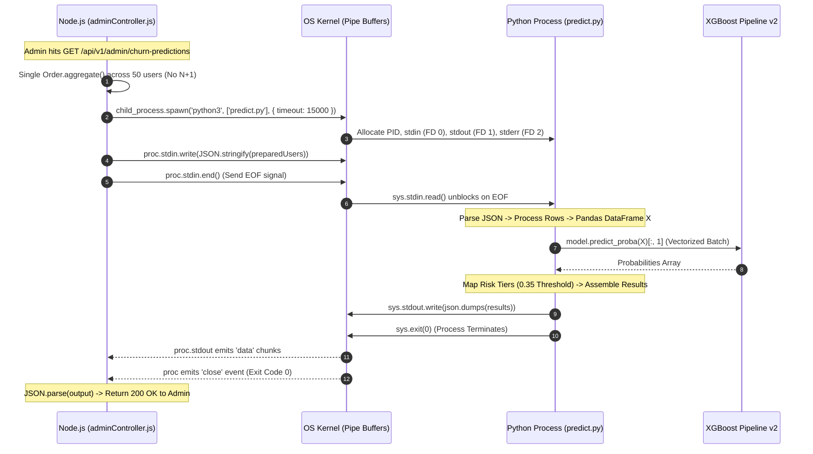

# CHAPTER 13: PYTHON & NODE.JS INTEGRATION (IPC DEEP DIVE)

> **Focus:** Cross-language Inter-Process Communication (IPC), Node.js `child_process.spawn` streaming, Python standard I/O pipes, JSON serialization over IPC, error containment, and architectural trade-offs.  
> **Source Files Referenced:** `backend/src/controllers/adminController.js`, `backend/ml-models/predict.py`, `backend/src/server.js`.

---

## 1. Core Definitions (English)

- **Inter-Process Communication (IPC):** A set of operating system mechanisms that allow separate, memory-isolated processes to exchange data and synchronize execution.
- **Anonymous Pipes (Standard Streams):** Unidirectional data channels allocated by the OS kernel referenced via integer file descriptors: `0` for Standard Input (`stdin`), `1` for Standard Output (`stdout`), and `2` for Standard Error (`stderr`).
- **`child_process.spawn`:** An asynchronous Node.js method that launches a new operating system process without creating an intermediate shell, establishing streaming pipelines over standard I/O file descriptors.
- **Vectorized IPC Streaming:** The architectural pattern of serializing an entire batch of data records into a single continuous JSON stream, piping it through an OS pipe to an external engine for matrix computation, and reading the response array in a single execution.
- **Graceful Degradation:** A system design principle ensuring that if a specialized component (such as the Python ML runtime) fails, the host application continues to function by falling back to simpler, deterministic logic without throwing a 500 crash.

---

## 2. Concept Explanations (Hinglish with Real-Life Metaphors)

### The Cross-Language Bridge: Why Node + Python?
> **Concept:** Node.js API requests aur asynchronous database queries ke liye duniya ka sabse fast aur efficient runtime hai. Lekin Machine Learning, Pandas aur XGBoost ki duniya par Python ka ek-chhatra raaj (monopoly) hai! Toh humne dono ki superpowers ko combine kiya!  
> **Real-Life Analogy (Office Manager aur Data Scientist):**  
> - **Node.js (Active Office Manager):** Phone par hazaro clients se baat karta hai (Express REST API), order book maintain karta hai (MongoDB), aur payment collect karta hai (Razorpay).  
> - **Python (Specialist Data Scientist):** Office ke kone wale cabin mein baithta hai jiske paas complex statistical formula aur model files hain.  
> Manager ko jab 50 customers ka risk nikalna hota hai, toh woh khud formula solve karne nahi baithta. Woh ek document (JSON file) print karta hai, scientist ke room ke darwaze ke niche se slide karta hai (`stdin.write()`). Scientist calculation karke result wapas darwaze ke niche se bahar bhej deta hai (`stdout.write()`). Manager usko utha kar computer screen par display kar deta hai!

---

### Why Standard I/O Pipes over an HTTP Microservice?
> **Real-Life Analogy (Window se Parchi Pass Karna vs International Phone Call Lagana):**  
> Agar tumhara scientist usi ghar ke dusre kamre mein baitha hai, toh usse baat karne ke liye kya tum alag SIM card kharidoge, network tower setup karoge, roaming charges doge aur call disconnect hone ka wait karoge? (FastAPI microservice running on another port with HTTP overhead, DNS, ports, separate hosting bills).  
> Bilkul nahi! Tum seedha room ki window kholte ho aur hath se file thama dete ho (OS Anonymous Pipe)! Zero network latency, zero extra hosting bill, aur zero socket overhead!

---

## 3. How It Works Internally: The IPC Protocol Lifecycle



### Critical OS Mechanics:
1. **Memory Isolation:** Node.js (V8 heap) and Python (CPython runtime) occupy completely separate virtual memory addresses. If Python suffers a segmentation fault or memory leak, the Node.js server does NOT crash.
2. **Buffer Backpressure:** OS pipes have an internal buffer (typically 64KB on Linux). If the producer writes faster than the consumer reads, the OS kernel automatically blocks the writing thread until buffer space clears, preventing runaway memory consumption.

---

## 4. Project Implementation & Code Snippets

### A. The Node.js Spawning Engine: `backend/src/controllers/adminController.js`
In `backend/src/controllers/adminController.js`, we establish standard stream listeners and enforce process isolation:

```javascript
// File: backend/src/controllers/adminController.js (Complete IPC implementation)
const { spawn } = require('child_process');
const path = require('path');

const ML_SCRIPT = path.join(__dirname, '../../ml-models/predict.py');

const runPrediction = (inputData) => {
  return new Promise((resolve) => {
    // Read command from environment variable (Docker compatibility), fallback to python3
    const pythonCmd = process.env.PYTHON_CMD || 'python3';
    
    // Spawn external process with a 15-second timeout guard
    const proc = spawn(pythonCmd, [ML_SCRIPT], { timeout: 15000 });

    let output = '';
    let errorOutput = '';

    // 1. Pipe input payload into Python's stdin
    proc.stdin.write(JSON.stringify(inputData));
    proc.stdin.end(); // CRITICAL: Signal EOF so sys.stdin.read() unblocks

    // 2. Capture output chunks from stdout
    proc.stdout.on('data', (data) => {
      output += data.toString();
    });

    // 3. Capture warning/error logs from stderr
    proc.stderr.on('data', (data) => {
      errorOutput += data.toString();
    });

    // 4. Handle clean process exit
    proc.on('close', (code) => {
      try {
        if (code === 0 && output.trim()) {
          resolve(JSON.parse(output.trim()));
        } else {
          console.error('Python execution error (stderr):', errorOutput);
          resolve({ success: false, error: errorOutput || `Process exited with code ${code}` });
        }
      } catch (e) {
        resolve({ success: false, error: `JSON parse failed: ${output}` });
      }
    });

    // 5. Handle operating system errors (e.g. Python binary not found)
    proc.on('error', (err) => {
      if (err.code === 'ENOENT') {
        console.warn('Primary python binary missing. Attempting fallback command...');
        // Try fallback to python if python3 failed
        resolve({ success: false, error: 'Python runtime binary not found on host' });
      } else {
        resolve({ success: false, error: err.message });
      }
    });
  });
};
```

---

### B. The Python Standard Stream Protocol: `backend/ml-models/predict.py`
In `backend/ml-models/predict.py`, Python strictly consumes from `sys.stdin` and communicates results solely over `sys.stdout`:

```python
# File: backend/ml-models/predict.py (I/O Handling excerpt)
import sys, json, os, warnings
warnings.filterwarnings('ignore') # Suppress warning prints that could corrupt JSON output!

if __name__ == '__main__':
    try:
        # 1. Read entire input stream until EOF
        raw_input = sys.stdin.read().strip()
        
        if not raw_input:
            sys.stdout.write(json.dumps({'success': False, 'error': 'No input provided'}))
            sys.exit(0)

        # 2. Parse JSON payload
        data = json.loads(raw_input)
        
        # 3. Execute Vectorized Prediction
        results = predict(data)
        
        # 4. Write pristine JSON result to stdout
        sys.stdout.write(json.dumps(results))
        sys.exit(0)

    except Exception as e:
        # Even on catastrophic failure, output a valid JSON error contract
        sys.stdout.write(json.dumps({'success': False, 'error': str(e)}))
        sys.exit(1)
```

---

### C. Graceful Heuristic Degradation: `adminController.js`
If Python fails (e.g. timeout, missing Python environment in tests), Node seamlessly degrades to an in-memory heuristic:

```javascript
// File: backend/src/controllers/adminController.js (Heuristic Fallback)
const getFallback = (accountAgeMonths, totalSpent, monthlySpend) => {
  let prob, risk;
  if (accountAgeMonths < 3 || totalSpent < 500) {
    prob = 0.75; risk = 'high';
  } else if (accountAgeMonths < 6 || totalSpent < 2000) {
    prob = 0.45; risk = 'medium';
  } else if (accountAgeMonths >= 12 && monthlySpend > 60) {
    prob = 0.10; risk = 'low';
  } else {
    prob = 0.20; risk = 'low';
  }
  return { churn_probability: prob, risk_level: risk, fallback: true };
};

// In getChurnPredictions controller:
let predictions = await runPrediction(preparedUsers.map(u => u.modelInput));

if (!Array.isArray(predictions) || !predictions.length || !predictions[0].success) {
  logger.warn('ML subprocess failed. Triggering heuristic degradation fallback.');
  // Map users through heuristic function
  predictions = preparedUsers.map(u => ({
    success: true,
    ...getFallback(u.accountAgeMonths, u.totalSpent, u.monthlySpend),
    engagement_score: 3,
    spend_tier: 'Medium',
    model: 'heuristic_fallback'
  }));
}
```

---

## 5. Spoken Interview Answers

### Short Answer (30 Seconds)
> *"We integrated Node.js and Python using standard I/O Inter-Process Communication via `child_process.spawn`. Node.js serializes a batch of up to 50 user feature vectors into a JSON string, writes to Python's `stdin`, and closes the stream. Python parses the stream, executes vectorized prediction using Scikit-learn and XGBoost, and emits the resulting JSON array to `stdout`. This delivers sub-300ms inference with memory isolation, zero networking overhead, and an automated in-memory heuristic fallback if Python encounters an error."*

---

### Detailed Answer (90 Seconds)
> *"When designing our architecture, we needed to bridge the non-blocking I/O efficiency of our Node.js backend with the mature machine learning ecosystem of Python.  
>  
> We evaluated three architectural approaches: building a separate FastAPI microservice, using a distributed message broker like Celery with Redis, or using standard I/O subprocess streaming. We intentionally chose `child_process.spawn` for our production scale.  
>  
> Running a separate microservice would introduce unnecessary HTTP protocol serialization overhead, require managing inter-service networking, double our container hosting costs on Render, and introduce additional points of network failure.  
>  
> Instead, our Node controller aggregates user features into a single batch JSON payload. We spawn the Python script directly, pipe the JSON payload into Python's `stdin`, and call `proc.stdin.end()`. In Python, `predict.py` reads from `sys.stdin`, feeds the batch into our serialized `xgboost_churn_pipeline_v2.pkl`, and writes pristine JSON directly to `sys.stdout`.  
>  
> To guarantee stability, we implemented strict defensive engineering:  
> First, in Python, we call `warnings.filterwarnings('ignore')` to ensure third-party library deprecation warnings are never printed to `stdout`, which would corrupt JSON parsing in Node.  
> Second, we set a 15-second timeout on the spawned process.  
> Third, if Python fails or times out, our controller catches the failure and immediately falls back to an in-memory heuristic calculation based on account age and monthly spend, guaranteeing that the administrator's dashboard never crashes."*

---

## 6. Interview Questions & Model Answers

### Level 1: Basic
**Question:** Why did you call `proc.stdin.end()` immediately after `proc.stdin.write()`?  
**Interview Answer (English):**  
*"`proc.stdin.end()` flushes any remaining buffered data and closes the writable stream by sending an EOF (End-Of-File) signal to the child process. In Python, `sys.stdin.read()` continues blocking and waiting for incoming data until an EOF is detected. If we omit `proc.stdin.end()`, Python waits forever, the promise never resolves, and the request inevitably hits the 15-second timeout."*

---

### Level 2: Intermediate
**Question:** Why did you call `warnings.filterwarnings('ignore')` in `predict.py`?  
**Interview Answer (English):**  
*"By default in Python, libraries like Scikit-learn, Pandas, or NumPy print runtime deprecation or optimization warnings to `stdout` or `stderr`. If a library prints `'UserWarning: X does not have valid feature names'` to `stdout`, that string will concatenate with our JSON output. When Node.js attempts to execute `JSON.parse(output)`, it will throw a fatal `SyntaxError: Unexpected token U in JSON at position 0`. Suppressing warnings ensures that `stdout` contains 100% valid, parsable JSON."*

---

### Level 3: Advanced
**Question:** Explain how an Operating System Pipe Buffer works and what happens if the Python process outputs more data than the pipe buffer size.  
**Interview Answer (English):**  
*"An anonymous OS pipe is an in-memory ring buffer managed by the kernel, typically 64KB on modern Linux kernels.  
When Python calls `sys.stdout.write()`, data fills the pipe buffer. If Python outputs data larger than 64KB, the kernel automatically puts the Python process into a blocked sleep state until the consumer (Node.js) reads bytes out of the buffer.  
In Node.js, because we attach an asynchronous streaming listener `proc.stdout.on('data', (chunk) => { output += chunk; })`, Node drains the kernel buffer as soon as bytes arrive. This prevents deadlock and allows arbitrary amounts of data to stream through standard I/O without hitting buffer size limits."*

---

### Level 4: Project-Specific Cross-Examination
**Interviewer:** *"If 100 administrators access the churn analytics dashboard simultaneously, you will spawn 100 Python processes concurrently. Won't that overwhelm CPU and RAM on a constrained Render instance?"*  
**Spoken Defense (English):**  
*"That is an accurate observation regarding subprocess concurrency limits. Spawning 100 concurrent Python runtimes—each loading a 50MB XGBoost model and Pandas runtime into memory—would cause an out-of-memory (OOM) kill on a container with 512MB RAM.  
We mitigate this through two layers in our current architecture:  
1. **Access Restrictions & Rate Limiting:** The churn prediction endpoint is strictly gated behind `protect` and `authorize('admin')`. Administrators represent a tiny fraction of system traffic compared to regular shoppers, naturally limiting request frequency.  
2. **Evolutionary Architecture Path:** In our roadmap (`docs/FEATURE_ROADMAP.md`), if analytics demand scales, we would transition this batch workload to a **Producer-Consumer Worker Queue** using Redis and BullMQ or Celery. Node.js would simply push an analytics job ID into Redis, and a single persistent background Python daemon worker would consume and process batches sequentially, keeping memory usage constant regardless of concurrent admin requests."*

---

## 7. Comparative Technical Matrix: IPC Strategies

| Approach | Latency | Infrastructure Cost | Memory Overhead | Implementation Complexity |
| :--- | :--- | :--- | :--- | :--- |
| **`child_process.spawn` (E-Shop)**| Sub-300ms | Zero extra cost (Same container) | Transient (Process exits immediately) | Low |
| **FastAPI Microservice** | ~50ms | High (Requires 2nd container/server) | Permanent (FastAPI + Uvicorn resident RAM)| Medium |
| **Redis / BullMQ Queue** | Asynchronous | Medium (Requires Redis instance) | Low (Decoupled background worker) | High |
| **Native C++ Addon (Node-gyp)**| <10ms | Zero | High (Complex C++ compilation) | Very High |

---

## 8. Common Interview Traps & Pitfalls

> [!WARNING]
> **Trap 1: Using `print()` inside Python for debugging.**  
> *Reality:* Any accidental `print("Debug: feature shape is", X.shape)` inside `predict.py` prints directly to `stdout`, completely corrupting the JSON stream returned to Node.js! If you must log inside Python, write explicitly to `sys.stderr.write()`, which Node captures on `proc.stderr.on('data')` without affecting `stdout`.
>
> **Trap 2: Using `child_process.exec` instead of `spawn`.**  
> *Reality:* `exec` buffers all output into a fixed memory string. If your batch size increases, `exec` will throw `Error: maxBuffer exceeded`. `spawn` streams chunks continuously with no hardcoded buffer limit.
>
> **Trap 3: Not verifying Python executable availability.**  
> *Reality:* In some Linux Docker environments, the executable is `python3`, while on Windows it is `python`. If your code hardcodes `python` and the server only has `python3`, Node throws an unhandled `ENOENT` error. We resolve this by supporting `process.env.PYTHON_CMD || 'python3'`.

---

## 9. Quick Revision Rapid-Fire (15 Q&As)

1. **What Node.js function is used to spawn Python?** `child_process.spawn`.
2. **What file path points to the ML inference script?** `backend/ml-models/predict.py`.
3. **What is the standard input file descriptor?** File descriptor `0` (`stdin`).
4. **What is the standard output file descriptor?** File descriptor `1` (`stdout`).
5. **What is the standard error file descriptor?** File descriptor `2` (`stderr`).
6. **How does Python read data from Node.js?** Via `sys.stdin.read()`.
7. **How does Python send data back to Node.js?** Via `sys.stdout.write(json.dumps(results))`.
8. **Why must warnings be ignored in Python?** To prevent non-JSON warning text from corrupting `JSON.parse` in Node.js.
9. **What signal closes the stdin stream in Node?** `proc.stdin.end()`.
10. **What event fires when the child process terminates?** The `'close'` event.
11. **What error code indicates Python is missing on the system?** `ENOENT`.
12. **What timeout is configured on the Python process?** 15,000 milliseconds (15 seconds).
13. **What happens if Python fails or times out?** The controller falls back to `getFallback()`, an in-memory heuristic.
14. **What data format is exchanged over the pipe?** Minified JSON string.
15. **Does spawning Python block the Node.js event loop?** No, stream reading is completely non-blocking and event-driven.

