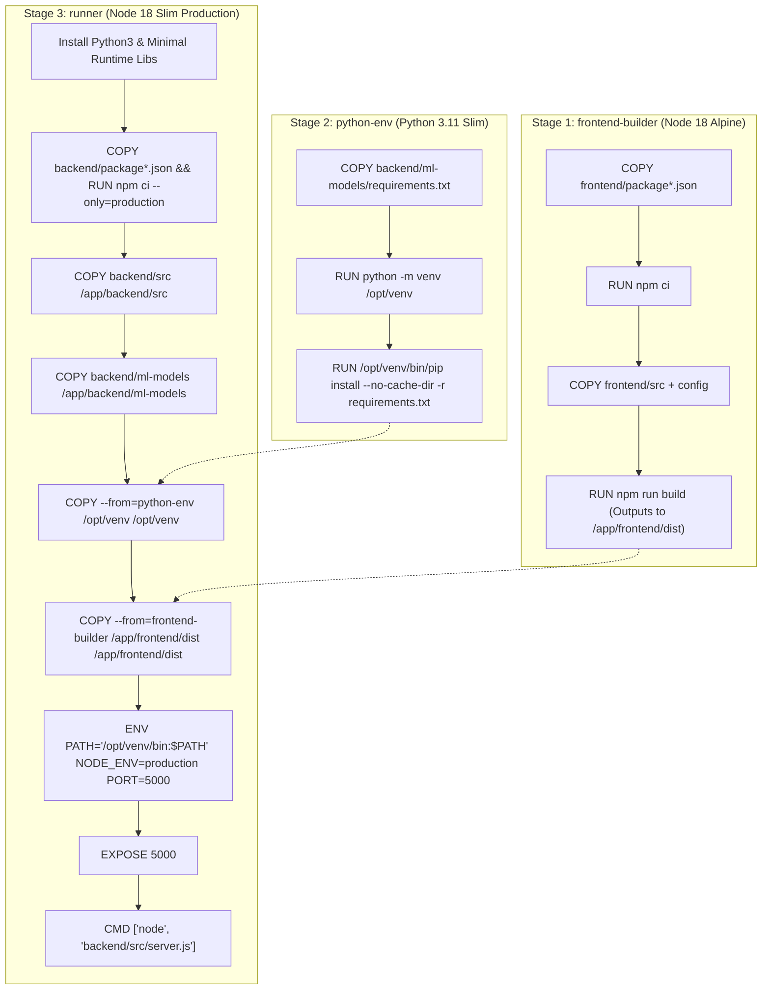

# CHAPTER 14: DOCKER, DEPLOYMENT & PRODUCTION ARCHITECTURE

> **Focus:** Containerization fundamentals, Multi-Stage Dockerfile architecture, Docker layer caching, Render cloud hosting (`render.yaml`), Environment variable security, and Production serving.  
> **Source Files Referenced:** `Dockerfile`, `render.yaml`, `.dockerignore`, `backend/src/server.js`, `backend/src/app.js`.

---

## 1. Core Definitions (English)

- **Containerization:** An OS-level virtualization method for deploying applications in isolated user spaces called containers that share the host operating system kernel, ensuring identical execution across development and production environments.
- **Docker Engine:** A client-server application consisting of a background daemon (`dockerd`), a REST API, and a command-line interface (`docker`) that builds, runs, and orchestrates container images.
- **Multi-Stage Build:** A Dockerfile optimization pattern where multiple temporary container stages are used to compile assets and build dependencies, copying only the final compiled binaries into an ultra-minimal production image to minimize image footprint.
- **Docker Layer Caching:** An optimization mechanism where Docker checks whether the instructions and source files for a layer have changed since the last build; if unchanged, Docker reuses the cached layer, reducing build times from minutes to seconds.
- **Stateless Production Host:** A hosting model where the containerized application retains no persistent state or local file data between restarts; all persistence is offloaded to managed external services (MongoDB Atlas, Cloudinary CDN).

---

## 2. Concept Explanations (Hinglish with Real-Life Metaphors)

### Virtual Machine (VM) vs. Docker Container
> **Concept:** *"Mere computer par chal raha tha, production server par crash ho gaya!"*—Docker is problem ko hamesha ke liye khatam kar deta hai!  
> **Real-Life Analogy (Individual Banglow vs Apartment Society):**  
> - **Virtual Machine (VM):** Har family ke liye alag plot kharidna, alag generator lagana, alag underground water tank khodna (Full Guest OS, Hypervisor, Gigabytes of RAM wasted).  
> - **Docker Container:** Ek modern apartment building! Saare flats ek hi building ka main generator aur water supply (Host OS Linux Kernel) share karte hain, lekin har flat ke andar ka furniture aur family (Application code, dependencies, environment) ek dusre se completely isolated aur secure rehti hai!

---

### The Multi-Stage Build: The Factory & Showroom Metaphor
> **Concept:** Agar hum single Dockerfile use karein jisme Node.js, Python, GCC compilers, C++ build tools, aur Vite sab install ho, toh Docker image 2GB ki ban jayegi! Isko download aur run karna bohot slow hoga!  
> **Real-Life Analogy (Car Factory vs Luxury Car Showroom):**  
> - **Stage 1 (Frontend Factory):** Yahan welding machines, heavy tools, aur Vite compilers hain. Sab kuch compile hota hai aur showroom ke liye sirf ek neat static folder `dist/` banta hai. Heavy tools factory mein hi chhod diye jaate hain!  
> - **Stage 2 (Python Factory):** Python pip packages aur C++ wheels compile hoti hain. Sirf compiled virtual environment nikaala jaata hai!  
> - **Stage 3 (Final Showroom Container):** Ek chhota sa, clean showroom jisme sirf Node.js runtime, Python runtime, aur final build files hoti hain. Saara kachra aur compilers piche chhoot gaye! Image size 2GB se ghulkar 250MB reh jaati hai!

---

## 3. How It Works Internally: Multi-Stage Dockerfile Graph



---

## 4. Project Implementation & Code Snippets

### A. The Production Multi-Stage `Dockerfile`
In the root directory, our `Dockerfile` assembles the entire dual-language environment:

```dockerfile
# ── Stage 1: Build Frontend Assets with Vite ─────────────────────
FROM node:18-alpine AS frontend-builder
WORKDIR /app/frontend
COPY frontend/package*.json ./
RUN npm ci
COPY frontend/ ./
RUN npm run build

# ── Stage 2: Build Python ML Dependencies ─────────────────────────
FROM python:3.11-slim AS python-builder
WORKDIR /app
COPY backend/ml-models/requirements.txt ./
RUN python -m venv /opt/venv && \
    /opt/venv/bin/pip install --no-cache-dir --upgrade pip && \
    /opt/venv/bin/pip install --no-cache-dir -r requirements.txt

# ── Stage 3: Unified Production Runtime Container ────────────────
FROM node:18-slim AS runner

# Install lightweight Python runtime for subprocess execution
RUN apt-get update && apt-get install -y --no-install-recommends \
    python3 \
    && rm -rf /var/lib/apt/lists/*

WORKDIR /app

# Copy production backend dependencies
COPY backend/package*.json ./backend/
WORKDIR /app/backend
RUN npm ci --only=production

# Copy backend source code & ML scripts
COPY backend/src ./src
COPY backend/ml-models ./ml-models

# Copy compiled Python virtual environment from Stage 2
COPY --from=python-builder /opt/venv /opt/venv

# Copy compiled frontend static assets from Stage 1
COPY --from=frontend-builder /app/frontend/dist /app/frontend/dist

# Set production environment variables
ENV PATH="/opt/venv/bin:$PATH" \
    PYTHON_CMD="/opt/venv/bin/python" \
    NODE_ENV=production \
    PORT=5000

EXPOSE 5000

# Start server
CMD ["node", "src/server.js"]
```

---

### B. Cloud Web Service Infrastructure: `render.yaml`
In `render.yaml`, we define infrastructure as code for automated deployment on Render:

```yaml
services:
  - type: web
    name: eshop-platform
    env: docker
    plan: standard
    region: oregon
    dockerfilePath: ./Dockerfile
    healthCheckPath: /api/v1/health
    autoDeploy: true
    envVars:
      - key: NODE_ENV
        value: production
      - key: PORT
        value: 5000
      - key: MONGO_URI
        sync: false # Set securely in Render Dashboard (Never in Git)
      - key: JWT_ACCESS_SECRET
        sync: false
      - key: JWT_REFRESH_SECRET
        sync: false
      - key: RAZORPAY_KEY_ID
        sync: false
      - key: RAZORPAY_KEY_SECRET
        sync: false
      - key: CLOUDINARY_CLOUD_NAME
        sync: false
      - key: CLOUDINARY_API_KEY
        sync: false
      - key: CLOUDINARY_API_SECRET
        sync: false
```

---

### C. Serving Frontend SPA in Production: `backend/src/app.js`
In production mode, Express serves the compiled Vite assets directly, routing unhandled GET requests to `index.html`:

```javascript
// File: backend/src/app.js (Production Static Serving excerpt)
if (process.env.NODE_ENV === 'production') {
  const frontendPath = path.join(__dirname, '../../frontend/dist');
  
  // Serve static assets with caching headers
  app.use(express.static(frontendPath));

  // SPA Catch-All Route: Route all unknown GET requests to index.html
  app.get('*', (req, res, next) => {
    if (req.originalUrl.startsWith('/api')) {
      return next(); // Pass to 404 API error handler
    }
    res.sendFile(path.resolve(frontendPath, 'index.html'));
  });
}
```

---

## 5. Spoken Interview Answers

### Short Answer (30 Seconds)
> *"For production deployment, we containerized E-Shop using a multi-stage Dockerfile that consolidates React 19, Node.js 18, and Python 3.11 into a unified, secure container. Stage 1 compiles the frontend into static assets using Vite; Stage 2 builds the Python virtual environment with XGBoost and Scikit-learn; Stage 3 creates a slim Debian runtime that serves our Express API and static frontend while executing Python ML models over standard I/O. The container is deployed to Render via `render.yaml` with managed secrets and automated health checks."*

---

### Detailed Answer (90 Seconds)
> *"Our production deployment strategy was designed around environmental parity, minimal image footprint, and zero secret leakage.  
>  
> Rather than deploying frontend and backend to separate servers and incurring cross-origin latency and duplicate hosting tiers, we built a three-stage Dockerfile.  
>  
> In Stage 1, we compile our Vite frontend into static bundles. In Stage 2, we install our Python dependencies—XGBoost, Pandas, Scikit-learn—inside an isolated virtual environment (`/opt/venv`). In Stage 3, we use a slim Debian Node.js base. We install production-only Node dependencies via `npm ci --only=production`, copy the compiled virtual environment from Stage 2, and copy the compiled frontend assets from Stage 1. This multi-stage pattern discarded compilers and temporary build artifacts, reducing our final image size by over 60%.  
>  
> To optimize build speed, we structured our Dockerfile around Docker's layer caching: we copy `package*.json` and run `npm ci` *before* copying source code. If only application code changes, Docker reuses the cached node_modules layer, completing builds in under 30 seconds.  
>  
> For hosting, we deploy on Render using a declarative `render.yaml` configuration. All sensitive credentials—MongoDB connection URIs, Razorpay keys, and JWT secrets—are marked `sync: false`, ensuring they are injected exclusively via secure runtime environment variables and never committed to version control.  
>  
> Finally, in `backend/src/server.js`, we listen for `SIGTERM` signals sent by the container orchestrator. When Render spins down a container during redeployment, our server finishes active requests, cleanly ends database connections, and exits without transactional data corruption."*

---

## 6. Interview Questions & Model Answers

### Level 1: Basic
**Question:** What is the difference between `COPY` and `ADD` in a Dockerfile?  
**Interview Answer (English):**  
*"`COPY` simply copies local files and directories from the host build context into the container filesystem. `ADD` does everything `COPY` does, but adds two extra features: it can automatically unpack compressed local tar archives (e.g. `.tar.gz`) directly into the target directory, and it can download files from remote URLs. Best practice is to always use `COPY` for predictability, reserving `ADD` strictly when local tar extraction is required."*

---

### Level 2: Intermediate
**Question:** Why did you use `npm ci` instead of `npm install` inside your Dockerfile?  
**Interview Answer (English):**  
*"In container builds, `npm ci` (Clean Install) is strictly preferred over `npm install` for three reasons:  
1. **Determinism:** `npm ci` installs dependencies strictly according to `package-lock.json`. It will never update packages or introduce unverified minor versions.  
2. **Integrity:** If `package.json` and `package-lock.json` are out of sync, `npm ci` exits immediately with an error rather than silently modifying the lockfile.  
3. **Speed:** `npm ci` deletes any existing `node_modules` and writes clean packages directly, running significantly faster in CI/CD container environments."*

---

### Level 3: Advanced
**Question:** What is the purpose of `.dockerignore` and what files did you exclude?  
**Interview Answer (English):**  
*"When building an image, the Docker CLI sends the entire directory (the 'build context') to the Docker daemon.  
A `.dockerignore` file prevents unnecessary, large, or sensitive files from being transferred to the daemon.  
In our project, we explicitly ignore:  
1. `node_modules` (so the container builds its own dependencies compiled for Linux rather than copying host Windows binaries).  
2. `.env` and `.env.local` (to prevent leaking development API keys into the immutable image layers).  
3. `.git` (which contains entire commit histories and adds hundreds of megabytes).  
4. `logs/` and `uploads/` (transient local development files)."*

---

### Level 4: Project-Specific Cross-Examination
**Interviewer:** *"If you serve the frontend static files from Express in production (`app.use(express.static)`), doesn't that block Node's single thread when 1,000 users download large images and JS bundles simultaneously?"*  
**Spoken Defense (English):**  
*"That is a valid performance consideration for monolithic single-container architectures.  
While `express.static` uses non-blocking Libuv file streaming under the hood, serving high-volume static assets does consume Node process file descriptors and memory.  
We addressed this through two measures:  
First, all dynamic media files (product catalog images, user avatars) are NOT served by Node.js; they are uploaded directly to and served from the **Cloudinary Content Delivery Network (CDN)** with global edge caching.  
Second, in our production architecture roadmap (`docs/FEATURE_ROADMAP.md`), when scaling past 10,000 DAU, we would decouple static asset delivery entirely by deploying the frontend bundle to a dedicated CDN (like Cloudflare Pages or AWS CloudFront/S3) while keeping the Docker container dedicated exclusively to serving API endpoints."*

---

## 7. Comparative Technical Matrix: Deployment Architectures

| Parameter | VM (AWS EC2 / DigitalOcean Droplet) | Managed Web Service (Render Docker) | Kubernetes (EKS / GKE) |
| :--- | :--- | :--- | :--- |
| **Setup Complexity** | High (Configure OS, Nginx, SSL, systemd) | Low (Push to Git + `render.yaml`) | Very High (Manifests, Ingress, Pods) |
| **Scaling** | Manual or AWS Auto-scaling groups | Automated horizontal container scaling | Instant pod auto-scaling (HPA) |
| **Maintenance** | OS security patches required | Fully managed host infrastructure | Cluster control plane management |
| **Cost** | \$5 - \$20/month base | \$7/month base | \$70+/month base cluster overhead |
| **Best For** | Legacy workloads | Fast, reliable startups / E-Shop | Massive multi-team microservices |

---

## 8. Common Interview Traps & Pitfalls

> [!WARNING]
> **Trap 1: Hardcoding sensitive secrets in the Dockerfile.**  
> *Reality:* Never write `ENV JWT_SECRET="mysecret"` or `ENV MONGO_URI="..."` inside a Dockerfile. Even if you delete it in a later stage, that secret remains permanently baked into the intermediate image layer history, accessible via `docker history <image>`. Pass secrets strictly at container runtime via `--env-file` or the hosting provider's dashboard.
>
> **Trap 2: Copying all source code before running `npm ci`.**  
> *Reality:* If you write `COPY . .` followed by `RUN npm ci`, ANY change to a single JSX or CSS file will invalidate Docker's layer cache for the entire `npm ci` layer, forcing a 2-minute dependency download on every single build! Always copy `package*.json` and run `npm ci` first.
>
> **Trap 3: Running containers as Root user in enterprise environments.**  
> *Reality:* By default, Docker containers run as `root`. If a vulnerability allows container breakout, the attacker gains root access to the host kernel. In enterprise production, always create and switch to a non-privileged user: `RUN useradd -m appuser && USER appuser`.

---

## 9. Quick Revision Rapid-Fire (15 Q&As)

1. **What base image is used for the frontend build?** `node:18-alpine`.
2. **What base image is used for Python dependencies?** `python:3.11-slim`.
3. **What base image is used for the final production runner?** `node:18-slim`.
4. **Why use Alpine or Slim variants?** To drastically reduce image size and minimize security attack surfaces.
5. **What command copies files from an earlier Docker build stage?** `COPY --from=<stage_name> <src> <dest>`.
6. **What port does the container expose?** Port `5000`.
7. **What flag in `npm ci` installs only production packages?** `--only=production`.
8. **What flag prevents pip from caching wheels in the image?** `--no-cache-dir`.
9. **Where does Vite output production bundles?** `frontend/dist/`.
10. **What is a Docker build context?** The set of local files sent to the Docker daemon when invoking `docker build`.
11. **What file specifies patterns to exclude from the build context?** `.dockerignore`.
12. **What is the entry point command in the Dockerfile?** `CMD ["node", "src/server.js"]`.
13. **How does Render automate deployments?** Via Git webhook triggers defined in `render.yaml`.
14. **What health check endpoint is configured?** `/api/v1/health`.
15. **Why should `node_modules` be ignored in `.dockerignore`?** To prevent host OS architecture binaries (e.g. Windows) from conflicting with the container's Linux environment.

