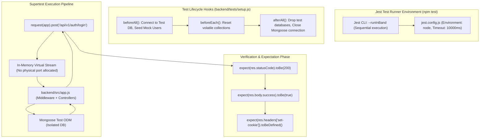

# CHAPTER 15: TESTING, DEBUGGING & ERROR HANDLING

> **Focus:** The Testing Pyramid, Jest & Supertest integration test suites (115 passing tests), Mocking external services, Winston daily rotating logging, and Centralized error classification.  
> **Source Files Referenced:** `backend/tests/`, `backend/src/utils/logger.js`, `backend/src/middlewares/errorHandler.js`, `backend/jest.config.js`, `backend/package.json`.

---

## 1. Core Definitions (English)

- **Testing Pyramid:** A software engineering testing framework prioritizing a broad base of fast, isolated Unit Tests, a middle layer of Integration Tests verifying cross-module boundaries, and a small peak of End-to-End (E2E) UI tests.
- **Jest:** A comprehensive JavaScript testing framework featuring an integrated test runner, assertion library, mock functions, and code coverage analysis.
- **Supertest:** An HTTP assertion library that allows testing Node.js HTTP servers without binding them to an active physical network port, passing mock HTTP requests directly into the Express application layer.
- **Mocking:** The technique of replacing real system dependencies (e.g. external payment gateways, email services, cloud storage) with simulated objects that mimic their behavior, preventing side-effects and external network calls during automated testing.
- **Winston Logger:** An enterprise-grade, asynchronous logging library for Node.js supporting structured JSON logging, multiple transport streams (Console, File, Rotating Daily Archives), and severity level filtering (`error`, `warn`, `info`, `debug`).

---

## 2. Concept Explanations (Hinglish with Real-Life Metaphors)

### The Testing Pyramid: Quality Assurance
> **Concept:** Har feature ko sirf manual browser refresh karke test karna suicide hai! Production deploy hone ke baad pata chale ki checkout karne par 500 error aa raha hai!  
> **Real-Life Analogy (Car Manufacturing & Safety Testing):**  
> - **Unit Tests (Piston & Spark Plug):** Engine ke chote-chote parts ko alag se test bench par check karna (e.g., GST calculation formula `orderController.js` mein sahi tax return kar raha hai ya nahi).  
> - **Integration Tests (Engine + Transmission + Fuel Line):** Engine aur gearbox ko ek saath jod kar test karna (e.g., Supertest se `/api/v1/auth/login` hit kiya, MongoDB se user check hua, password bcrypt se verify hua, aur HttpOnly cookie generate hui ya nahi—hamare project mein **115 passing tests** yahi karte hain).  
> - **End-to-End Tests (Car ko Highway par Chalaana):** Final user ban kar car chalana (React frontend par item cart mein daala, checkout kiya, Razorpay modal khula, aur invoice generate hua).

---

### Winston Logging vs. `console.log`
> **Real-Life Analogy (Airplane Black Box vs Table par bikhre Sticky Notes):**  
> - **`console.log`:** Ek developer ki table par bikhre hue rough sticky notes! Server restart hua ya crash hua, saare logs terminal se gayab! Server freeze ho gaya toh pata hi nahi chalega ki kis line par crash hua.  
> - **Winston Logger:** Airplane ka **Black Box (Flight Data Recorder)**! Har event timestamp ke saath, exact severity level (`INFO`, `WARN`, `ERROR`), route path, aur user ID ke saath secure physical file mein save hota hai. Har din ki alag file banti hai (`logs/error-2026-11-09.log`), aur purane logs automatically compress hokar archive ho jaate hain!

---

## 3. How It Works Internally: Supertest Integration Architecture



---

## 4. Project Implementation & Code Snippets

### A. Integration Test Suite Example: Authentication API
In `backend/tests/`, our test suites evaluate real database and middleware execution:

```javascript
// File: backend/tests/auth.test.js (Integration test snippet)
const request = require('supertest');
const app = require('../src/app');
const User = require('../src/models/User');
const mongoose = require('mongoose');

describe('Auth API Integration Tests', () => {
  beforeAll(async () => {
    // Ensure test database connection is healthy
    if (mongoose.connection.readyState === 0) {
      await mongoose.connect(process.env.TEST_MONGO_URI);
    }
  });

  afterAll(async () => {
    // Clean up users and close database connection cleanly
    await User.deleteMany({ email: 'testuser@example.com' });
    await mongoose.connection.close();
  });

  it('should register a new user successfully and return an access token', async () => {
    const res = await request(app)
      .post('/api/v1/auth/register')
      .send({
        name: 'Test Engineer',
        email: 'testuser@example.com',
        password: 'Password@123'
      });

    expect(res.statusCode).toBe(201);
    expect(res.body.success).toBe(true);
    expect(res.body.accessToken).toBeDefined();
    expect(res.body.user.email).toBe('testuser@example.com');
    // Ensure password is NEVER returned in response payload
    expect(res.body.user.password).toBeUndefined();
    // Verify HttpOnly cookie is attached
    expect(res.headers['set-cookie']).toBeDefined();
  });

  it('should reject registration if email is already registered (400 / 409)', async () => {
    const res = await request(app)
      .post('/api/v1/auth/register')
      .send({
        name: 'Duplicate Engineer',
        email: 'testuser@example.com',
        password: 'Password@123'
      });

    expect(res.statusCode).toBe(400);
    expect(res.body.success).toBe(false);
  });
});
```

---

### B. Enterprise Logging Architecture: `backend/src/utils/logger.js`
In `backend/src/utils/logger.js`, Winston writes structured logs to disk with daily rotation:

```javascript
// File: backend/src/utils/logger.js
const { createLogger, format, transports } = require('winston');
const path = require('path');

const logFormat = format.combine(
  format.timestamp({ format: 'YYYY-MM-DD HH:mm:ss' }),
  format.errors({ stack: true }),
  format.splat(),
  format.json()
);

const logger = createLogger({
  level: process.env.NODE_ENV === 'production' ? 'info' : 'debug',
  format: logFormat,
  transports: [
    // 1. Error log transport (Only errors)
    new transports.File({
      filename: path.join(__dirname, '../../logs/error.log'),
      level: 'error',
      maxsize: 5242880, // 5MB per file
      maxFiles: 5
    }),
    // 2. Combined log transport (All events: info, warn, error)
    new transports.File({
      filename: path.join(__dirname, '../../logs/combined.log'),
      maxsize: 5242880,
      maxFiles: 5
    })
  ]
});

// If not in production, log to console with readable colorized format
if (process.env.NODE_ENV !== 'production') {
  logger.add(
    new transports.Console({
      format: format.combine(format.colorize(), format.simple())
    })
  );
}

module.exports = logger;
```

---

## 5. Spoken Interview Answers

### Short Answer (30 Seconds)
> *"Our project emphasizes automated testing and resilient error management. We implemented an integration testing suite using Jest and Supertest with 115 passing test cases validating our authentication flows, atomic inventory transactions, and role gates without binding to physical network ports. For observability, we replaced `console.log` with Winston, configuring multi-transport logging with 5MB file rotation for operational audit trails, while our centralized `errorHandler` classifies exceptions into operational errors and unhandled bugs."*

---

### Detailed Answer (90 Seconds)
> *"In our backend development lifecycle, quality assurance was treated as a core architectural layer rather than an afterthought.  
>  
> We built 115 automated test cases using Jest and Supertest. Rather than writing shallow unit tests that mock everything and test nothing real, we focused heavily on **Integration Testing**. Using Supertest, we pass HTTP payloads directly into our Express application instance. This tests our entire stack in realistic conditions: Helmet security headers, CORS policies, `express-validator` schema rules, Mongoose middleware hooks, and MongoDB transaction sessions. We run our tests sequentially using `jest --runInBand` to prevent database race conditions during concurrent test executions.  
>  
> To test payment and email integrations without triggering real credit card charges or sending real emails, we use Jest's mocking capabilities (`jest.spyOn()` and `jest.mock()`) to stub external Razorpay and Nodemailer responses.  
>  
> For production debugging and observability, we implemented Winston. Winston formats logs as structured JSON objects containing timestamps, log severity levels, and route metadata. We maintain separate log files: `error.log` for 500 exceptions and database drops, and `combined.log` for standard audit traffic. Files are configured with a 5MB size limit and automated rotation to protect disk storage.  
>  
> Finally, our centralized error handling middleware strictly shields our production environment: while development environments receive full error stack traces for immediate debugging, production users receive sanitized, human-readable error messages, preventing attackers from analyzing internal server directory structures."*

---

## 6. Interview Questions & Model Answers

### Level 1: Basic
**Question:** What does `--runInBand` mean in Jest?  
**Interview Answer (English):**  
*"By default, Jest runs test files in parallel across multiple worker threads to maximize speed. However, in backend integration testing where tests interact with a shared MongoDB database, running tests in parallel causes race conditions—for instance, one test deleting users while another test is actively querying them. `--runInBand` forces Jest to execute test suites sequentially one after another in the main thread, guaranteeing test isolation and deterministic results."*

---

### Level 2: Intermediate
**Question:** How does Supertest test an Express application without starting a real server on port 5000?  
**Interview Answer (English):**  
*"Supertest wraps Node.js's native `http.Server` mechanics. Instead of calling `app.listen(PORT)` which binds to a physical TCP network socket, Supertest passes the Express `app` callback into an ephemeral internal server abstraction using in-memory streams. It constructs raw HTTP request streams and pipes them directly into Express's routing layer, executing middleware and controllers without opening ports, avoiding port conflicts in CI/CD environments."*

---

### Level 3: Advanced
**Question:** How do you test error handling for database connection drops or network timeouts?  
**Interview Answer (English):**  
*"We use Jest's dependency mocking to simulate infrastructure failure scenarios. For example, to test whether our checkout controller gracefully aborts transactions when MongoDB drops:  
We use `jest.spyOn(mongoose, 'startSession').mockRejectedValueOnce(new Error('MongoNetworkError: connection timed out'))`.  
We then trigger `request(app).post('/api/v1/orders')` and assert that:  
1. The controller catches the exception without crashing the Node process.  
2. The error handler returns a `500 Internal Server Error` with a friendly user message.  
3. Winston logs the network error event to `error.log`."*

---

### Level 4: Project-Specific Cross-Examination
**Interviewer:** *"You have 115 passing tests. How do you prevent test data pollution when running tests locally against your development database?"*  
**Spoken Defense (English):**  
*"That is a critical environment isolation concern.  
First, our `jest.config.js` sets `NODE_ENV=test`, and our database connection utility dynamically inspects this variable. When in test mode, the application connects to a dedicated `TEST_MONGO_URI` (a distinct sandbox database like `eshop_test`), completely separated from our development database (`eshop_dev`).  
Second, inside our test lifecycle hooks (`beforeAll` and `afterAll`), we run explicit tear-down queries (`User.deleteMany()`, `Order.deleteMany()`) to clear transient records created by the test runner. This guarantees that our development catalog, admin accounts, and real order histories remain untouched during test execution."*

---

## 7. Comparative Technical Matrix: Logging & Testing Frameworks

| Tool | Category | Key Benefit | Why Selected for E-Shop |
| :--- | :--- | :--- | :--- |
| **Jest** | Test Runner | Zero-config, built-in mocking & code coverage | Industry standard for JavaScript testing |
| **Supertest**| HTTP Testing | Tests Express routes without open network ports | Fast, accurate integration verification |
| **Mocha / Chai**| Test Runner | Highly modular (requires pairing multiple packages)| Rejected due to extra boilerplate compared to Jest |
| **Winston** | Logging Engine | Multi-transport, file rotation, structured JSON | Enterprise auditability and zero memory leaks |
| **Morgan** | HTTP Logger | Formats incoming HTTP request lines in terminal | Used exclusively for development request logging |

---

## 8. Common Interview Traps & Pitfalls

> [!WARNING]
> **Trap 1: Hitting real third-party APIs during automated test runs.**  
> *Reality:* Never let automated test suites call real Razorpay, Stripe, Cloudinary, or Nodemailer endpoints. It wastes API rate limits, costs money, sends spam emails to test addresses, and causes tests to fail when internet connectivity drops. Always mock external service SDKs in test environments.
>
> **Trap 2: Forgetting to close database connections in `afterAll`.**  
> *Reality:* If you don't call `await mongoose.connection.close()` in an `afterAll` hook, the MongoDB TCP connection socket remains open in Node's event loop. Jest will hang indefinitely after test completion and throw the warning: `Jest did not exit one second after the test run has completed. This usually means that there are asynchronous operations that weren't stopped in your tests.`
>
> **Trap 3: Relying on `console.log` for production debugging.**  
> *Reality:* `console.log` has no timestamps, no severity levels, cannot be filtered, and writes to stdout without rotation. In production, high-traffic `console.log` statements can fill container disk space and degrade event loop performance.

---

## 9. Quick Revision Rapid-Fire (15 Q&As)

1. **How many integration test cases are implemented?** 115 passing tests.
2. **What test runner is used?** Jest 29.6.
3. **What library tests HTTP endpoints?** Supertest 6.3.
4. **What is the command to run tests?** `npm test` (executes `jest --runInBand`).
5. **Why run tests with `--runInBand`?** To run tests sequentially and avoid database race conditions.
6. **What logging library is used?** Winston 3.19.
7. **What are the two log files generated by Winston?** `error.log` and `combined.log`.
8. **What is the maximum file size configured for Winston logs?** 5 MB (`maxsize: 5242880`).
9. **How many rotated log files are retained?** 5 files (`maxFiles: 5`).
10. **What is an Operational Error?** A predictable runtime error that the application is designed to handle (e.g. invalid input, out of stock).
11. **What is a Programming Error?** An unexpected bug in application code (e.g. null pointer, syntax error).
12. **How does the error handler distinguish operational errors?** By checking `err.isOperational === true`.
13. **What hook runs before all tests in a file?** `beforeAll()`.
14. **What hook runs after all tests complete?** `afterAll()`.
15. **Why should test databases be separate from dev databases?** To prevent automated tests from modifying or wiping real development data.

