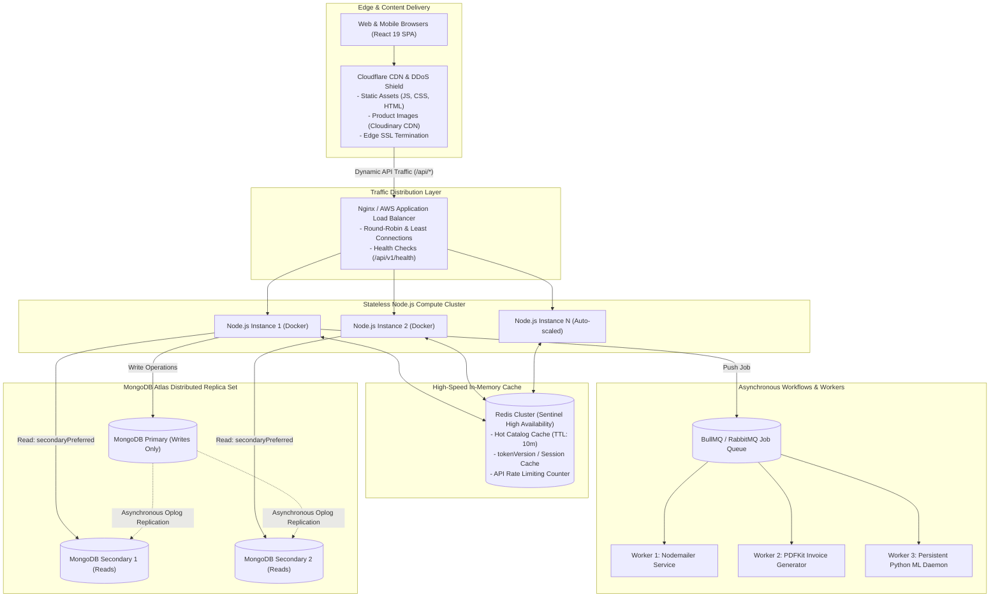

# CHAPTER 16: SYSTEM DESIGN & SCALABILITY ROADMAP

> **Focus:** Architectural evolution, Scaling from 1,000 to 100,000 Daily Active Users (DAU), Redis caching patterns, Message queues (BullMQ/RabbitMQ), MongoDB Sharding & Read Replicas, and Microservices decomposition.  
> **Source Files Referenced:** `docs/ARCHITECTURE.md`, `docs/FEATURE_ROADMAP.md`, `backend/src/server.js`, `backend/src/controllers/productController.js`.

---

## 1. Core Definitions (English)

- **Vertical Scaling (Scale Up):** Adding more computational power (CPU, RAM, NVMe storage) to an existing single server instance.
- **Horizontal Scaling (Scale Out):** Adding more discrete server nodes to a distributed pool and balancing incoming network traffic across them via a load balancer.
- **Cache-Aside Pattern:** A caching strategy where the application code first queries an in-memory cache (e.g. Redis); if a cache miss occurs, it queries the persistent database, stores the result in cache with a TTL, and returns it to the client.
- **Message Queue:** An asynchronous communication protocol where message producers push jobs to a durable FIFO broker (e.g. RabbitMQ, Redis BullMQ), which holds the messages until consumer worker processes dequeue and process them.
- **Read Replicas:** Read-only copies of the primary database node that asynchronously replicate write operations, allowing read-heavy traffic to be distributed away from the write-master.

---

## 2. Concept Explanations (Hinglish with Real-Life Metaphors)

### Vertical vs. Horizontal Scaling
> **Real-Life Analogy (Gym Bodybuilder vs Team of 5 Friends):**  
> - **Vertical Scaling (Scale-Up):** Ek hi bande ko bolna *"Tu gym jaakar 500kg utha!"* Ek limit ke baad insaan ki haddiya toot jayengi (Hardware cost exponential ho jaati hai aur single point of failure rehta hai).  
> - **Horizontal Scaling (Scale-Out):** 5 normal dosto ko bula lena aur sabko 100-100kg uthane ko bolna! Agar ek dost beemar bhi pad gaya, baaki 4 dost load sambhal lenge (Fault-tolerant, cost-effective, infinite scaling).

---

### Redis In-Memory Caching
> **Real-Life Analogy (Bed ke Paas rakhi Water Bottle vs Har baar Kitchen jana):**  
> Raat ko 2 baje tumhe pyas lagi:  
> - **Database Query:** Bed se utho, chappal pehno, kitchen jao, filter ka button dabao, glass bharo, wapas aao (High latency: 50ms - 200ms disk read).  
> - **Redis Cache:** Bed ke side table par rakhi bottle se turant ek ghoont paani pi lo (Sub-millisecond: 1ms RAM read).

---

### Asynchronous Message Queues
> **Real-Life Analogy (Post Office Mailbox vs Daakiye ko Hath mein Letter Dena):**  
> - **Synchronous:** Tum post office jate ho aur bolte ho *"Jab tak daakiya Mumbai jakar letter deliver nahi karta, main counter se nahi hilunga!"* Pura post office ruk jayega!  
> - **Asynchronous Queue:** Tum counter par box mein letter drop karte ho (`job added to queue`), receipt lete ho aur turant ghar chale aate ho (`200 OK Accepted`). Daakiya raat ko apni cycle se letter Mumbai deliver kar deta hai (`Background Worker Processing`).

---

## 3. High-Scale Production Architecture (100,000 DAU)



---

## 4. Architectural Scaling Milestones (Phased Evolution)

### Phase 1: Current Baseline (1,000 DAU)
- **Architecture:** Monolithic container running Express + embedded Python ML via `child_process.spawn`.
- **Database:** Single MongoDB Atlas cluster.
- **Assets:** Frontend compiled and served via Express static middleware; dynamic images stored on Cloudinary.
- **Concurrency:** Up to 50 concurrent users handled smoothly; batch ML inference capped at 50 users.

---

### Phase 2: Caching & Separation (10,000 DAU)
1. **Decouple Frontend Delivery:** Move the compiled React bundle to Cloudflare Pages or AWS S3 + CloudFront. Node.js focuses 100% of its event loop on processing API queries.
2. **Implement Redis Cache-Aside for Catalog:**
   ```javascript
   // Evolution snippet: Redis caching for product catalog
   const getProducts = async (req, res) => {
     const cacheKey = `products:${JSON.stringify(req.query)}`;
     const cachedData = await redisClient.get(cacheKey);

     if (cachedData) {
       return res.status(200).json(JSON.parse(cachedData));
     }

     const products = await Product.find(query).lean();
     await redisClient.set(cacheKey, JSON.stringify(products), 'EX', 600); // 10 min TTL
     res.status(200).json({ success: true, products });
   };
   ```
3. **Database Read/Write Splitting:** Configure Mongoose connection with `readPreference: 'secondaryPreferred'`. Catalog read queries are routed to replica nodes, reserving the primary node for checkouts and inventory mutations.

---

### Phase 3: High-Throughput Distributed Microservices (100,000+ DAU)
1. **Decouple Python ML into Persistent Daemon:** Replace `child_process.spawn` with an independent Python FastAPI microservice or Celery worker backed by Redis. The ML model resides permanently in GPU/CPU RAM, eliminating process spawn overhead.
2. **Asynchronous Order Processing Queue (BullMQ):**
   - When the user completes Razorpay payment, Node immediately responds: `202 Accepted { orderId, status: 'Processing' }`.
   - The order event is pushed to BullMQ.
   - Dedicated background workers generate the PDFKit invoice, decrement stock, and send the Nodemailer confirmation email asynchronously.
3. **MongoDB Sharding:** Shard the `Order` collection across multiple physical shards using a compound shard key `{ user: 'hashed', createdAt: 1 }` to distribute write I/O across hardware partitions.

---

## 5. Spoken Interview Answers

### Short Answer (30 Seconds)
> *"To scale E-Shop from its current architecture to 100,000 daily active users, we would transition our stateless monolith into a horizontally distributed system. We would offload static assets to Cloudflare CDN, place an Nginx load balancer across multiple stateless Node instances, and implement Redis for product caching and token versioning. For heavy workloads, we would decouple PDF generation, email notifications, and Python churn inference into asynchronous BullMQ background workers, while scaling MongoDB using replica sets for read/write splitting."*

---

### Detailed Answer (90 Seconds)
> *"Scaling a full-stack e-commerce system requires analyzing where bottlenecks emerge under high concurrency. In our current architecture, the application is already designed to be horizontally scalable because our Node backend is completely **stateless**—sessions are handled via JWTs, media is stored in Cloudinary, and state is preserved in MongoDB.  
>  
> To scale to 100,000 DAU, we would evolve the system across three core tiers:  
>  
> First, at the **Caching Tier**, over 80% of e-commerce traffic is read-only browsing. We would implement Redis using the Cache-Aside pattern for our catalog endpoints (`/api/v1/products`), setting a 10-minute TTL with automated cache eviction upon admin product updates. This would deflect up to 85% of database read queries away from MongoDB directly to in-memory RAM.  
>  
> Second, at the **Compute & Asynchronous Tier**, heavy operations like PDF invoice generation with PDFKit and Python ML churn predictions should not compete with checkout requests on the main Node event loop. We would introduce a distributed message queue using BullMQ and Redis. When a customer pays, we immediately return a 200 response, while a background worker generates the PDF, and a persistent Python worker runs churn predictions continuously in the background.  
>  
> Third, at the **Database Tier**, we would configure Mongoose with `readPreference: 'secondaryPreferred'`. Write operations—such as atomic inventory decrements during checkout—would hit the MongoDB primary master, while search and catalog queries would distribute across read-only replica secondaries. As the database exceeds terabytes of order data, we would introduce horizontal sharding on the order collection using a hashed user shard key."*

---

## 6. Interview Questions & Model Answers

### Level 1: Basic
**Question:** What is the difference between Cache-Aside and Write-Through caching?  
**Interview Answer (English):**  
*"In **Cache-Aside (Lazy Loading)**, the application first checks the cache. On a cache miss, it reads from the database, writes the entry into the cache, and returns it. Data is only loaded into the cache when requested.  
In **Write-Through**, whenever data is written or updated, the application writes to the cache and the database simultaneously. The cache is always consistent with the database, but it introduces higher write latency."*

---

### Level 2: Intermediate
**Question:** What is the Thundering Herd Problem (Cache Stampede) and how do you prevent it?  
**Interview Answer (English):**  
*"The Thundering Herd problem occurs when a highly requested cache key expires (for example, the homepage featured products key during Black Friday). Suddenly, thousands of concurrent requests experience a cache miss simultaneously and hit the database at the exact same millisecond, overwhelming database CPU and causing an outage.  
We prevent this using:  
1. **Mutual Exclusion Locks (Mutex / Redlock):** Only the first request that misses the cache acquires a distributed lock to query the database and rebuild the cache; all other requests wait or receive stale data.  
2. **Probabilistic Early Expiration (XFetch):** The cache asynchronously refetches and updates the database record slightly before the TTL officially expires."*

---

### Level 3: Advanced
**Question:** How does MongoDB handle data replication across replica sets, and what is the difference between `w: 1` and `w: 'majority'`?  
**Interview Answer (English):**  
*"MongoDB uses an asynchronous Oplog (Operations Log) mechanism for replication. The primary node records all writes into its local `oplog.rs` collection, and secondary nodes continuously poll and apply these operations to their local data copies.  
The write concern `w` defines the acknowledgment level:  
- **`w: 1` (Default):** The primary acknowledges the write as soon as it commits to its local memory/journal, before replicating to secondaries. It is fast, but if the primary crashes before replicating, data can be lost during failover.  
- **`w: 'majority'`:** The primary waits until a majority of replica set nodes (e.g. 2 out of 3) have committed the write to their journals before returning success. This guarantees strong durability and prevents rollbacks during primary election failovers, making it essential for financial transactions like our checkout pipeline."*

---

### Level 4: Project-Specific Cross-Examination
**Interviewer:** *"If you introduce Redis to cache products, how do you handle Cache Invalidation when an admin updates a product price or stock decrements during checkout?"*  
**Spoken Defense (English):**  
*"Cache invalidation is handled using an event-driven eviction strategy:  
For administrative product updates (e.g. changing title, description, or base price), our `productController.js` invalidates the specific key upon successful database mutation:  
`await Promise.all([redisClient.del(`product:${id}`), redisClient.del('products:featured')])`.  
However, for high-frequency **Stock Decrements** during checkout, caching mutable stock numbers in Redis alongside static product data can cause cache inconsistency.  
Therefore, we separate static product details (title, category, images) which are cached in Redis with a 15-minute TTL, from real-time available inventory counts. Inventory verification is ALWAYS routed directly to MongoDB using our atomic `$inc` queries. This gives us sub-millisecond catalog browsing while maintaining 100% transactional accuracy for stock levels."*

---

## 7. Comparative Technical Matrix: Message Brokers

| Feature | Redis BullMQ | RabbitMQ | Apache Kafka |
| :--- | :--- | :--- | :--- |
| **Architecture** | Memory-based FIFO Job Queue | Advanced Message Broker (AMQP) | Distributed Streaming Event Log |
| **Throughput** | ~50,000 jobs/sec | ~30,000 messages/sec | 1,000,000+ events/sec |
| **Complexity** | Very Low (Uses existing Redis) | Medium (Erlang runtime) | High (Requires Zookeeper/KRaft) |
| **Message Ordering** | Strict Priority & FIFO | Strict FIFO | Partition-ordered |
| **Best For** | Background jobs, emails, invoices | Complex enterprise routing | Big Data pipelines, clickstreams |

---

## 8. Common Interview Traps & Pitfalls

> [!WARNING]
> **Trap 1: Suggesting Microservices prematurely.**  
> *Reality:* Never tell an interviewer you would immediately rewrite your app into 15 microservices for 10,000 users. Microservices introduce massive operational overhead: network serialization latency, distributed tracing (Jaeger), container orchestration (Kubernetes), and distributed transactions (Saga pattern). A well-architected modular monolith with Redis and background queues easily scales to 100,000+ DAU at a fraction of the cost.
>
> **Trap 2: Ignoring Database Connection Pool exhaustion.**  
> *Reality:* When horizontally scaling Node instances (e.g. 10 instances), if each instance configures `maxPoolSize: 100`, your instances could attempt to open 1,000 concurrent TCP sockets to MongoDB Atlas. Free or basic database tiers have connection limits (e.g. 500 connections). Always tune `maxPoolSize` relative to your horizontal instance count.
>
> **Trap 3: Caching user-specific data with generic keys.**  
> *Reality:* Writing `redis.set('cart', JSON.stringify(cart))` without namespacing will cause all users to share the exact same cart! Always namespace cache keys with user identifiers: `cart:${userId}`.

---

## 9. Quick Revision Rapid-Fire (15 Q&As)

1. **What is Horizontal Scaling?** Adding more server instances to distribute load.
2. **What is Vertical Scaling?** Upgrading CPU/RAM on an existing machine.
3. **What is a Load Balancer?** A device or software (Nginx, ALB) that distributes incoming network traffic across multiple backend servers.
4. **What is Round Robin load balancing?** Distributing requests sequentially down the list of servers.
5. **What is the Cache-Aside pattern?** Checking cache first; querying DB and populating cache on a miss.
6. **What is Redis?** An open-source, in-memory key-value data structure store used as a database, cache, and message broker.
7. **What is a TTL in Redis?** Time-To-Live—the expiration time after which a key is automatically deleted.
8. **What is BullMQ?** A fast, reliable Node.js message queue library based on Redis.
9. **What is Read/Write Splitting?** Directing write operations to the database primary and read operations to secondary replicas.
10. **What is Database Sharding?** Partitioning data horizontally across multiple independent database servers.
11. **What is an Oplog in MongoDB?** A special capped collection that records a rolling history of all write operations for replication.
12. **What does `readPreference: 'secondaryPreferred'` mean?** Read from secondary replica nodes under normal conditions, but fall back to the primary if secondaries are unavailable.
13. **What is a CDN?** Content Delivery Network—a geographically distributed network of proxy servers that cache content close to end users.
14. **Why is our Node server stateless?** Because it stores no user sessions in local memory, enabling horizontal scaling without sticky sessions.
15. **What is the primary bottleneck in e-commerce applications?** Database write contention on inventory during high-concurrency checkouts.

