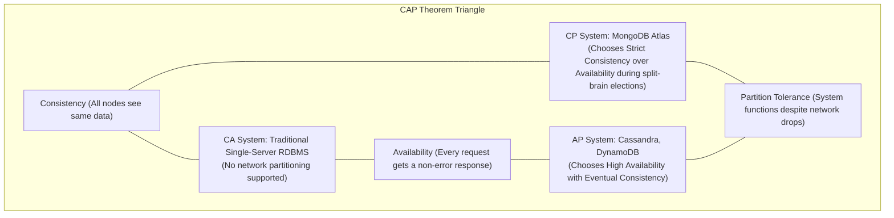
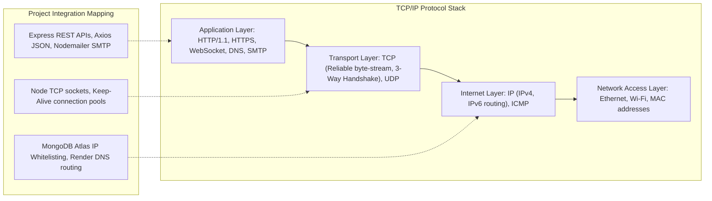

# CHAPTER 18: COMPUTER SCIENCE FUNDAMENTALS APPLIED TO E-SHOP

> **Focus:** Operating Systems, Database Management Systems (DBMS), Computer Networks, and Object-Oriented Software Engineering applied directly to project implementation.  
> **Source Files Referenced:** `backend/src/server.js`, `backend/src/controllers/adminController.js`, `backend/src/config/db.js`, `frontend/src/services/api.js`.

---

## 1. Operating Systems (OS) in Project Context

### A. Process vs. Thread
- **Definition:**  
  - **Process:** An executing instance of a computer program allocated its own independent virtual address space, memory heap, file descriptors, and security context by the OS kernel.  
  - **Thread:** The smallest unit of execution scheduled by an operating system, residing within a parent process and sharing the process's heap memory, code segment, and open files.
- **Project Application:**  
  When our backend runs, Node.js is an **Operating System Process** running on a single main thread for JavaScript execution.  
  When `adminController.js` executes `spawn('python3', [ML_SCRIPT])`, Node does NOT spawn a thread; it makes a kernel system call (`fork/exec` on Linux) to create an entirely separate **OS Process** with a unique Process Identifier (PID).  
  Meanwhile, Libuv's C++ worker threads (`UV_THREADPOOL_SIZE=4`) operate as **Threads** within the Node process, executing Bcrypt hashing and disk I/O concurrently while sharing Node's process memory.

---

### B. Inter-Process Communication (IPC) Mechanisms
- **Concept & Comparison:**
  | IPC Mechanism | Speed | Memory Sharing | Project Usage |
  | :--- | :--- | :--- | :--- |
  | **Anonymous Pipes** | High (In-memory ring buffer) | Isolated (OS buffer) | **Used in E-Shop:** `stdin`/`stdout` streams between Node and Python |
  | **UNIX Domain Sockets**| Very High | Isolated (Kernel socket) | Docker daemon communication |
  | **TCP/IP Sockets** | Medium (Network stack) | Isolated (Remote network)| Node.js communicating with MongoDB Atlas |
  | **Shared Memory** | Fastest | Shared RAM address space | High-frequency algorithmic trading systems |

---

### C. Virtual Memory & Garbage Collection (V8 Engine)
- **Concept:** Node.js memory is divided into the **Stack** (primitive values and call frames) and the **Heap** (dynamic objects, closures, strings, buffers).
- **V8 Generational Garbage Collection:**  
  1. **Young Generation (Scavenge Algorithm):** Short-lived objects (e.g. temporary variables inside controllers) are allocated here and quickly reclaimed using the Cheney copying algorithm.  
  2. **Old Generation (Mark-Sweep & Mark-Compact):** Long-lived objects (e.g. Mongoose models, Express router tables, persistent stores) that survive several scavenge cycles are promoted to the Old Space and collected via Mark-Sweep algorithms to prevent memory fragmentation.

---

## 2. Database Management Systems (DBMS) in Project Context

### A. ACID vs. BASE Properties
- **ACID (Traditional Relational / MongoDB Transactions):**
  - **Atomicity:** All operations in checkout succeed or all rollback (Mongoose transaction session).
  - **Consistency:** Inventory stock never drops below zero (`{ stock: { $gte: quantity } }`).
  - **Isolation:** Concurrent transactions cannot see uncommitted stock decrements.
  - **Durability:** Committed orders are written to the Write-Ahead Log (WiredTiger Journal) and will survive server crashes.
- **BASE (NoSQL Distributed Systems):**
  - **Basically Available:** System remains available during partitions.
  - **Soft state:** State may drift temporarily without input.
  - **Eventual consistency:** Read replicas in MongoDB catch up to the primary via the replication Oplog within milliseconds.

---

### B. Database Indexing: B-Trees vs. B+ Trees
- **Internal Mechanics:**  
  MongoDB's WiredTiger storage engine utilizes a **B-Tree** structure for indexing single and compound fields (e.g. `{ category: 1, price: 1 }`).  
  In a B-Tree, both internal nodes and leaf nodes store keys and document data pointers. In a B+ Tree (used by MySQL InnoDB), data pointers are stored *only* at the leaf nodes, connected via a doubly-linked list.  
  Because MongoDB uses B-Trees, queries searching for exact keys (like finding an order by `_id`) can terminate early at an internal branch node in $O(\log n)$ time without traversing down to the leaf layer.

---

### C. CAP Theorem & MongoDB Classification
- **Theorem:** A distributed system can guarantee at most two out of three properties simultaneously: **Consistency**, **Availability**, and **Partition Tolerance**.

- **Where MongoDB Fits:**  
  MongoDB is fundamentally a **CP (Consistency & Partition-Tolerant)** system. If a network partition occurs between replica set nodes, MongoDB elects a new primary only if a majority of nodes are reachable. If a network partition isolates a primary node from the majority, that primary steps down to read-only, prioritizing strict data consistency over availability to prevent conflicting writes (split-brain).

---

## 3. Computer Networks in Project Context

### A. The OSI vs. TCP/IP Model Mapped to E-Shop

---

### B. The TCP 3-Way Handshake & 4-Way Teardown
1. **SYN (Synchronize):** Client sends a TCP packet with a random sequence number $X$ to port 5000: *"I want to open a connection."*
2. **SYN-ACK (Synchronize-Acknowledge):** Server acknowledges receipt by sending $ACK = X + 1$ and responds with its own sequence number $Y$: *"Connection approved; here is my sequence."*
3. **ACK (Acknowledge):** Client sends $ACK = Y + 1$: *"Acknowledged; connection established."*  
- **Why HTTP Keep-Alive Matters:** Performing this 3-way handshake on every single API request adds 50ms of network latency. In our Express server, we enable HTTP `Keep-Alive`, allowing a client to send multiple HTTP requests over a single established TCP socket.

---

### C. The TLS/SSL Handshake (HTTPS)
1. **Client Hello:** Browser sends supported cipher suites and TLS version to our server.
2. **Server Hello & Certificate:** Server presents its public SSL certificate containing its public RSA/ECC key, verified by a Certificate Authority (Let's Encrypt on Render).
3. **Pre-Master Secret Exchange:** Browser generates an ephemeral symmetric encryption key, encrypts it using the server's public key, and sends it to the server.
4. **Symmetric Session Encryption:** Both parties derive identical **Symmetric Session Keys**. All subsequent HTTP headers, JWTs, and payloads are encrypted using high-speed symmetric AES-256-GCM.

---

## 4. Software Engineering & SOLID Principles Applied

### A. The 4 Pillars of OOP in E-Shop
1. **Encapsulation:** In `User.js`, password hashing is encapsulated within a Mongoose pre-save middleware hook. The rest of the application never interacts with raw password salting algorithms; they simply invoke `user.save()`.
2. **Abstraction:** In `paymentService.js`, the complexity of generating HMAC-SHA256 digests and timing-safe buffers is abstracted behind a clean function contract: `verifyRazorpayPayment(orderId, paymentId, signature)`.
3. **Inheritance:** Our operational error class `class AppError extends Error` inherits JavaScript's native `Error` prototype, extending it with custom properties (`statusCode`, `isOperational`).
4. **Polymorphism:** The `predict()` function in `backend/ml-models/predict.py` exhibits polymorphism: it accepts either a single JSON record or an array of records, routing dynamically to `predict_xgboost()` while returning a standardized response contract.

---

### B. SOLID Principles in Our Codebase
- **S — Single Responsibility Principle (SRP):**  
  Each file handles strictly one concern. Routes define URL paths; Controllers parse HTTP requests and format responses; Services (`invoiceService.js`, `paymentService.js`) execute specialized domain logic; Models define data schemas.
- **O — Open/Closed Principle (OCP):**  
  Our Express middleware pipeline is open for extension but closed for modification. We can add new security or auditing middlewares (`AdminLog.js`) by chaining them with `app.use()` without modifying existing controller source code.
- **L — Liskov Substitution Principle (LSP):**  
  Our custom `AppError` can substitute for standard JavaScript `Error` objects anywhere in the Express pipeline without breaking the 4-argument error-handling middleware.
- **I — Interface Segregation Principle (ISP):**  
  Our frontend React components adhere to granular props contracts. Rather than passing an entire heavy 50-field `product` object to `<ProductPriceTag />`, we pass strictly `{ price, discountPercentage }`.
- **D — Dependency Inversion Principle (DIP):**  
  Controllers do not directly instantiate database socket connections; they depend on high-level Mongoose Model abstractions (`Product`, `Order`), which in turn depend on connection configurations injected via environment variables.

---

## 5. Spoken Interview Answers

### Short Answer (30 Seconds)
> *"Our project directly demonstrates core Computer Science fundamentals. In Operating Systems, we leverage process isolation by spawning an independent Python process via anonymous OS streams while running concurrent I/O on Node's Libuv thread pool. In DBMS, we balance the CAP theorem by using MongoDB as a CP system, executing atomic operations on WiredTiger B-Trees. In Computer Networks, we enforce HTTPS security via TLS handshakes and minimize socket overhead using HTTP Keep-Alive. In Software Engineering, our codebase strictly implements the SOLID principles and 3-tier MVC modularity."*

---

### Detailed Answer (90 Seconds)
> *"When designing E-Shop, computer science fundamentals guided our low-level technical trade-offs across four disciplines:  
>  
> In **Operating Systems**, understanding process address space separation was crucial when integrating machine learning. Spawning Python as an independent OS process guarantees memory isolation: if Python crashes or suffers a segmentation fault due to a native C++ XGBoost issue, the OS kernel terminates that PID without taking down our Node.js server. Node's event loop simply receives an exit code on the process stream and gracefully falls back to JavaScript heuristics.  
>  
> In **Database Systems**, we designed our schemas around the CAP theorem and indexing theory. MongoDB operates as a CP system, prioritizing strict consistency during network partitions to prevent financial double-spending. For indexing, WiredTiger utilizes balanced B-Trees. We created compound indexes on `{ category: 1, price: 1 }` so multi-field queries execute in $O(\log n)$ B-Tree traversals rather than $O(n)$ full collection scans.  
>  
> In **Computer Networks**, we optimized network latency and security. All API communication requires TLS encryption, where asymmetric cryptography exchanges an ephemeral symmetric key used to encrypt subsequent traffic via AES. We configure HTTP Keep-Alive connection pools to eliminate redundant TCP 3-way handshakes between our Node backend and MongoDB Atlas.  
>  
> Finally, in **Software Engineering**, we enforced the Single Responsibility Principle across our MVC architecture. Controllers manage HTTP request and response lifecycles, Services isolate third-party integrations like Razorpay and PDFKit, and custom classes like `AppError` leverage inheritance to standardize operational error propagation."*

---

## 6. Interview Questions & Model Answers

### Level 1: Basic
**Question:** What is a Deadlock in Operating Systems, and what are the four Coffman conditions required for a deadlock to occur?  
**Interview Answer (English):**  
*"A deadlock is a situation where two or more competing processes are unable to proceed because each is waiting for the other to release a shared resource.  
The four Coffman conditions that must hold simultaneously for a deadlock to exist are:  
1. **Mutual Exclusion:** Resources cannot be shared simultaneously.  
2. **Hold and Wait:** A process holding at least one resource is waiting to acquire additional resources held by other processes.  
3. **No Preemption:** Resources cannot be forcibly confiscated from a process holding them.  
4. **Circular Wait:** A closed chain of processes exists such that each process holds a resource needed by the next process in the chain."*

---

### Level 2: Intermediate
**Question:** Explain how a B-Tree Index differs from a Hash Index in database systems. Why does MongoDB use B-Trees for range queries?  
**Interview Answer (English):**  
*"A **Hash Index** uses a hash function to map keys to bucket locations. It provides instantaneous $O(1)$ lookups for exact matches (e.g. `find({ _id: '123' })`). However, hash functions scramble ordering, making Hash Indexes completely incapable of supporting range queries or sorting (e.g. `{ price: { $gte: 500, $lte: 2000 } }` or `.sort({ price: 1 })`).  
A **B-Tree Index** maintains keys in a strictly sorted, self-balancing hierarchical tree structure. Traversals for exact lookups take $O(\log n)$ time, but because nodes preserve key order, B-Trees efficiently traverse ranges and satisfy sorted queries directly from the index tree without requiring expensive in-memory disk sorting."*

---

### Level 3: Advanced
**Question:** What is the difference between TCP and UDP? Why does our REST API use TCP, and when would an e-commerce platform use UDP?  
**Interview Answer (English):**  
*"TCP (Transmission Control Protocol) is connection-oriented, reliable, and byte-stream-based. It uses sequence numbers, acknowledgments, retransmissions, and flow control to guarantee that every byte arrives intact and in correct order. E-commerce REST APIs, credit card transactions, and authentication require 100% data integrity; losing a packet during a checkout call would corrupt the transaction.  
UDP (User Datagram Protocol) is connectionless, unreliable, and message-oriented. It sends datagrams without handshakes or retransmissions, prioritizing low latency over packet loss. An e-commerce platform would use UDP for live video streaming of product launches, VoIP customer service calls, or when adopting HTTP/3 (QUIC) to eliminate head-of-line blocking."*

---

### Level 4: Project-Specific Cross-Examination
**Interviewer:** *"If Node.js is single-threaded, how does it manage 10,000 concurrent network connections on the operating system level without blocking?"*  
**Spoken Defense (English):**  
*"Node.js achieves massive network concurrency using non-blocking I/O multiplexing provided by the OS kernel through Libuv.  
On Linux, Libuv registers incoming TCP socket file descriptors with the kernel's `epoll` system call (or `kqueue` on macOS).  
When 10,000 clients connect, Node does not allocate 10,000 threads. The sockets remain idle in the kernel. When a client transmits data packets, the network card triggers an interrupt, and `epoll_wait` notifies Node's Event Loop in the **Poll Phase**.  
Node reads the bytes asynchronously, processes the request, and dispatches the response. The single JavaScript thread is only active during the few microseconds needed to execute user code, remaining free to handle thousands of other socket notifications."*

---

## 7. Comparative Technical Matrix: Concurrency Models

| Concurrency Model | Architecture | Memory Overhead | Context Switch Cost | Examples |
| :--- | :--- | :--- | :--- | :--- |
| **Multi-Threaded (Thread-per-request)** | 1 OS Thread per client connection | High (~1MB stack per thread)| Heavy (Kernel context switch)| Apache HTTP, Java Spring Boot |
| **Event-Driven Non-Blocking (Single Thread)** | 1 Thread with Event Loop + Kernel `epoll` | Minimal (~few KB per socket) | Extremely Low (In-process loop) | **Node.js (E-Shop)**, Nginx |
| **Actor Model / CSP (Green Threads)** | Lightweight user-space green threads | Low (~2KB per goroutine) | Low (User-space scheduler) | Go (Goroutines), Erlang / Elixir |

---

## 8. Common Interview Traps & Pitfalls

> [!WARNING]
> **Trap 1: Claiming MongoDB does not support ACID transactions.**  
> *Reality:* A common legacy misconception. MongoDB has supported full multi-document ACID transactions across replica sets since version 4.0 (2018). Our project explicitly leverages them during multi-item checkout in `orderController.js`.
>
> **Trap 2: Saying HTTP/2 uses UDP.**  
> *Reality:* HTTP/2 still runs over traditional **TCP**. It introduced multiplexing, header compression (HPACK), and binary framing, but it still suffers from TCP head-of-line blocking if a packet drops. **HTTP/3 (QUIC)** is the version that runs over UDP.
>
> **Trap 3: Confusing Authentication with Authorization.**  
> *Reality:* Authentication answers: *"Who are you?"* (Identity verified via JWT / Password). Authorization answers: *"Do you have permission to do this?"* (Role verified via RBAC `authorize('admin')`).

---

## 9. Quick Revision Rapid-Fire (15 Q&As)

1. **What is a Process?** An executing program with its own dedicated memory address space.
2. **What is a Thread?** A lightweight unit of execution sharing memory with other threads in the same process.
3. **What is Virtual Memory?** An OS abstraction that gives programs the illusion of a contiguous memory space using physical RAM and disk paging.
4. **What is a Context Switch?** The process of saving the execution state of one thread/process and loading the state of another.
5. **What is an Index in DBMS?** A data structure (B-Tree/Hash) that accelerates data retrieval operations.
6. **What does the C in ACID stand for?** Consistency.
7. **What does the C in CAP stand for?** Consistency.
8. **Is MongoDB CP or AP?** CP (Consistency and Partition Tolerance).
9. **What port does HTTPS use?** Port `443`.
10. **What port does standard HTTP use?** Port `80`.
11. **What is the TCP 3-Way Handshake sequence?** SYN -> SYN-ACK -> ACK.
12. **What symmetric encryption algorithm is standard in TLS?** AES-256-GCM.
13. **What is the S in SOLID?** Single Responsibility Principle.
14. **What is the D in SOLID?** Dependency Inversion Principle.
15. **What is the OS system call used by Libuv on Linux for non-blocking I/O?** `epoll`.

