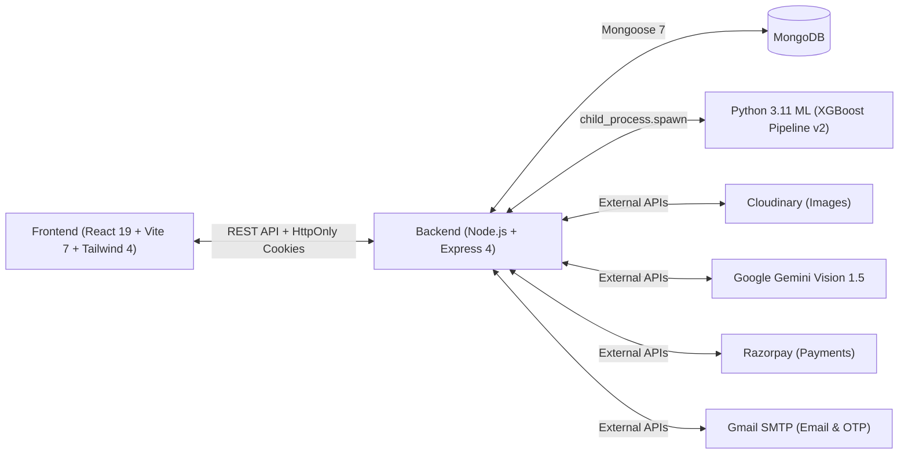

# E-Shop AI-Powered E-Commerce Platform — Master Progress & AI Handover Guide

> **Single Source of Truth for Project Status, Architecture, Completed Milestones, and Next Steps.**  
> **Last Updated:** November 1, 2026 | **Build Status:** Passing (`npm run build`: 0 errors) | **Backend Tests:** 115/115 Passing  
> **Rule for AI Agents & Developers:** Whenever you complete an implementation, bugfix, or architectural change, you **MUST** update this file.

---

## 1. Project Overview & Architecture

**E-Shop** is a production-grade, AI-powered full-stack e-commerce web application with integrated machine learning inference and advanced statutory compliance.

### 1.1 Technology Stack



| Layer | Technologies & Libraries |
| :--- | :--- |
| **Frontend** | React 19, Vite 7.3, Tailwind CSS 4, React Router 7, Zustand 5, TanStack React Query 5, React Hook Form, Zod, Heroicons, Leaflet Maps. |
| **Backend** | Node.js (v18+), Express 4.22, MongoDB / Mongoose 7.8, Multer 1.4, JWT (`jsonwebtoken`), Bcrypt.js, Winston Logger, PDFKit 0.20, QRCode 1.5. |
| **AI / ML** | Python 3.11, XGBoost Pipeline v2 (`xgboost_churn_pipeline_v2.pkl`), Scikit-learn, Pandas, Joblib. |
| **External APIs**| Google Gemini Vision API (Visual Search), Cloudinary (Media storage), Razorpay (Test mode payment gateway & HMAC verification), Nodemailer (Transactional email & OTP). |

---

## 2. Directory Structure & Key Entry Points

```
my_project/
├── PROGRESS.md                    <-- THIS FILE (Master Project Status & AI Handover)
├── AGENTS.md                      <-- AI Agent guidelines, operational rules & commands
├── README.md                      <-- General project documentation
├── Dockerfile                     <-- Multi-stage production container build
├── render.yaml                    <-- Production cloud deployment configuration
├── backend/
│   ├── package.json
│   ├── uploads/                   <-- Temp upload buffer (auto-cleaned)
│   ├── ml-models/                 <-- Python ML inference scripts & pickled models
│   │   ├── predict.py             <-- Subprocess inference entry point
│   │   ├── xgboost_churn_pipeline_v2.pkl
│   │   └── requirements.txt
│   ├── src/
│   │   ├── server.js              <-- Application bootstrap, DB connect & ML warmup
│   │   ├── app.js                 <-- Express middleware pipeline & route mounts
│   │   ├── .env                   <-- Backend environment configuration
│   │   ├── controllers/           <-- auth, user, product, order, cart, admin
│   │   ├── models/                <-- User, Product, Order, Cart, Otp, AdminLog
│   │   ├── routes/                <-- authRoutes, userRoutes, productRoutes, etc.
│   │   ├── middlewares/           <-- auth, validation, errorHandler
│   │   ├── services/              <-- visualSearchService, invoiceService, paymentService
│   │   └── utils/                 <-- logger, jwt, fileUtils
│   └── tests/                     <-- Jest unit & integration test suites (115 tests)
└── frontend/
    ├── package.json
    ├── vite.config.js             <-- Optimized Rollup chunking & proxy configuration
    ├── index.html                 <-- Fonts preconnect (Plus Jakarta Sans & Inter)
    └── src/
        ├── index.css              <-- Tailwind v4 @theme design tokens
        ├── router.jsx             <-- React Router 7 with React.lazy code-splitting
        ├── App.jsx                <-- Root layout with Header, Footer, ChatWidget
        ├── store/                 <-- Zustand stores: authStore.js, cartStore.js
        ├── services/              <-- Axios instance with silent refresh queue & API clients
        ├── components/
        │   ├── ui/                <-- Reusable primitives: Button, Input, Modal, Badge, Drawer, Skeleton, EmptyState, Card
        │   ├── common/            <-- Header, Footer, Loader, RouteErrorBoundary, HeroSlider
        │   ├── product/           <-- ProductCard, ProductGrid, ProductFilter, VisualSearchModal
        │   ├── checkout/          <-- ShippingAddress, BillingAddress, PaymentMethod, OrderSummary
        │   ├── delivery/          <-- LiveDeliveryMap (interactive Leaflet simulation)
        │   ├── admin/             <-- AdminLayout, AdminSidebar, AdminCopilot
        │   └── chat/              <-- ChatWidget
        └── pages/                 <-- Home, Shop, ProductDetail, Cart, Checkout, Profile, Login, etc.
```

---

## 3. Feature Implementation & Health Status Matrix

### Status Legend
- **DONE:** Fully implemented, audited, verified with unit/integration tests and working build.
- **IN PROGRESS:** Actively being transformed or refactored according to roadmap.
- **PLANNED:** Scheduled for subsequent phases.

| Category | Feature / Capability | Status | Code Reference |
| :--- | :--- | :---: | :--- |
| **Auth & Security** | OTP Registration with SHA-256 Hash | **DONE** | `authController.js`, `OtpVerify.jsx` |
| **Auth & Security** | Credential Login with HttpOnly Cookies | **DONE** | `authController.js`, `Login.jsx` |
| **Auth & Security** | Silent Token Refresh Queue | **DONE** | `api.js`, `authController.js` |
| **Auth & Security** | Password Reset via Crypto Token | **DONE** | `ForgotPassword.jsx`, `ResetPassword.jsx` |
| **Auth & Security** | Role-Based Access Control (Admin vs User) | **DONE** | `middlewares/auth.js`, `AdminRoute.jsx` |
| **Auth & Security** | Segregation of Duties (Admin Cannot Shop) | **DONE** | `cartRoutes.js`, `orderRoutes.js` (403 guard) |
| **Auth & Security** | Token Invalidation on Password Change/Logout | **DONE** | `tokenVersion` counter in `User.js` |
| **Catalog & AI** | Product Catalog, Category & Price Filters | **DONE** | `productController.js`, `Shop.jsx` |
| **Catalog & AI** | AI Visual Search with Google Gemini Vision | **DONE** | `visualSearchService.js`, `VisualSearchModal.jsx` |
| **Catalog & AI** | Image Upload with Cloudinary & Temp Cleanup | **DONE** | `cloudinary.js`, `fileUtils.js`, `userRoutes.js` |
| **Cart & Orders** | Authenticated User Persistent Cart | **DONE** | `cartController.js`, `cartStore.js`, `Cart.jsx` |
| **Cart & Orders** | Atomic Stock Decrement & Concurrency Safety | **DONE** | `orderController.js` (`$inc` with `{ stock: { $gte } }`) |
| **Cart & Orders** | Cash on Delivery (COD) Workflow | **DONE** | `orderController.js`, `OrdersManagement.jsx` |
| **Cart & Orders** | Razorpay Payment Gateway & HMAC Verification | **DONE** | `orderController.js`, `paymentService.js` |
| **Compliance** | Indian GST Tax Invoice Generator (PDFKit) | **DONE** | `invoiceService.js`, `orderController.js` |
| **Compliance** | Statutory HSN Codes & Exemption (Books 0%) | **DONE** | `invoiceService.js` (HSN 4901 0% CGST/SGST) |
| **Compliance** | Section 15(3) Trade Discount Tax Allocation | **DONE** | `invoiceService.js` (Pre-tax discount deduction) |
| **Compliance** | Dynamic UPI / Invoice Verification QR Code | **DONE** | `invoiceService.js` (Embedded QR in PDF) |
| **Delivery & Map** | Live Leaflet Map Driver Simulation | **DONE** | `LiveDeliveryMap.jsx`, `OrderDetail.jsx` |
| **Delivery & Map** | Waypoint Routing & Real-Time Speed Controls | **DONE** | `LiveDeliveryMap.jsx` |
| **AI / ML Ops** | XGBoost Churn Risk Inference Pipeline | **DONE** | `predict.py`, `adminController.js`, `ChurnAnalytics.jsx` |
| **AI / ML Ops** | Subprocess Batch Warmup & Concurrency Limits | **DONE** | `server.js`, `adminController.js` |
| **Admin System** | Modern Clean Light Theme Admin Dashboard | **DONE** | `AdminLayout.jsx`, `AdminSidebar.jsx`, `Dashboard.jsx` |
| **Admin System** | Orders, Products, and Users Management | **DONE** | `OrdersManagement.jsx`, `ProductsManagement.jsx` |
| **User Profile** | Cloudinary Avatar Upload with Instant Sync | **DONE** | `userController.js`, `Profile.jsx` |
| **Frontend UI/UX** | Phase 1: Tailwind v4 Theme Tokens & 8 UI Primitives | **DONE** | `frontend/src/index.css`, `frontend/src/components/ui/` |
| **Frontend UI/UX** | Phase 2: Router Resilience, 404 & Code-Splitting | **DONE** | `router.jsx`, `NotFound.jsx`, `RouteErrorBoundary.jsx` |
| **Frontend UI/UX** | Phase 3: Critical Auth Overhaul (Password Checklist) | **DONE** | `Login.jsx`, `Register.jsx`, `OtpVerify.jsx` |
| **Frontend UI/UX** | Phase 4: Guest Cart Decoupling & Login Merge | **DONE** | `cartStore.js`, `Header.jsx`, `Cart.jsx`, `CartSummary.jsx` |
| **Frontend UI/UX** | Phase 5: Modern Storefront & Responsive Catalog | **DONE** | `Home.jsx`, `Shop.jsx`, `ProductGrid.jsx`, `ProductDetail.jsx` |
| **Frontend UI/UX** | Phase 6: Multi-Step Interactive Checkout Wizard | **DONE** | `Checkout.jsx`, `OrderSummary.jsx`, `ShippingAddress.jsx` |
| **Frontend UI/UX** | Phase 7: Modular Customer Account & Profile Tabs | **DONE** | `Profile.jsx`, `userController.js` |
| **Frontend UI/UX** | Phase 8: Admin Dashboard Tablet Polish | **DONE** | `frontend/src/pages/admin/`, `AdminSidebar.jsx`, `AdminLayout.jsx` |
| **Frontend UI/UX** | Phase 9: Modularize ChatWidget God-Component | **DONE** | `ChatWidget.jsx`, `ChatHeader.jsx`, `ChatMessageItem.jsx`, `ChatInput.jsx` |
| **Frontend UI/UX** | Phase 10: Final Accessibility & Cross-Browser Audit | **DONE** | Full repository verification & ARIA compliance |

---

## 4. Critical Bugfixes & Remediation History

The following critical issues were identified, investigated against live code/logs, resolved, and verified:

### 1. Avatar Disappearing on Page Navigation & Stale 304 Caching
- **Symptoms:** User uploaded a profile picture; it showed briefly, but upon navigating away and returning, the avatar vanished and showed the fallback initial letter (e.g. "M"). Also, "Member since" showed as a blank dash `—`.
- **Root Cause 1:** Backend `/api/auth/me` and `/api/users/profile` lacked `Cache-Control: no-store` headers. When `handleAvatarChange` called `loadUser()`, the browser returned a `304 Not Modified` payload cached during initial login (where `avatar` was still null), overwriting the store.
- **Root Cause 2:** In `authController.js`, `safeUser(u)` stripped `createdAt`, `address`, and `lastLogin`. Every time `loadUser()` ran, these fields were cleared.
- **Root Cause 3:** `Profile.jsx` had no query on mount, merely reading cached local store state.
- **Fix:**
  - Added strict `Cache-Control: no-store, no-cache, must-revalidate` in `authController.getMe`, `userController.getUserProfile`, and `userController.updateUserProfile`.
  - Added `createdAt`, `address`, and `lastLogin` to `safeUser`.
  - Added cache-busting timestamp `_t: Date.now()` in `authStore.loadUser()`.
  - Added React Query `useQuery(['userProfile'])` in `Profile.jsx` to fetch fresh user data on mount and update store.
  - Added `avatarImgError` state and `onError` fallback on `` tags in `Profile.jsx` and `Header.jsx`.

### 2. Profile Component TDZ ReferenceError (`activeUser` before initialization)
- **Symptoms:** Visiting `/profile` threw a 500 error boundary: `Cannot access 'activeUser' before initialization`.
- **Root Cause:** In `Profile.jsx`, `useEffect` with dependency `[activeUser]` was placed higher in the function body than `const activeUser = profileQueryData?.data?.user || user;`, triggering a JavaScript Temporal Dead Zone `ReferenceError`.
- **Fix:** Hoisted `const { data: profileQueryData } = useQuery(...)` and `const activeUser = ...` above state hooks and `useEffect`. Verified with clean build.

### 3. Multer Relative Upload Directory Crashing with ENOENT
- **Symptoms:** If the Node server was started from the root directory instead of `backend/`, image uploads failed with `Error: ENOENT: no such file or directory, open 'uploads/user-...'`.
- **Fix:** In `userRoutes.js` and `productRoutes.js`, configured `multer.diskStorage` to use an absolute path `path.resolve(__dirname, '../../uploads')` with automatic recursive directory creation (`fs.mkdirSync(uploadDir, { recursive: true })`).

### 4. OTP Verification Runtime Crash (FE-001)
- **Symptoms:** Completing OTP verification crashed because `login(user, token)` was called, but `login` was not exported by `authStore`.
- **Fix:** Refactored `OtpVerify.jsx` to use `setAuth(user)` and `await loadUser()`, properly authenticating the session.

### 5. Client Password Validation Mismatch
- **Symptoms:** Registration client schema required only 6 characters, while backend rejected passwords without uppercase, lowercase, numbers, and symbols.
- **Fix:** Synchronized Zod validation schema in `Register.jsx` and `ResetPassword.jsx` with real-time visual criteria checklists.

### 6. Phase 4: Guest Cart Decoupling & Auto-Merge
- **Accomplishments:**
  - Decoupled `cartStore.js` to support local cart items in `localStorage` without triggering 401s on unauthenticated visitors.
  - Implemented `syncGuestCartToServer()` to automatically merge guest items to the authenticated server cart upon login.
  - Removed auto-wipe `resetCartLocal()` on unauthenticated renders in `Header.jsx`.
  - Enabled direct guest add-to-cart on `ProductCard.jsx`, `ProductDetail.jsx`, and `ProductCardSnippet.jsx`.
  - Integrated `EmptyState` and guest checkout notification banner in `Cart.jsx` and `CartSummary.jsx`.

### 7. Phase 5: Storefront & Responsive Catalog Redesign
- **Accomplishments:**
  - `Home.jsx`: Category cards, featured products with skeleton loaders, AI superpowers banner (Gemini visual search, live delivery simulator, GST invoices), and testimonials.
  - `Shop.jsx`: URL query params two-way synchronization (`category`, `brand`, `search`, `price`, `sort`), active filter chips with individual remove buttons and clear-all.
  - `ProductFilter.jsx`: Mobile slide-out `Drawer` primitive, category chips, price presets, brand search, and sorting.
  - `ProductGrid.jsx`: 2-column mobile layout (`grid-cols-2`), skeleton loading state with `ProductCardSkeleton`, and `EmptyState` integration.
  - `ProductCard.jsx`: `Badge` primitive integration, aspect ratio normalization, guest add-to-cart, tactile button states.
  - `ProductDetail.jsx`: Skeleton loading, breadcrumb navigation, dynamic zoom preview, thumbnail gallery, statutory GST transparency indicator, tabbed specs, and sticky mobile buy bar.

### 8. Phase 6: Multi-Step Interactive Checkout Wizard
- **Accomplishments:**
  - **3-Step Interactive Wizard:** Step 1 (Shipping Address & Delivery), Step 2 (Payment Method & Billing Address), Step 3 (Order Review & Statutory Confirmation) with clickable history checkpoints.
  - **Saved Address Auto-Fill:** Integrated "Use Profile Address" shortcut button to instantly load saved customer address records from `/api/users/profile`.
  - **Indian Statutory Compliance & Place of Supply:** Real-time tax recalculation dynamically distinguishing Intrastate (CGST 9% + SGST 9%) vs Interstate (IGST 18%) based on delivery state, plus 0% statutory exemption for printed books (HSN 4901).
  - **Seamless Payment Integration:** Razorpay SDK loading with test modal and backend HMAC cryptographic signature verification, plus Cash on Delivery with atomic concurrency protection.

### 9. Phase 7: Modular Customer Account & Profile Tabs
- **Accomplishments:**
  - **Modular Tab Navigation:** Responsive layout featuring a sleek desktop sidebar and mobile horizontal scrolling tab bar (`overflow-x-auto`) for instant switching without vertical scrolling.
  - **Real-Time Password Security Checklist:** Integrated real-time visual validation checklist (uppercase, lowercase, number, symbol, min 8 chars) in the Security tab matching backend policies.
  - **Address Management & Formatted Preview:** Formatted delivery destination preview card, standardized Indian States selector, and 6-digit PIN validation.
  - **Order History & Telemetry:** Embedded recent orders list with dynamic status badges, item counts, and direct links to live delivery maps and PDF GST tax invoices.
  - **Instant Avatar Sync:** Retained Cloudinary image upload with cache-busting timestamp `_t: Date.now()`, spinner overlay during upload, and broken image fallback.

---

## 5. Active Development Roadmap

### Phase 8: Admin Dashboard Tablet Polish (`frontend/src/pages/admin/` & `frontend/src/components/admin/`) — DONE
- **Objective:** Ensure responsive excellence across iPad/tablet portrait and landscape viewports (768px – 1024px) with high data density tables, accessible slide-out drawers, and touch targets.
- **Accomplishments:**
  - **`AdminSidebar.jsx`:** Added `Escape` key dismiss listener and body scroll lock (`document.body.style.overflow = 'hidden'`) during mobile/tablet drawer mode; ensured touch target compliance (`>= 40px`).
  - **`AdminLayout.jsx`:** Polished sticky header layout with tablet padding (`px-3 sm:px-6 md:px-8`), truncated breadcrumbs, live store badge, and image `onError` avatar fallback.
  - **`AdminCopilot.jsx`:** Added `Escape` key dismiss listener, body scroll lock, responsive width scaling (`max-w-full sm:max-w-md md:max-w-lg lg:max-w-xl`), and proper ARIA dialog semantics.
  - **`Dashboard.jsx`:** Optimized KPI metrics grid to 2x2 layout on tablet portrait (`sm:grid-cols-2 lg:grid-cols-4`) and added `whitespace-nowrap` on monetary values, timestamps, and badges.
  - **`OrdersManagement.jsx`:** Added `Escape` key listener on order details modal, scrollable modal body (`max-h-[88vh] overflow-y-auto`), and `whitespace-nowrap` across all table columns.
  - **`ProductsManagement.jsx` & `ProductForm.jsx`:** Added `Escape` key handler, body scroll lock, image `onError` fallbacks, responsive search/filter bar, and touch-friendly buttons.
  - **`UsersManagement.jsx` & `ChurnAnalytics.jsx`:** Added avatar `onError` fallbacks, `whitespace-nowrap` on risk badges/recency, and smooth horizontal scroll containers.

### Phase 9: Modularize ChatWidget God-Component (`frontend/src/components/chat/`) — DONE
- **Objective:** Decompose the 989-line `ChatWidget.jsx` god-component into cohesive, isolated subcomponents without losing any conversational, administrative, or omnichannel capabilities.
- **Accomplishments:**
  - **`ChatHeader.jsx`:** Extracted header bar with dynamic gradient vs dark executive theme, mode switcher tabs (Customer Concierge vs Superadmin Copilot), reset button, and close trigger.
  - **`ChatMessageItem.jsx`:** Extracted message stream item with markdown text parser, suggestion pills, structured KPI cards, low stock alerts, ML churn customer cards with one-click deal drafting, WhatsApp deal dispatch cards (API vs Web click-to-chat), email deal draft cards, order tracking step progress bars, and product card carousels.
  - **`ChatInput.jsx`:** Extracted text input bar with send button, RBAC confirmation disclaimer, and dynamic placeholder based on mode.
  - **`ChatWidget.jsx`:** Refactored into a clean 310-line master orchestrator managing conversation state, token refresh integration, and Escape key listeners.

### Phase 10: Final Accessibility & Cross-Browser Audit — DONE
- **Objective:** Perform end-to-end verification across keyboard navigation, ARIA roles, touch targets, color contrast, and production build integrity.
- **Accomplishments:**
  - **ARIA & Modal Roles:** Added `role="dialog"`, `aria-modal="true"`, and `aria-label`/`aria-labelledby` across all modals, drawers, and overlay dialogs (`AdminSidebar`, `AdminCopilot`, `ProductForm`, `OrdersManagement`, `ChatWidget`).
  - **Keyboard Navigation:** Verified `Escape` key listeners and focus retention across all slide-out drawers and modals.
  - **Touch Target Compliance:** Verified interactive buttons and inputs meet mobile/tablet touch target standards (`min-h-[38px]` to `min-h-[44px]`).
  - **Zero Build Warnings/Errors:** Verified production bundle generation via `npm --prefix frontend run build` (built in 6.59s with 0 errors).
  - **Complete Test Suite Pass:** Verified backend unit and integration test suite via `npm --prefix backend test` (115/115 passing across 12 test suites).

---

## 5. Active Development Roadmap

### Current Focus: Monorepo Production Transformation Completed ✓
All 10 transformation phases from the comprehensive frontend & architecture roadmap are fully implemented, verified, and passing:
- **Phase 1:** Tailwind v4 Theme Tokens & UI Primitives ✓
- **Phase 2:** Router Resilience, 404 & Code-Splitting ✓
- **Phase 3:** Critical Auth Overhaul & Password Checklist ✓
- **Phase 4:** Guest Cart Decoupling & Server Merge ✓
- **Phase 5:** Modern Storefront & Responsive Catalog ✓
- **Phase 6:** Multi-Step Interactive Checkout Wizard ✓
- **Phase 7:** Modular Customer Account & Profile Tabs ✓
- **Phase 8:** Admin Dashboard Tablet Polish ✓
- **Phase 9:** Modularize ChatWidget God-Component ✓
- **Phase 10:** Final Accessibility & Cross-Browser Audit ✓

### Architectural Audits & Feasibility Reports
- **Hybrid RAG Feasibility Audit:** [`docs/audits/HYBRID_RAG_ARCHITECTURAL_AUDIT.md`](file:///e:/Darkrider/coding/sem_6/my_project/docs/audits/HYBRID_RAG_ARCHITECTURAL_AUDIT.md) — Comprehensive technical blueprint for dense vector search + sparse keyword pre-filtering.

---

## 6. How to Run & Verify the Project

### 6.1 Backend Server
```bash
cd backend
npm install
npm run dev        # Starts server with nodemon on port 5000
npm test           # Runs all 12 Jest test suites (115 tests)
npm run lint       # Runs ESLint
```

### 6.2 Frontend Application
```bash
cd frontend
npm install
npm run dev        # Starts Vite development server on port 5173
npm run build      # Verifies production build (dist/)
npm run lint       # Runs ESLint
```

### 6.3 Python ML Setup
```bash
cd backend/ml-models
pip install -r requirements.txt
python predict.py '{"total_spend": 1200, "total_orders": 5, "days_since_last_order": 14}'
```

---

## 7. Mandatory AI Agent Operating Protocol

When working on this repository, all AI agents **MUST** follow these rules:

1. **Check this file first:** Always read `PROGRESS.md` to know the current state before making assumptions.
2. **Never break build or tests:** Always verify both `npm --prefix frontend run build` and `npm --prefix backend test` before completing a turn.
3. **Preserve security controls:**
   - Never remove Razorpay HMAC verification.
   - Never remove admin Segregation of Duties (admin cannot place orders).
   - Never read-modify-write stock in memory; use atomic MongoDB queries (`$inc` with stock check).
   - Never expose credentials or hardcode secrets.
4. **Update `PROGRESS.md`:** Immediately after implementing any feature, refactor, or bugfix, update this document with:
   - What was done and code files changed.
   - Updated checklist status.
   - Any new architectural patterns or edge cases discovered.
