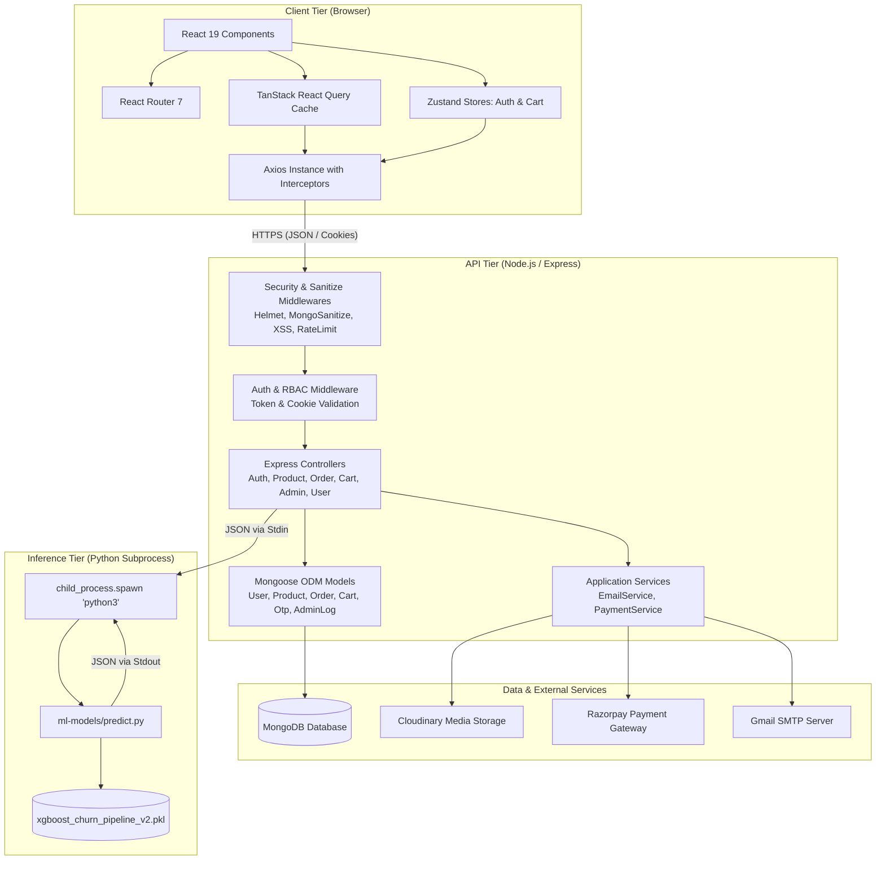
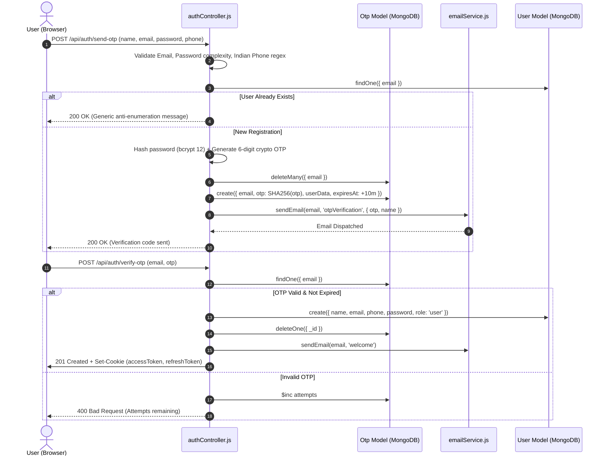
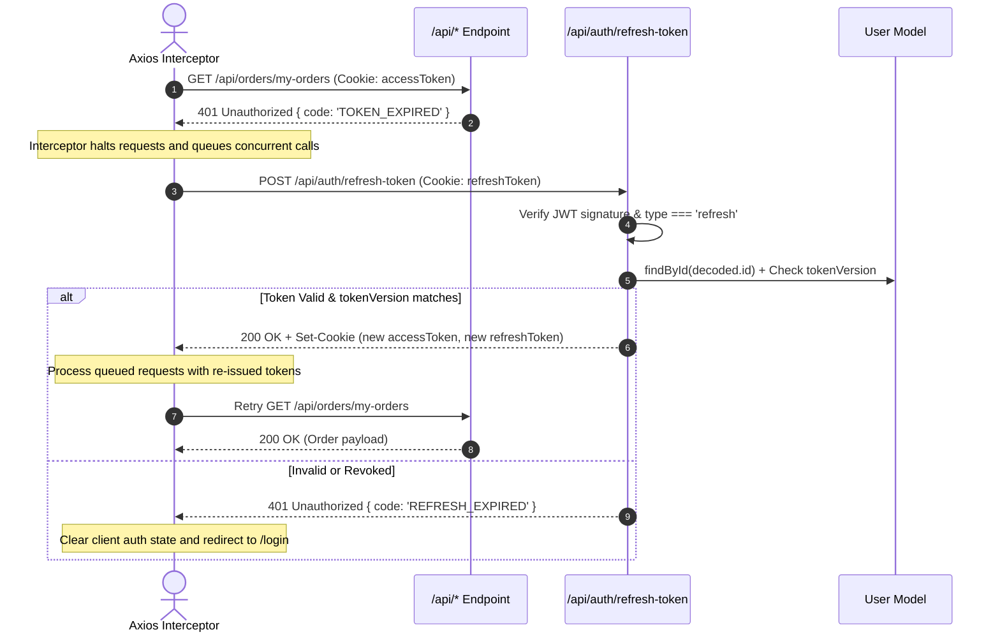
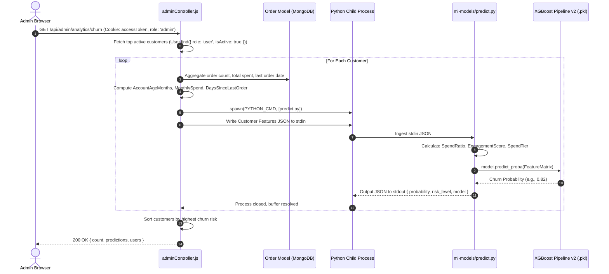

# System Architecture: E-Shop Platform

## 1. Architectural Philosophy & Patterns

E-Shop is designed following modern decoupled architectural principles:
- **Presentation Layer (Client):** Single Page Application (SPA) driven by stateful reactive components and remote cache management.
- **API & Application Layer (Backend):** Model-View-Controller (MVC) pattern implemented in Express.js with layered middleware (Security, Sanitization, Authentication, Validation, Error Handling).
- **Persistence Layer (Data):** Document-oriented database (MongoDB) with Mongoose schemas, virtual properties, compound indexes, and pre/post lifecycle hooks.
- **Inference Layer (Machine Learning):** Isolated Python script executed as a subprocess via standard input/output (IPC), protected with fallback heuristics.

---

## 2. Component Architecture & Data Flow

---

## 3. Core Workflow Sequences

### 3.1 Secure OTP-Based User Registration Flow

---

### 3.2 Silent JWT Refresh Mechanism

---

### 3.3 Customer Churn ML Prediction Flow

---

## 4. Cross-Cutting Concerns

### 4.1 Security Layering
- **Edge HTTP Security:** Helmet sets HTTP response headers, content security policies (CSP) allowing Razorpay framing, Cloudinary assets, and Google Fonts.
- **Sanitization:** `express-mongo-sanitize` strips out `$` and `.` operators to prevent NoSQL query injection; `xss-clean` escapes script payloads; `hpp` guards against HTTP parameter pollution.
- **Rate Limiting:**
  - Global API: 1,000 requests per 15-minute window per IP.
  - Auth Login: 5 requests per 15-minute window.
  - OTP Requests: 5 requests per 15-minute window.
  - Forgot Password: 3 requests per 15-minute window.
- **Session Revocation:** Users possess a `tokenVersion` counter in MongoDB. Changing passwords or logging out increments this counter, immediately invalidating all outstanding JWT access and refresh tokens.

### 4.2 Logging & Auditing
- Application events are routed through Winston (`logger.js`) with two transport streams:
  - Console transport formatted for human readability in development.
  - Rotating daily file transports (`logs/error-%DATE%.log` and `logs/combined-%DATE%.log`) capturing structured JSON payloads with request methods, IPs, and user identifiers.
