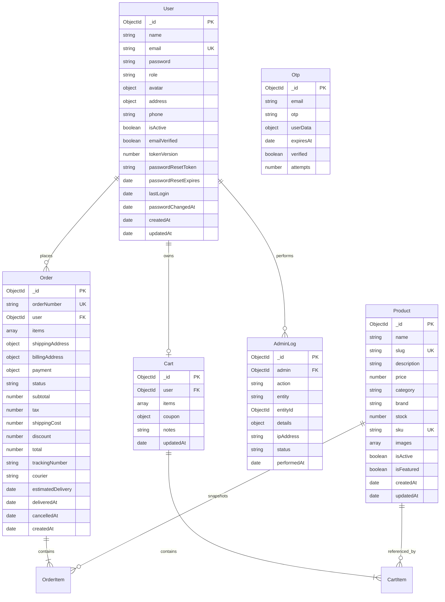

# Database Schema & Data Models Documentation

## 1. Overview
E-Shop uses **MongoDB** as its primary persistent data store, accessed and managed through **Mongoose ODM 7.8.9**. The data models represent the e-commerce domain: customers, authentication tokens, product catalog, shopping carts, orders, and administrative activity logs.

---

## 2. Entity-Relationship Overview



---

## 3. Detailed Model Specifications

### 3.1 User Model (`backend/src/models/User.js`)
Represents customer and administrator accounts.
- **Fields:**
  - `name` (String, required, min: 2, max: 50, trimmed)
  - `email` (String, required, unique, lowercase, trimmed, indexed)
  - `password` (String, required, min: 8, `select: false`)
  - `role` (String, enum: `['user', 'admin']`, default: `'user'`)
  - `avatar` (Object: `{ url: String, publicId: String }`)
  - `address` (Object: `{ street: String, city: String, state: String, zipCode: String, country: String (default: 'India') }`)
  - `phone` (String, validated with 10-digit regex `/^[0-9]{10}$/`)
  - `isActive` (Boolean, default: `true`)
  - `emailVerified` (Boolean, default: `true`)
  - `tokenVersion` (Number, default: `0`, `select: false` — used for session invalidation)
  - `passwordResetToken` (String, stores SHA-256 hash of reset token)
  - `passwordResetExpires` (Date)
  - `lastLogin` (Date)
  - `passwordChangedAt` (Date)
- **Indexes:**
  - `{ email: 1 }` (unique)
  - `{ role: 1 }`
  - `{ createdAt: -1 }`
- **Hooks & Methods:**
  - `pre('save')`: Hashes `password` using bcrypt (salt rounds: 12) if modified and `_skipPasswordHash` is false.
  - `pre('save')`: Updates `passwordChangedAt = Date.now() - 1000` when password is modified on an existing document.
  - `comparePassword(candidate)`: Compares plaintext with stored bcrypt hash.
  - `changedPasswordAfter(JWTTimestamp)`: Validates if token was issued prior to password change.
  - `toSafeObject()`: Strips password and `__v` before returning.

---

### 3.2 Product Model (`backend/src/models/Product.js`)
Represents the items available for purchase in the store.
- **Fields:**
  - `name` (String, required, trimmed)
  - `slug` (String, unique, lowercase, indexed)
  - `description` (String, required)
  - `price` (Number, required, min: 0)
  - `category` (String, required, enum: `['electronics', 'clothing', 'books', 'home', 'beauty', 'sports', 'other']`)
  - `brand` (String, trimmed)
  - `stock` (Number, required, min: 0, default: 0)
  - `sku` (String, unique, uppercase, trimmed)
  - `images` (Array of `{ url: String, publicId: String, alt: String, isPrimary: Boolean }`)
  - `isActive` (Boolean, default: `true` — soft deletion toggle)
  - `isFeatured` (Boolean, default: `false`)
- **Indexes:**
  - `{ slug: 1 }` (unique)
  - Text search index on name / description (used in `productController.searchProducts`)
- **Hooks:**
  - `pre('save')`: Generates URL-friendly `slug` from `name` if slug is not present.

---

### 3.3 Cart Model (`backend/src/models/Cart.js`)
Maintains persistent shopping cart contents per registered user.
- **Fields:**
  - `user` (ObjectId, ref: `'User'`, required, unique, indexed)
  - `items` (Array of subdocuments):
    - `product` (ObjectId, ref: `'Product'`, required)
    - `quantity` (Number, required, min: 1, max: 100, default: 1)
    - `price` (Number, required, min: 0)
    - `addedAt` (Date, default: Date.now)
  - `coupon` (Object: `{ code: String, discount: Number, discountType: enum ['percentage', 'fixed'] }`)
  - `notes` (String)
- **Virtual Properties:**
  - `itemsCount`: Total quantity sum of all items in cart.
  - `subtotal`: `sum(item.price * item.quantity)`.
  - `discountAmount`: Value deducted according to coupon type.
  - `total`: `max(subtotal - discountAmount, 0)`.

---

### 3.4 Order Model (`backend/src/models/Order.js`)
Represents finalized customer purchases and tracking lifecycle.
- **Fields:**
  - `orderNumber` (String, required, unique, indexed, default generated ORD string)
  - `user` (ObjectId, ref: `'User'`, required, indexed)
  - `items` (Array of `{ product: ObjectId ref 'Product', name: String, price: Number, quantity: Number, image: String, sku: String }`)
  - `shippingAddress` (Object: street, city, state, zipCode, country, phone)
  - `billingAddress` (Object: street, city, state, zipCode, country)
  - `payment`:
    - `method` (String, enum: `['credit_card', 'debit_card', 'paypal', 'cash_on_delivery', 'stripe', 'razorpay']`)
    - `status` (String, enum: `['pending', 'completed', 'failed', 'refunded']`, default: `'pending'`)
    - `transactionId` (String)
    - `razorpayOrderId` (String)
    - `amount` (Number, required, min: 0)
    - `paidAt` (Date)
  - `status` (String, enum: `['pending', 'processing', 'shipped', 'delivered', 'cancelled']`, default: `'pending'`, indexed)
  - `subtotal` (Number, required, min: 0)
  - `tax` (Number, default: 0 — statutory Indian GST computed per Section 15(3) of CGST Act: pre-tax trade discount deduction, 0% NIL rate for books under HSN 4901, and 18% standard rate for general goods)
  - `shippingCost` (Number, default: 0)
  - `discount` (Number, default: 0)
  - `total` (Number, required, min: 0)
  - `trackingNumber` (String), `courier` (String)
  - `estimatedDelivery` (Date), `deliveredAt` (Date), `cancelledAt` (Date), `cancellationReason` (String)
- **Indexes:**
  - `{ orderNumber: 1 }` (unique)
  - `{ user: 1, createdAt: -1 }` (compound)
  - `{ status: 1, createdAt: -1 }` (compound)
  - `{ 'payment.status': 1 }`
  - `{ createdAt: -1 }`

---

### 3.5 Otp Model (`backend/src/models/Otp.js`)
Temporary storage for pending user registrations awaiting email verification.
- **Fields:**
  - `email` (String, required, lowercase, trimmed)
  - `otp` (String, required — stores SHA-256 hash of plaintext OTP)
  - `userData` (Object: `{ name: String, password: String (pre-hashed), phone: String }`)
  - `expiresAt` (Date, default: `now + 10 minutes`)
  - `verified` (Boolean, default: `false`)
  - `attempts` (Number, default: `0`)
- **Indexes:**
  - `{ expiresAt: 1 }` with `{ expireAfterSeconds: 0 }` (MongoDB TTL index: documents are automatically pruned by MongoDB upon expiration)
  - `{ email: 1 }`

---

### 3.6 AdminLog Model (`backend/src/models/AdminLog.js`)
Audit trail for administrative operations.
- **Fields:**
  - `admin` (ObjectId, ref: `'User'`, required, indexed)
  - `action` (String, enum: `['login', 'logout', 'create', 'update', 'delete', 'approve', 'reject', 'export', 'import', 'backup']`)
  - `entity` (String, enum: `['user', 'product', 'order', 'category', 'coupon', 'setting']`)
  - `entityId` (ObjectId, indexed)
  - `details` (Mixed)
  - `ipAddress` (String), `userAgent` (String)
  - `status` (String, enum: `['success', 'failure']`)
  - `performedAt` (Date, default: Date.now, indexed)

---

## 4. Identified Database Risks & Integrity Issues

1. **Non-Atomic Stock Decrement (Concurrency Hazard):**
   - In `orderController.js`, stock is reduced via `product.stock -= item.quantity; await product.save();` inside a loop.
   - If two customers checkout the last remaining item simultaneously, both read `stock = 1`, both decrement to `0`, and both orders succeed, leading to negative inventory or duplicate allocation.
   - **Remedy:** Utilize atomic MongoDB updates with condition check:
     ```javascript
     const updated = await Product.findOneAndUpdate(
       { _id: item.product, stock: { $gte: item.quantity } },
       { $inc: { stock: -item.quantity } },
       { new: true }
     );
     ```
2. **Missing Distributed Transactions:**
   - Multi-document order placement modifies `Product` stock, creates an `Order`, and empties the `Cart`. A crash during step 2 or 3 leaves stock permanently decremented without an order record.
   - **Remedy:** Wrap checkout in a Mongoose session transaction (`startSession()`, `withTransaction()`).
