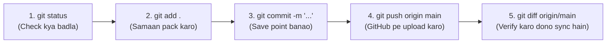

# E-Shop Project: Complete Git & GitHub Commands Guide 🚀

> **Ye guide hamare E-Shop project me use hone wale sabhi Git aur GitHub commands ka practical reference hai.**  
> Har command ka matlab **Hinglish** me aur ek **Real Life Example (Rozmarra ki Zindagi ka Analogy)** ke sath samjhaya gaya hai taaki concept hamesha ke liye crystal clear rahe!

---

## 📌 Quick Summary Table (Cheatsheet)

| Command | Kya Karta Hai? (In Short) | Real-Life Analogy |
| :--- | :--- | :--- |
| `git status` | Project ki live halat (state) check karna | Room me check karna ki kya samaan bikhra hai |
| `git add .` | Sabhi changes ko Staging Area me pack karna | Courier box me saare items pack karna |
| `git commit -m "..."` | Changes ka snapshot/photo lena message ke sath | Courier box pe seal aur address label lagana |
| `git push origin main` | Local code ko GitHub cloud pe upload karna | Sealed parcel ko post office me dispatch kar dena |
| `git fetch origin` | Check karna ki GitHub pe koi naya update aaya ya nahi | Letterbox khol kar dekhna koi nayi chitthi aayi kya |
| `git pull origin main` | GitHub se naya code download karke merge karna | Nayi chitthi padh kar apni diary update karna |
| `git diff` / `git diff origin/main` | Code me kya naya juda ya hata, uska antar dekhna | Purani photo aur nayi photo ka "Spot the Difference" |
| `git log --oneline` | Past commits ki history/timeline dekhna | Bank passbook ki transaction history |
| `git remote -v` | Dekhna local folder kis GitHub link se juda hai | Phone me contact number verify karna |
| `git branch` / `checkout -b` | Nayi branch banana taaki main code kharab na ho | Ek rough notebook me naya chapter likhna |
| `git restore <file>` | Galti se hua change undo karke purana code wapas lana | MS Word me `Ctrl + Z` (Undo) dabana |
| `git stash` / `stash pop` | Aadhe-adhure kaam ko temporary tijori me chupana | Mehman aane par bikhre kapde almari me rakhna |

---

## 1. `git status`

### 💻 Command:
```bash
git status
# ya short format me:
git status -sb
```

### 🗣️ Hinglish me Meaning:
Ye command check karta hai ki aapke project folder me abhi **kya chal raha hai**. Konsi files nayi bani hain (`untracked`), konsi files me aapne code badla hai (`modified`), aur kya koi aisi cheez hai jo abhi commit ya push nahi hui hai.

### 🌟 Real Life Example:
> **Almari / Room Inspection:**  
> Maan lo aap apne kamre ki safai kar rahe ho. `git status` chalana bilkul aisa hai jaise room ke beech me khade hoke charo taraf dekhna ki: *"Konsi kitaab table pe nayi aayi hai, konsa kapda dhone ke liye alag rakha hai, aur kya sab kuch pack ho chuka hai ya abhi kaam baki hai?"*

---

## 2. `git add .` / `git add <file>`

### 💻 Command:
```bash
git add .
# ya specific file ke liye:
git add PROGRESS.md
```

### 🗣️ Hinglish me Meaning:
`git add` badle huye code ko **Staging Area** (tayyari wale dabbe) me daalta hai. Dot (`.`) ka matlab hota hai: *"Is folder aur iske andar ke saare subfolders me jitne bhi changes huye hain, sabhi ko ek sath pack kar lo."*

### 🌟 Real Life Example:
> **Amazon / Flipkart Cart me Items Daalna:**  
> Jab aap online shopping karte ho, to pehle samaan ko direct buy nahi karte; pehle ek-ek karke **"Add to Cart"** karte ho.  
> `git add .` ka matlab hai shopping cart me wo saare items daal lena jinka aap aage chal kar final bill (commit) banana chahte ho.

---

## 3. `git commit -m "..."`

### 💻 Command:
```bash
git commit -m "feat: complete frontend & architecture transformation phases 3-10"
```

### 🗣️ Hinglish me Meaning:
`git commit` aapke staged changes ka ek **permanent snapshot (photo)** le leta hai aur project ki history me hamesha ke liye save kar deta hai. `-m` flag ke baad double quotes me hum ek meaningful message likhte hain jo batata hai ki is commit me kya kaam kiya gaya hai.

### 🌟 Real Life Example:
> **Video Game me Save Point / Checkpoint:**  
> Jab aap koi mushkil game khelte ho aur ek level complete kar lete ho, to aap game ko **"Save"** karte ho taaki agar aage mar bhi jao, to usi checkpoint se wapas shuru kar sako.  
> `git commit` wahi save-point hai. Agar kal ko aage ka code bigad bhi gaya, to aap is commit par bina kisi nuksan ke laut sakte ho!

---

## 4. `git push origin main`

### 💻 Command:
```bash
git push origin main
```

### 🗣️ Hinglish me Meaning:
Ye command aapke local computer par kiye gaye commits ko internet par maujood **GitHub repository (Cloud)** par bhej deta hai.  
- `origin` = Aapka remote GitHub server URL.  
- `main` = Main branch jisme live production code rehta hai.

### 🌟 Real Life Example:
> **Courier Box ko Dispatch Karna / Instagram Photo Post Karna:**  
> Aapne apne phone se mast photo kheench li (commit kar li), lekin abhi wo sirf aapke phone me hai. Jab tak aap use Instagram pe **"Share / Post"** nahi karoge, duniya use nahi dekh sakti.  
> `git push` wahi "Post" button hai jo aapke laptop ke kaam ko GitHub ki cloud duniya me live kar deta hai.

---

## 5. `git fetch origin`

### 💻 Command:
```bash
git fetch origin
```

### 🗣️ Hinglish me Meaning:
Ye command GitHub remote se check karta hai ki kya wahan koi naya commit ya update aaya hai, bina aapke local code ko chhede ya badle. Ye sirf jaankari download karta hai, merge nahi karta.

### 🌟 Real Life Example:
> **Letterbox Check Karna:**  
> Subah-subah ghar ke bahar lage letterbox ko khol ke sirf dekhna ki: *"Koi nayi chitthi ya akhbaar aaya hai kya?"* Aap use turant padhne ya ghar me laane ke liye force nahi ho rahe, bas dekh rahe ho ki naya kya hai.

---

## 6. `git pull origin main`

### 💻 Command:
```bash
git pull origin main
```

### 🗣️ Hinglish me Meaning:
`git pull` darasal do commands ka jod hai: `git fetch` + `git merge`. Ye GitHub se naye updates lata hai aur unhe seedhe aapke computer ke current code ke sath jod (merge) deta hai.

### 🌟 Real Life Example:
> **WhatsApp Group Chat Sync Hona:**  
> Jab aap internet band karke shaam ko on karte ho, to group ke saare naye messages ek sath download hoke aapki screen pe dikhne lagte hain. `git pull` se aapka computer GitHub ke latest version ke sath barabar ho jata hai.

---

## 7. `git diff` / `git diff origin/main`

### 💻 Command:
```bash
# Local uncommitted changes dekhne ke liye:
git diff

# Local aur GitHub ke beech antar dekhne ke liye:
git diff origin/main
```

### 🗣️ Hinglish me Meaning:
Ye command line-by-line dikhata hai ki **kya naya juda hai (green `+`)** aur **kya purana hata hai (red `-`)**. Agar output blank aata hai, to iska matlab local aur GitHub me 100% koi farq nahi hai, sab barabar hai.

### 🌟 Real Life Example:
> **"Spot the Difference" Puzzle:**  
> Bachpan me akhbaar me do lagbhag ek jaisi tasveerein aati thi jisme 5 antar dhoondhne hote the. `git diff` bilkul wahi kaam code ke sath karta hai aur ek-ek character ka antar screen par highlight kar deta hai.

---

## 8. `git log` / `git log --oneline`

### 💻 Command:
```bash
git log -n 5 --oneline --decorate
```

### 🗣️ Hinglish me Meaning:
Ye command project ki **poori itihaas (history)** dikhata hai — kisne, kab, konsa commit kiya, commit ka hash ID kya hai, aur HEAD kahan point kar raha hai. `--oneline` ise ek-ek line me sundar format me dikhata hai.

### 🌟 Real Life Example:
> **Bank Passbook Statement:**  
> Jab aap bank ki passbook print karate ho, to har entry ke aage date, transaction ID aur description likha hota hai. `git log` aapke software ka passbook statement hai jo batata hai ki kab kya change hua tha.

---

## 9. `git remote -v`

### 💻 Command:
```bash
git remote -v
```

### 🗣️ Hinglish me Meaning:
`-v` ka matlab hota hai **verbose** (detail me). Ye command batata hai ki aapka local folder internet par kis exact GitHub repository link se connect hai jahan code bheja (`push`) ya laya (`fetch`) jata hai.

### 🌟 Real Life Example:
> **Phone Contact Book me Dost ka Address Verify Karna:**  
> Ye confirm karna ki aap jis ghar parcel bhej rahe ho, kya address wahi hai (`https://github.com/aniket821108/ecommerce-churn-prediction`) ya koi galat destination to set nahi hai.

---

## 10. `git branch` & `git checkout -b <name>`

### 💻 Command:
```bash
# Current branches dekhna:
git branch

# Nayi branch bana kar usme switch karna:
git checkout -b feature/hybrid-rag
```

### 🗣️ Hinglish me Meaning:
Branching ka matlab hai main code se alag ek parallel raasta banana. Isme aap jitna chahe naya experiment karo, aapka `main` production code bilkul safe aur untouched rehta hai. Jab naya feature test ho jaye, tab use main me merge kar diya jata hai.

### 🌟 Real Life Example:
> **Rough Notebook vs Fair Notebook:**  
> School me jab teacher naya formula sikhate the, to hum pehle use rough copy me solve karte the taaki fair copy me kaata-peeti na ho. Jab calculation sahi ho jati thi, tabhi fair copy me likhte the.  
> `git branch` wahi rough copy hai jahan aap bina dare naye ideas try kar sakte ho!

---

## 11. `git restore <file>` / `git restore --staged <file>`

### 💻 Command:
```bash
# Agar kisi file me galat code likh diya aur purana chahiye:
git restore frontend/src/pages/Home.jsx

# Agar galti se 'git add' kar diya aur use unstage karna hai:
git restore --staged frontend/src/pages/Home.jsx
```

### 🗣️ Hinglish me Meaning:
Agar aapse code me koi aisi galti ho gayi jo aap sudhar nahi pa rahe, to `git restore` us file ko theek waisa bana deta hai jaisa wo pichle commit me tha. Saare naye unsaved changes gayab ho jate hain.

### 🌟 Real Life Example:
> **Time Machine / `Ctrl + Z`:**  
> Maan lo aap drawing bana rahe ho aur galti se poori sheet par kaali ink gir gayi. `git restore` dabate hi waqt peeche chala jata hai aur aapko bina ink wali saaf sheet wapas mil jati hai.

---

## 12. `git stash` & `git stash pop`

### 💻 Command:
```bash
# Kaam ko temporary chupa ke safe rakhna:
git stash

# Chupaya hua kaam wapas nikalna:
git stash pop
```

### 🗣️ Hinglish me Meaning:
Maan lo aap ek adhe-adhure feature pe kaam kar rahe ho, aur achanak boss ne kaha: *"Pehle ye urgent bug fix karo!"* Aap aadha code na commit kar sakte ho na delete. Tab aap `git stash` chalate ho jo aapke adhe kaam ko ek secret drawer me daal deta hai aur screen ko bilkul clean kar deta hai. Urgent kaam khatam karke `git stash pop` se purana kaam wapas nikaal lo!

### 🌟 Real Life Example:
> **Mehman Aane par Bikhre Kapde Almari me Rakhna:**  
> Aap room me padhai ya painting kar rahe the, tabhi achanak darwaze par rishtedaar aa gaye. Aapne jaldi se sab samaan uthakar almari me band kar diya (`git stash`). Jab rishtedaar chale gaye, aapne almari khol kar apna painting ka samaan dobara table par nikaal liya (`git stash pop`).

---

## 13. `.gitignore` File ka Role

### 💻 File: `.gitignore`

### 🗣️ Hinglish me Meaning:
Is file me hum un files aur folders ke naam likhte hain jinhe hum **kabhi bhi GitHub par nahi bhejna chahte** — jaise passwords wali `.env` files, bhari-bharkam `node_modules/`, ya temporary upload folders (`uploads/`). Git in files ko dekhta tak nahi hai!

### 🌟 Real Life Example:
> **Passport Check par VIP Exclusion List:**  
> Airport security me ek list hoti hai jisme bataya hota hai ki konsi cheezein flight me le jana mana hai (jaise lighter, sharp objects). `.gitignore` wahi security list hai jo secret passwords aur faaltu files ko public internet par jaane se rokti hai.

---

## 🏆 Hamare E-Shop Project ka Typical Daily Workflow

Roz kaam karte waqt hum ye 4 commands ka classic circle follow karte hain:



---
*Created as part of E-Shop Developer Documentation knowledge base.*

