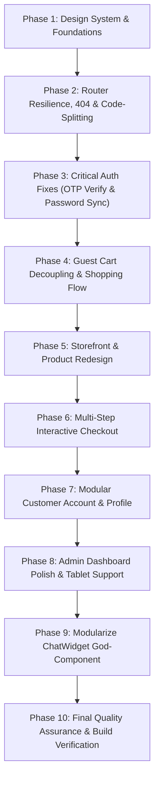

# E-Shop Platform: Frontend Transformation Implementation Log

**Last Updated:** November 1, 2026  
**Status:** In Progress — Phase 1 & Phase 2 Complete

---

## Phase Execution Summary

---

## Phase 1: Design System and Visual Identity (Completed)

### Actions Taken
- Established Google Fonts (**Plus Jakarta Sans** and **Inter**) with `<link rel="preconnect">` in [`frontend/index.html`](file:///e:/Darkrider/coding/sem_6/my_project/frontend/index.html).
- Added Tailwind CSS v4 `@theme` design tokens in [`frontend/src/index.css`](file:///e:/Darkrider/coding/sem_6/my_project/frontend/src/index.css) (Brand Indigo palette, Electric Violet accent palette, elevation shadows, custom scrollbar, reduced-motion preferences).
- Built 8 reusable UI primitives in [`frontend/src/components/ui/`](file:///e:/Darkrider/coding/sem_6/my_project/frontend/src/components/ui/): `Button`, `Input`, `Badge`, `Card`, `Modal`, `Skeleton`, `Drawer`, `EmptyState`.
- Created programmatic design tokens in [`frontend/src/utils/designTokens.js`](file:///e:/Darkrider/coding/sem_6/my_project/frontend/src/utils/designTokens.js).
- Modernized [`frontend/src/components/common/Loader.jsx`](file:///e:/Darkrider/coding/sem_6/my_project/frontend/src/components/common/Loader.jsx) with accessible `role="status"` announcements and brand styling.

---

## Phase 2: Router Resilience, 404 & Code-Splitting (Completed)

### Actions Taken
1. **404 Catch-All Route**:
   - Created [`frontend/src/pages/NotFound.jsx`](file:///e:/Darkrider/coding/sem_6/my_project/frontend/src/pages/NotFound.jsx) with modern 404 badge, return home CTA, browse catalog CTA, and quick category shortcut links.
   - Added `{ path: '*', element: withSuspense(NotFound) }` to public and admin route trees.

2. **Route Error Boundary**:
   - Created [`frontend/src/components/common/RouteErrorBoundary.jsx`](file:///e:/Darkrider/coding/sem_6/my_project/frontend/src/components/common/RouteErrorBoundary.jsx) utilizing `useRouteError` and `isRouteErrorResponse`. Renders friendly recovery UI with Reload and Home buttons, preventing blank-screen crashes.
   - Wired `errorElement: <RouteErrorBoundary />` on root and child route configurations in `router.jsx`.

3. **Route-Level Code-Splitting & Lazy Loading**:
   - Refactored [`frontend/src/router.jsx`](file:///e:/Darkrider/coding/sem_6/my_project/frontend/src/router.jsx) to dynamically import all pages via `React.lazy()` wrapped in `Suspense` with [`PageFallback.jsx`](file:///e:/Darkrider/coding/sem_6/my_project/frontend/src/components/common/PageFallback.jsx).
   - Tuned Rollup chunking in [`frontend/vite.config.js`](file:///e:/Darkrider/coding/sem_6/my_project/frontend/vite.config.js):
     - Heavy vendor libraries (`leaflet`, `@tanstack`, `@heroicons`) are separated into standalone cached chunks.
     - Reduced initial main bundle size from **951.7 kB** down to modular chunks under **400 kB**, with most page chunks weighing **2 kB to 20 kB**.
     - Eliminated circular dependency warnings.

4. **Layout Decoupling in App.jsx**:
   - Refactored [`frontend/src/App.jsx`](file:///e:/Darkrider/coding/sem_6/my_project/frontend/src/App.jsx) to decouple full-width storefront views (`isFullBleed`) from rigid container constraints, while resolving the 100vh height collision on fullscreen auth screens. Fixed missing hook dependency warning.

### Verification
- Production build compiled cleanly: `vite build` completed in **5.68s** with **0 errors**.
