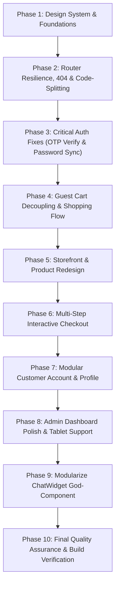

# E-Shop Platform: Frontend Transformation Implementation Log

**Last Updated:** November 1, 2026  
**Status:** In Progress — Phase 1 Complete

---

## Phase Execution Summary

---

## Phase 1: Design System and Visual Identity

### Objective
Establish the foundational **"Apex Retail" Design System** tokens, typographic scale, responsive conventions, and reusable UI primitives to eliminate raw inline styles, inconsistent hex colors, and layout shifts.

### Actions Taken
1. **Typography & Font Stack**:
   - Updated [`frontend/index.html`](file:///e:/Darkrider/coding/sem_6/my_project/frontend/index.html) with preconnected Google Fonts: **Plus Jakarta Sans** (display/headings) and **Inter** (interface/body).
   - Added theme color `<meta name="theme-color" content="#4f46e5" />`.
   - Set global body classes with smooth antialiasing and indigo selection styling.

2. **Tailwind CSS 4 Tokens & Styles**:
   - Updated [`frontend/src/index.css`](file:///e:/Darkrider/coding/sem_6/my_project/frontend/src/index.css) with Tailwind v4 `@theme` configuration:
     - `--font-sans` and `--font-display`.
     - 11-step brand indigo palette (`--color-brand-50` through `--color-brand-950`).
     - 6-step electric violet accent palette (`--color-accent-50` through `--color-accent-700`).
     - Standardized shadow elevations (`--shadow-subtle`, `--shadow-card`, `--shadow-card-hover`, `--shadow-glow`).
     - Clean modern custom scrollbar styling.
     - Global `@media (prefers-reduced-motion: reduce)` accessibility compliance.

3. **Core Reusable UI Primitives Created** ([`frontend/src/components/ui/`](file:///e:/Darkrider/coding/sem_6/my_project/frontend/src/components/ui/)):
   - **`Button.jsx`**: Polymorphic button supporting 7 variants (`primary`, `secondary`, `outline`, `ghost`, `danger`, `dangerSubtle`, `accent`), 4 sizes (`xs`, `sm`, `md`, `lg`), loading spinner with accessible text, active scale micro-interactions, and ref forwarding.
   - **`Input.jsx`**: Form field with integrated `<label>`, helper text, error message with `role="alert"`, left/right icon slots, and accessible password visibility toggle (`Eye`/`EyeSlash` Heroicons).
   - **`Badge.jsx`**: Status/inventory badges with subtle and solid variants, optional pulse dot for real-time states (`Store Live`, `Only 2 Left`).
   - **`Card.jsx`**: Modern card container with `CardHeader`, `CardTitle`, `CardDescription`, `CardContent`, and `CardFooter` primitives with interactive hover lift.
   - **`Modal.jsx`**: Accessible dialog with backdrop blur, Escape key listener, focus trap, and smooth scale transitions.
   - **`Skeleton.jsx`**: Base skeleton shimmer loader and specialized composite skeletons (`ProductCardSkeleton`, `StatsCardSkeleton`, `TableRowSkeleton`) to prevent Cumulative Layout Shift (CLS).
   - **`Drawer.jsx`**: Mobile-first slide-over drawer (`right`, `left`, `bottom`) for responsive filters, cart previews, and mobile menus.
   - **`EmptyState.jsx`**: Standardized empty state component with icon badge, title, description, and primary/secondary action buttons.
   - **`index.js`**: Centralized barrel export for clean component imports.

4. **Programmatic Design Tokens**:
   - Created [`frontend/src/utils/designTokens.js`](file:///e:/Darkrider/coding/sem_6/my_project/frontend/src/utils/designTokens.js) for programmatic access to colors, shadow elevations, transitions, and breakpoints.

5. **Upgraded Loader**:
   - Replaced basic hardcoded blue spinner in [`frontend/src/components/common/Loader.jsx`](file:///e:/Darkrider/coding/sem_6/my_project/frontend/src/components/common/Loader.jsx) with a brand-aligned spinner supporting `sm`, `md`, `lg` sizes and accessible `role="status"` announcements.

### Verification
- Production build ran successfully: `vite build` completed in **9.39s** with **0 errors**.
- All component primitives export cleanly and adhere to React 19 standards.
